# Avistar Dashboard Design System v2 — handoff (responsive)

Load: fonts → tokens.css → components.css → orb.js + av-charts.js (`AvCharts.hydrate(document)` after render, `AvCharts.redraw()` on theme change).

```html
<meta name="viewport" content="width=device-width, initial-scale=1, viewport-fit=cover">
<body class="av-root">
```

.av-root is the container-query root; layout switches at 900px / 560px container width; everything else reflows via auto-fit/minmax and clamp(). Light theme: `<html data-theme="light">`.

## Foundations

### Overview
One ecosystem for the Avistar dashboard: tokens.css (all variables, dark + light) → components.css (every .av-* class) → copy-paste HTML. Inter + JetBrains Mono. Dark is default.

#### Install
```html
<link rel="preconnect" href="https://fonts.googleapis.com">
<link href="https://fonts.googleapis.com/css2?family=Inter:wght@400;500;600;700&family=JetBrains+Mono:wght@400;500;600&display=swap" rel="stylesheet">
<link rel="stylesheet" href="/styles/tokens.css">
<link rel="stylesheet" href="/styles/components.css">

<body class="av-root" style="margin:0;background:var(--av-background)">
  …
</body>
```

#### Theming
```html
<!-- dark (default) -->
<html>
<!-- light -->
<html data-theme="light">
<!-- scoped: any wrapper -->
<section data-theme="light">…</section>
```

#### Naming
```html
<div class="av-slist" style="max-width:560px"><div class="av-slist__row"><span class="av-slist__k">Token</span><span class="av-slist__v av-slist__v--mono">--av-{category}-{role}-{state}</span></div><div class="av-slist__row"><span class="av-slist__k">Block</span><span class="av-slist__v av-slist__v--mono">.av-btn</span></div><div class="av-slist__row"><span class="av-slist__k">Element</span><span class="av-slist__v av-slist__v--mono">.av-modal__title</span></div><div class="av-slist__row"><span class="av-slist__k">Modifier</span><span class="av-slist__v av-slist__v--mono">.av-btn--primary .av-btn--sm</span></div><div class="av-slist__row"><span class="av-slist__k">State</span><span class="av-slist__v av-slist__v--mono">aria-pressed / aria-selected / aria-current / aria-invalid / :disabled</span></div></div>
```

#### Principles
```html
<div style="display:grid;grid-template-columns:repeat(auto-fit,minmax(min(100%,200px),1fr));gap:12px;width:100%"><div class="avd-principle"><b>Neutral first</b><span>Surfaces are warm greys. Signal and Ion are earned — brand, severity, focus.</span></div><div class="avd-principle"><b>One primary</b><span>One Signal button per view. Everything else is secondary, ghost or link.</span></div><div class="avd-principle"><b>Numbers lead</b><span>Scores and counts are the largest type on a card. Tabular numerals always.</span></div><div class="avd-principle"><b>Mono for machines</b><span>IDs, ARNs, labels and tags use JetBrains Mono. People-text uses Inter.</span></div></div>
```

### Responsive
Fluid from 320px to 2560px. Containers use %, min() and clamp() — never fixed px for structure. Grid with auto-fit + minmax() reflows without breakpoints; container queries (on .av-root) handle the few real layout switches. Touch targets ≥ 44×44. Media sits in fixed-ratio wrappers with object-fit: cover.

#### Fluid tokens
```html
--av-gutter: clamp(1rem, 4vw, 2rem);
--av-card-pad: clamp(1rem, 3vw, 1.25rem);
--av-section-gap: clamp(1.25rem, 3vw, 1.75rem);
--av-touch: 44px;
--av-sidebar-w: clamp(220px, 20vw, 248px);
--av-drawer-w: min(300px, 86vw);
```

#### Viewport reference
```html
<div class="av-slist" style="width:100%"><div class="av-slist__row"><span class="av-slist__v av-slist__v--mono">320px</span><span class="av-slist__k">Smallest phone · single column, drawer nav, full-width actions</span></div><div class="av-slist__row"><span class="av-slist__v av-slist__v--mono">560px</span><span class="av-slist__k">Container switch · stacked score card, wrapped footers</span></div><div class="av-slist__row"><span class="av-slist__v av-slist__v--mono">900px</span><span class="av-slist__k">Container switch · sidebar becomes drawer + mobile bar</span></div><div class="av-slist__row"><span class="av-slist__v av-slist__v--mono">1280px</span><span class="av-slist__k">--av-content-max · main column stops growing</span></div><div class="av-slist__row"><span class="av-slist__v av-slist__v--mono">1800+px</span><span class="av-slist__k">Ultra-wide · main column caps at 1440px</span></div><div class="av-slist__row"><span class="av-slist__v av-slist__v--mono">2560px</span><span class="av-slist__k">Max tested width · everything centred</span></div></div>
```

#### Auto-fit grid
```html
.grid{display:grid;grid-template-columns:repeat(auto-fit,minmax(min(100%,180px),1fr));gap:clamp(.75rem,2vw,1rem)}
```

#### Fluid flex row
```html
.row{display:flex;flex-wrap:wrap;gap:16px}
.row>.a{flex:1 1 min(100%,340px)}
.row>.b{flex:2 1 min(100%,520px)}
```

#### Media wrappers
```html
<div class="av-media av-media--4x3"></div>
/* .av-media{aspect-ratio:var(--av-ratio,16/9);overflow:hidden} .av-media>img{width:100%;height:100%;object-fit:cover} */
```

#### Touch targets
```html
.av-btn--sm{position:relative}
.av-btn--sm::after{content:"";position:absolute;left:50%;top:50%;width:max(100%,var(--av-touch));height:max(100%,var(--av-touch));transform:translate(-50%,-50%)}
```

#### Container query
```html
.av-root{container:av-root / inline-size}
@container av-root (max-width: 900px){
  .av-shell>.av-sidebar{position:fixed;transform:translateX(-100%)}
  .av-shell>.av-sidebar[data-open="true"]{transform:none}
  .av-shell .av-mobilebar{display:flex}
}
```

### Color
Primitive ramps. Never use primitives directly in product code — use the semantic tokens under Color tokens.

#### Neutral
```html
--av-neutral-1000: #060708;
--av-neutral-950: #0B0B0C;
--av-neutral-900: #0F0F11;
--av-neutral-850: #121214;
--av-neutral-800: #141416;
--av-neutral-750: #18181B;
--av-neutral-700: #1E1E21;
--av-neutral-650: #232326;
--av-neutral-600: #2A2A2E;
--av-neutral-550: #3A3A40;
--av-neutral-500: #5A5955;
--av-neutral-450: #6B6A67;
--av-neutral-400: #7A7874;
--av-neutral-350: #8C8A85;
--av-neutral-300: #A3A19C;
--av-neutral-250: #B8B6B1;
--av-neutral-200: #D9D7D2;
--av-neutral-150: #F2F2F0;
--av-neutral-100: #F4F2EE;
--av-neutral-0: #FFFFFF;
```

#### Signal
```html
--av-signal-700: #C2300A;
--av-signal-600: #E63E14;
--av-signal-500: #FF4B1F;
--av-signal-400: #FF6A45;
--av-signal-300: #FF8A5B;
```

#### Ion
```html
--av-ion-700: #006A82;
--av-ion-600: #0A6F8C;
--av-ion-500: #1FDDFF;
--av-ion-300: #9FEFFF;
--av-ion-100: #E8FCFF;
```

#### Amber
```html
--av-amber-700: #8A5300;
--av-amber-500: #FFB547;
```

#### Green
```html
--av-green-700: #0E7A4E;
--av-green-500: #3DDC97;
```

#### Brand gradient
```html
background: var(--av-gradient-brand); /* linear-gradient(90deg,#FF4B1F,#1FDDFF) */
```

#### Posture scale
```html
const postureColor = s => s == null ? 'var(--av-support-neutral)'
  : s >= 80 ? 'var(--av-posture-good)'
  : s >= 65 ? 'var(--av-posture-fair)'
  : 'var(--av-posture-poor)';
```

#### Severity scale
```html
<div class="avd-swatches"><div class="avd-swatch"><span class="avd-swatch__chip" style="background:var(--av-support-critical)"></span><span class="avd-swatch__n">Critical</span><span class="avd-swatch__v">--av-support-critical</span></div><div class="avd-swatch"><span class="avd-swatch__chip" style="background:var(--av-support-high)"></span><span class="avd-swatch__n">High</span><span class="avd-swatch__v">--av-support-high</span></div><div class="avd-swatch"><span class="avd-swatch__chip" style="background:var(--av-support-medium)"></span><span class="avd-swatch__n">Medium</span><span class="avd-swatch__v">--av-support-medium</span></div><div class="avd-swatch"><span class="avd-swatch__chip" style="background:var(--av-support-low)"></span><span class="avd-swatch__n">Low</span><span class="avd-swatch__v">--av-support-low</span></div><div class="avd-swatch"><span class="avd-swatch__chip" style="background:var(--av-support-success)"></span><span class="avd-swatch__n">Success</span><span class="avd-swatch__v">--av-support-success</span></div></div>
```

### Type
Inter for UI and data, JetBrains Mono for labels, IDs and numeric tags. Tight negative tracking on display sizes.

#### Display
```html
<p class="av-type-display" style="margin:0">Welcome back, <span class="av-text-gradient">Zalak</span>.</p>
```

#### Heading 01 · Page title
```html
<p class="av-type-heading-01" style="margin:0">Overview</p>
```

#### Heading 02 · Section
```html
<p class="av-type-heading-02" style="margin:0">Fix these first</p>
```

#### Heading 03 · Card title
```html
<p class="av-type-heading-03" style="margin:0">Everything flows into one score.</p>
```

#### KPI numeral
```html
<p class="av-type-kpi" style="margin:0">293</p>
```

#### Score numeral
```html
<span class="av-type-score av-text-gradient" style="background-image:var(--av-gradient-brand-45)">64</span>
```

#### Body 01
```html
<p class="av-type-body-01" style="margin:0">Last scan finished 2 hours ago.</p>
```

#### Body 02 / UI
```html
<p class="av-type-body-02" style="margin:0">Every scan feeds the number below.</p>
```

#### Label (mono eyebrow)
```html
<p class="av-type-label" style="margin:0">HYDROPONIC CLOUD INDUSTRIES · 3 ACCOUNTS</p>
```

#### Code / numeric mono
```html
<p class="av-type-code" style="margin:0">arn:aws:iam::0105:role/ci</p>
```

### Icons
Line icons (24 grid, 1.6–2.2 stroke, currentColor) for actions. Duotone set for KPI and empty states. 3D mascots for sidebar nav and moments.

#### Line set
```html
<svg class="av-icon" width="16" height="16" viewBox="0 0 24 24" fill="none" stroke="currentColor" stroke-width="1.8" stroke-linecap="round" stroke-linejoin="round" aria-hidden="true"><path d="M5 12h14M13 6l6 6-6 6"/></svg>
```

#### Sizes & stroke
```html
<div class="av-row" style="gap:28px;align-items:flex-end"><span class="av-stack" style="align-items:center;gap:8px"><svg class="av-icon" width="12" height="12" viewBox="0 0 24 24" fill="none" stroke="currentColor" stroke-width="2.2" stroke-linecap="round" stroke-linejoin="round" aria-hidden="true"><path d="M12 3l8 3v6c0 5-3.5 8-8 9-4.5-1-8-4-8-9V6z"/></svg><span class="av-mono" style="font-size:10px;color:var(--av-text-helper)">12/2.2</span></span><span class="av-stack" style="align-items:center;gap:8px"><svg class="av-icon" width="14" height="14" viewBox="0 0 24 24" fill="none" stroke="currentColor" stroke-width="2" stroke-linecap="round" stroke-linejoin="round" aria-hidden="true"><path d="M12 3l8 3v6c0 5-3.5 8-8 9-4.5-1-8-4-8-9V6z"/></svg><span class="av-mono" style="font-size:10px;color:var(--av-text-helper)">14/2</span></span><span class="av-stack" style="align-items:center;gap:8px"><svg class="av-icon" width="16" height="16" viewBox="0 0 24 24" fill="none" stroke="currentColor" stroke-width="1.8" stroke-linecap="round" stroke-linejoin="round" aria-hidden="true"><path d="M12 3l8 3v6c0 5-3.5 8-8 9-4.5-1-8-4-8-9V6z"/></svg><span class="av-mono" style="font-size:10px;color:var(--av-text-helper)">16/1.8</span></span><span class="av-stack" style="align-items:center;gap:8px"><svg class="av-icon" width="18" height="18" viewBox="0 0 24 24" fill="none" stroke="currentColor" stroke-width="1.6" stroke-linecap="round" stroke-linejoin="round" aria-hidden="true"><path d="M12 3l8 3v6c0 5-3.5 8-8 9-4.5-1-8-4-8-9V6z"/></svg><span class="av-mono" style="font-size:10px;color:var(--av-text-helper)">18/1.6</span></span><span class="av-stack" style="align-items:center;gap:8px"><svg class="av-icon" width="24" height="24" viewBox="0 0 24 24" fill="none" stroke="currentColor" stroke-width="1.6" stroke-linecap="round" stroke-linejoin="round" aria-hidden="true"><path d="M12 3l8 3v6c0 5-3.5 8-8 9-4.5-1-8-4-8-9V6z"/></svg><span class="av-mono" style="font-size:10px;color:var(--av-text-helper)">24/1.6</span></span></div>
```

#### Duotone (icons-duo)
```html

```

#### Glass (icons-glass)
```html
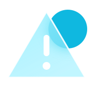
```

#### Tile (icons-tile)
```html
<div class="avd-grid"><div class="avd-cell">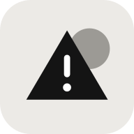<span>alert</span></div><div class="avd-cell"><span>cloud</span></div><div class="avd-cell"><span>fingerprint</span></div><div class="avd-cell"><span>identity</span></div><div class="avd-cell"><span>key</span></div><div class="avd-cell"><span>lock</span></div><div class="avd-cell">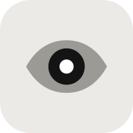<span>monitor</span></div><div class="avd-cell">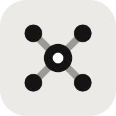<span>network</span></div><div class="avd-cell">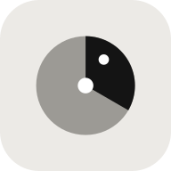<span>scan</span></div><div class="avd-cell"><span>server</span></div><div class="avd-cell"><span>shield</span></div><div class="avd-cell"><span>threat</span></div></div>
```

#### Mascots
```html

```

#### Provider logos
```html
 <!-- use logo-aws.svg on light -->
```

#### Brand mark
```html
<a class="av-brand" href="/">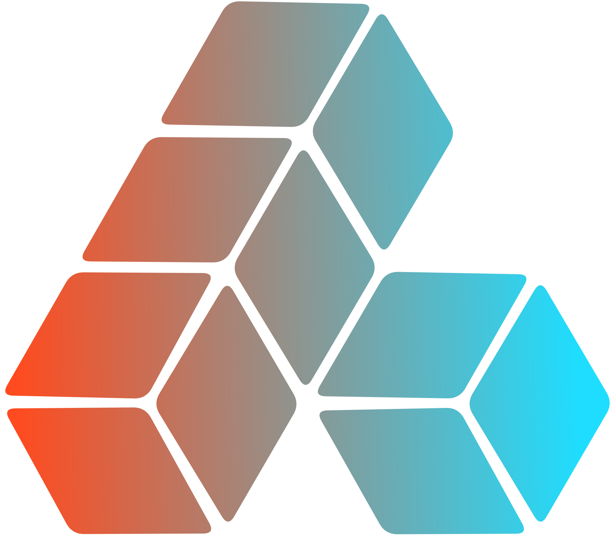</a>
<!-- light theme: avistar-wordmark-ink.svg -->
```

### Space & elevation
4px base grid. Radius scale from 4 (intro cards) to 16 (cards, modals) and pill. Five elevation levels.

#### Spacing scale
```html
--av-space-1: 4px; /* Icon gap */
--av-space-2: 8px; /* Inline gap */
--av-space-3: 12px; /* Control gap */
--av-space-4: 16px; /* Card grid gap */
--av-space-5: 20px; /* Card padding */
--av-space-6: 24px; /* Hero card padding */
--av-space-7: 28px; /* Main column gap */
--av-space-8: 32px; /* Page top padding */
--av-space-9: 40px; /* Page gutter (max) */
--av-space-10: 56px; /* Intro section gap */
--av-space-11: 72px; /* Doc section rhythm */
```

#### Radius
```html
--av-radius-xs: 4px; /* Intro cards, checkbox */
--av-radius-sm: 6px; /* Mono tags */
--av-radius-md: 8px; /* Menu items, icon btn (sm) */
--av-radius-lg: 10px; /* Inputs, nav items, icon btn */
--av-radius-xl: 14px; /* KPI grid, popovers, toasts */
--av-radius-2xl: 16px; /* Cards, tables, modals */
--av-radius-pill: 999px; /* Buttons, badges, switchers */
```

#### Elevation
```html
--av-shadow-hairline: 0 0 0 .5px var(--av-border-subtle-00);
--av-shadow-toast: 0 8px 24px rgba(0,0,0,.18);
--av-shadow-popover: 0 20px 50px rgba(0,0,0,.5);
--av-shadow-modal: 0 24px 60px rgba(0,0,0,.55);
--av-shadow-sheet: -24px 0 60px rgba(0,0,0,.35);
```

#### Z-index
```html
<div class="av-slist" style="width:100%;max-width:480px"><div class="av-slist__row"><span class="av-slist__v av-slist__v--mono">--av-z-sidebar</span><span class="av-slist__k">20 · Sidebar</span></div><div class="av-slist__row"><span class="av-slist__v av-slist__v--mono">--av-z-header</span><span class="av-slist__k">30 · Top bar</span></div><div class="av-slist__row"><span class="av-slist__v av-slist__v--mono">--av-z-dropdown</span><span class="av-slist__k">40 · Menus</span></div><div class="av-slist__row"><span class="av-slist__v av-slist__v--mono">--av-z-intro</span><span class="av-slist__k">50 · Intro takeover</span></div><div class="av-slist__row"><span class="av-slist__v av-slist__v--mono">--av-z-modal</span><span class="av-slist__k">60 · Modal / sheet</span></div><div class="av-slist__row"><span class="av-slist__v av-slist__v--mono">--av-z-toast</span><span class="av-slist__k">70 · Toast</span></div></div>
```

### Spacing block
Layout anatomy measured from the live dashboard.

#### App shell
```html
<div class="av-shell">
  <aside class="av-sidebar">…</aside>
  <div class="av-shell__body">
    <header class="av-topbar">…</header>
    <main class="av-main">…</main>
  </div>
</div>
```

#### Card
```html
<div class="av-tile" style="max-width:360px;padding:0;gap:0;overflow:visible"><div class="avd-measure" style="margin:0;padding:20px;display:flex;flex-direction:column;gap:14px;border-radius:16px"><span class="avd-label" style="top:-8px;left:12px">PAD 20</span><span class="avd-measure" style="height:20px;background:var(--av-layer-03)"></span><span class="avd-label" style="top:44px;right:8px">GAP 14</span><span class="avd-measure" style="height:34px;background:var(--av-layer-03)"></span><span class="avd-measure" style="height:14px;background:var(--av-layer-03)"></span></div></div>
```

#### Grids
```html
<div class="av-stack" style="width:100%;gap:16px"><div><span class="av-eyebrow">Client grid · minmax(min(100%,250px),1fr) · gap 12</span><div style="display:grid;grid-template-columns:repeat(auto-fill,minmax(120px,1fr));gap:12px;margin-top:8px"><span class="avd-measure" style="height:56px"></span><span class="avd-measure" style="height:56px"></span><span class="avd-measure" style="height:56px"></span><span class="avd-measure" style="height:56px"></span></div></div><div><span class="av-eyebrow">KPI grid · minmax(min(100%,220px),1fr) · gap 0 · hairline</span><div style="display:grid;grid-template-columns:repeat(4,1fr);margin-top:8px"><span class="avd-measure" style="height:56px"></span><span class="avd-measure" style="height:56px"></span><span class="avd-measure" style="height:56px"></span><span class="avd-measure" style="height:56px"></span></div></div><div><span class="av-eyebrow">Hero row · flex 1 1 340 / 2 1 520 · gap 16</span><div style="display:flex;gap:16px;margin-top:8px"><span class="avd-measure" style="flex:1;height:56px"></span><span class="avd-measure" style="flex:2;height:56px"></span></div></div></div>
```

#### Page header
```html
<div class="avd-measure" style="width:100%;padding:12px;display:flex;justify-content:space-between;align-items:flex-end;gap:16px"><div class="av-stack" style="gap:8px"><span class="av-eyebrow">Eyebrow · 11 mono</span><span style="font-size:28px;font-weight:600;letter-spacing:-0.03em">Title · 28–36</span><span style="font-size:13px;color:var(--av-text-tertiary)">Subtitle · 15 · gap 8</span></div><span class="av-mono" style="font-size:10px;color:var(--av-text-info)">ACTIONS · GAP 12/20</span></div>
```

#### Intro column
```html
<div class="avd-measure" style="width:100%;padding:14px;display:flex;gap:16px;font:10px var(--av-font-mono);color:var(--av-text-helper)"><span class="avd-measure" style="flex:1;height:90px;display:flex;align-items:center;justify-content:center">TEXT · flex 1 1 440</span><span class="avd-measure" style="flex:1;height:90px;display:flex;align-items:center;justify-content:center">FRAME · dashed</span></div>
```

### Effects
Gradients, glows, patterns, dashed frames, focus, blur and motion — the texture layer of the dashboard.

#### Brand gradient
```html
background: var(--av-gradient-brand);
```

#### Text gradient
```html
<span class="av-text-gradient">Zalak</span>
```

#### Glow · signal
```html
<div class="av-tile av-glow-signal">…</div>
```

#### Glow · ion
```html
<div class="av-tile av-glow-ion">…</div>
```

#### Glow · dual (score card)
```html
<div class="av-tile av-glow-dual">…</div>
```

#### Line-weave corner
```html
<div class="av-tile" style="position:relative;overflow:hidden">
  <div class="av-weave" aria-hidden="true"></div>
  …
</div>
```

#### Dashed frame
```html
<div class="av-frame" style="width:100%;height:160px"></div>
```

#### Focus ring
```html
:focus-visible { outline: 2px solid var(--av-focus); outline-offset: 2px; }
/* fields */ box-shadow: 0 0 0 3px var(--av-focus-ring); border-color: var(--av-border-interactive);
```

#### Hover lift
```html
<button class="av-tile av-tile--clickable" style="width:min(240px,100%)">Hover me</button>
```

#### Backdrop blur
```html
<header class="av-topbar av-blur-header">…</header>
```

#### Motion · easing
```html
--av-ease-standard: cubic-bezier(.3,.7,.4,1);
--av-ease-enter: cubic-bezier(.2,.8,.2,1);
--av-ease-spring: cubic-bezier(.3,1.6,.5,1);
--av-duration-fast: 150ms;
--av-duration-base: 200ms;
--av-duration-slow: 250ms;
--av-duration-enter: 500ms;
```

#### Keyframes
```html
av-spin · av-shimmer · av-pulse · av-ctx-in · av-sheet-in · av-slide-up · av-indet · av-pop · av-draw
/* defined in components.css */
```

## Components

### Button
Pill-shaped actions. One primary (Signal) per view. Heights 32 / 40 / 44 / 52. Ghost and link styles for secondary navigation actions like “Schedule scans →”.

#### Kinds
```html
<div class="av-row">
  <button class="av-btn av-btn--primary"><svg class="av-icon" width="14" height="14" viewBox="0 0 24 24" fill="none" stroke="currentColor" stroke-width="2.2" stroke-linecap="round" stroke-linejoin="round" aria-hidden="true"><path d="M12 5v14M5 12h14"/></svg>Connect account</button>
  <button class="av-btn av-btn--secondary">Portfolio report</button>
  <button class="av-btn av-btn--tertiary">Export CSV</button>
  <button class="av-btn av-btn--ghost">Cancel</button>
  <button class="av-btn av-btn--link">Schedule scans<svg class="av-icon" width="16" height="16" viewBox="0 0 24 24" fill="none" stroke="currentColor" stroke-width="2" stroke-linecap="round" stroke-linejoin="round" aria-hidden="true"><path d="M5 12h14M13 6l6 6-6 6"/></svg></button>
</div>
```

#### Danger
```html
<div class="av-row">
  <button class="av-btn av-btn--danger"><svg class="av-icon" width="14" height="14" viewBox="0 0 24 24" fill="none" stroke="currentColor" stroke-width="1.8" stroke-linecap="round" stroke-linejoin="round" aria-hidden="true"><path d="M4 7h16M9 7V4h6v3M6 7l1 13h10l1-13"/></svg>Remove client</button>
  <button class="av-btn av-btn--danger-solid">Revoke key</button>
</div>
```

#### Sizes
```html
<div class="av-row">
  <button class="av-btn av-btn--primary av-btn--sm">Small · 32</button>
  <button class="av-btn av-btn--primary">Medium · 40</button>
  <button class="av-btn av-btn--primary av-btn--lg">Large · 44</button>
  <button class="av-btn av-btn--primary av-btn--xl"><svg class="av-icon" width="16" height="16" viewBox="0 0 24 24" fill="none" stroke="currentColor" stroke-width="2.2" stroke-linecap="round" stroke-linejoin="round" aria-hidden="true"><path d="M12 5v14M5 12h14"/></svg>Create organization</button>
</div>
```

#### With icon
```html
<div class="av-row">
  <button class="av-btn av-btn--primary"><svg class="av-icon" width="14" height="14" viewBox="0 0 24 24" fill="currentColor" stroke="none" stroke-width="0" stroke-linecap="round" stroke-linejoin="round" aria-hidden="true"><path d="M7 5v14l11-7z"/></svg>Run scan</button>
  <button class="av-btn av-btn--secondary"><svg class="av-icon" width="14" height="14" viewBox="0 0 24 24" fill="none" stroke="currentColor" stroke-width="1.8" stroke-linecap="round" stroke-linejoin="round" aria-hidden="true"><path d="M12 4v11M7.5 10.5 12 15l4.5-4.5M5 20h14"/></svg>Download PDF</button>
  <button class="av-btn av-btn--secondary"><svg class="av-icon" width="14" height="14" viewBox="0 0 24 24" fill="none" stroke="currentColor" stroke-width="1.8" stroke-linecap="round" stroke-linejoin="round" aria-hidden="true"><path d="M20 11a8 8 0 0 0-14.5-4.5L4 8M4 4v4h4M4 13a8 8 0 0 0 14.5 4.5L20 16M20 20v-4h-4"/></svg>Rescan</button>
</div>
```

#### States
```html
<div class="av-row">
  <button class="av-btn av-btn--primary" disabled>Disabled</button>
  <button class="av-btn av-btn--secondary" disabled>Disabled</button>
  <button class="av-btn av-btn--primary" aria-busy="true"><span class="av-btn__spinner"></span>Scanning…</button>
</div>
```

#### Icon buttons
```html
<div class="av-row">
  <button class="av-icon-btn" aria-label="Notifications"><svg class="av-icon" width="18" height="18" viewBox="0 0 24 24" fill="none" stroke="currentColor" stroke-width="1.6" stroke-linecap="round" stroke-linejoin="round" aria-hidden="true"><path d="M6 16V11a6 6 0 1 1 12 0v5l1.5 2h-15zM10 20.5a2 2 0 0 0 4 0"/></svg><span class="av-icon-btn__dot"></span></button>
  <button class="av-icon-btn av-icon-btn--round" aria-label="Organization settings"><svg class="av-icon" width="18" height="18" viewBox="0 0 24 24" fill="none" stroke="currentColor" stroke-width="1.6" stroke-linecap="round" stroke-linejoin="round" aria-hidden="true"><path d="M12 15a3 3 0 1 0 0-6 3 3 0 0 0 0 6zM19.4 15a1.7 1.7 0 0 0 .3 1.8l.1.1a2 2 0 1 1-2.8 2.8l-.1-.1a1.7 1.7 0 0 0-1.8-.3 1.7 1.7 0 0 0-1 1.5V21a2 2 0 1 1-4 0v-.1a1.7 1.7 0 0 0-1.1-1.5 1.7 1.7 0 0 0-1.8.3l-.1.1a2 2 0 1 1-2.8-2.8l.1-.1a1.7 1.7 0 0 0 .3-1.8 1.7 1.7 0 0 0-1.5-1H3a2 2 0 1 1 0-4h.1a1.7 1.7 0 0 0 1.5-1.1 1.7 1.7 0 0 0-.3-1.8l-.1-.1a2 2 0 1 1 2.8-2.8l.1.1a1.7 1.7 0 0 0 1.8.3H9a1.7 1.7 0 0 0 1-1.5V3a2 2 0 1 1 4 0v.1a1.7 1.7 0 0 0 1 1.5 1.7 1.7 0 0 0 1.8-.3l.1-.1a2 2 0 1 1 2.8 2.8l-.1.1a1.7 1.7 0 0 0-.3 1.8V9a1.7 1.7 0 0 0 1.5 1H21a2 2 0 1 1 0 4h-.1a1.7 1.7 0 0 0-1.5 1z"/></svg></button>
  <button class="av-icon-btn av-icon-btn--round" aria-pressed="true" aria-label="Organization settings"><svg class="av-icon" width="18" height="18" viewBox="0 0 24 24" fill="none" stroke="currentColor" stroke-width="1.6" stroke-linecap="round" stroke-linejoin="round" aria-hidden="true"><path d="M12 15a3 3 0 1 0 0-6 3 3 0 0 0 0 6zM19.4 15a1.7 1.7 0 0 0 .3 1.8l.1.1a2 2 0 1 1-2.8 2.8l-.1-.1a1.7 1.7 0 0 0-1.8-.3 1.7 1.7 0 0 0-1 1.5V21a2 2 0 1 1-4 0v-.1a1.7 1.7 0 0 0-1.1-1.5 1.7 1.7 0 0 0-1.8.3l-.1.1a2 2 0 1 1-2.8-2.8l.1-.1a1.7 1.7 0 0 0 .3-1.8 1.7 1.7 0 0 0-1.5-1H3a2 2 0 1 1 0-4h.1a1.7 1.7 0 0 0 1.5-1.1 1.7 1.7 0 0 0-.3-1.8l-.1-.1a2 2 0 1 1 2.8-2.8l.1.1a1.7 1.7 0 0 0 1.8.3H9a1.7 1.7 0 0 0 1-1.5V3a2 2 0 1 1 4 0v.1a1.7 1.7 0 0 0 1 1.5 1.7 1.7 0 0 0 1.8-.3l.1-.1a2 2 0 1 1 2.8 2.8l-.1.1a1.7 1.7 0 0 0-.3 1.8V9a1.7 1.7 0 0 0 1.5 1H21a2 2 0 1 1 0 4h-.1a1.7 1.7 0 0 0-1.5 1z"/></svg></button>
  <button class="av-icon-btn av-icon-btn--arrow" aria-label="Open"><svg class="av-icon" width="14" height="14" viewBox="0 0 24 24" fill="none" stroke="currentColor" stroke-width="2" stroke-linecap="round" stroke-linejoin="round" aria-hidden="true"><path d="M5 12h14M13 6l6 6-6 6"/></svg></button>
  <button class="av-icon-btn av-icon-btn--arrow" aria-pressed="true" aria-label="Collapse"><svg class="av-icon" width="14" height="14" viewBox="0 0 24 24" fill="none" stroke="currentColor" stroke-width="2" stroke-linecap="round" stroke-linejoin="round" aria-hidden="true"><path d="M6 9l6 6 6-6"/></svg></button>
  <button class="av-icon-btn av-icon-btn--ghost" aria-label="More"><svg class="av-icon" width="18" height="18" viewBox="0 0 24 24" fill="none" stroke="currentColor" stroke-width="2.6" stroke-linecap="round" stroke-linejoin="round" aria-hidden="true"><path d="M5 12h.01M12 12h.01M19 12h.01"/></svg></button>
</div>
```

### Accordion
Native <details> disclosure. Used for FAQ in the help guide, remediation steps and advanced settings.

#### Default
```html
<div class="av-accordion">
  <details class="av-accordion__item"><summary class="av-accordion__title">How is the posture score calculated?<svg class="av-icon av-accordion__chev" width="16" height="16" viewBox="0 0 24 24" fill="none" stroke="currentColor" stroke-width="2" stroke-linecap="round" stroke-linejoin="round" aria-hidden="true"><path d="M6 9l6 6 6-6"/></svg></summary><div class="av-accordion__body">Each open finding subtracts points weighted by severity and blast radius.</div></details>
  <details class="av-accordion__item"><summary class="av-accordion__title">How often do scans run?<svg class="av-icon av-accordion__chev" width="16" height="16" viewBox="0 0 24 24" fill="none" stroke="currentColor" stroke-width="2" stroke-linecap="round" stroke-linejoin="round" aria-hidden="true"><path d="M6 9l6 6 6-6"/></svg></summary><div class="av-accordion__body">Every 6 hours by default. Change it in Schedule scans.</div></details>
</div>
```

#### Open
```html
<div class="av-accordion">
  <details class="av-accordion__item" open><summary class="av-accordion__title">Step 1 · Block public access<span class="av-accordion__meta">~2 min</span><svg class="av-icon av-accordion__chev" width="16" height="16" viewBox="0 0 24 24" fill="none" stroke="currentColor" stroke-width="2" stroke-linecap="round" stroke-linejoin="round" aria-hidden="true"><path d="M6 9l6 6 6-6"/></svg></summary><div class="av-accordion__body">Open the S3 console, select the bucket and enable “Block all public access”.</div></details>
</div>
```

#### Contained
```html
<div class="av-accordion av-accordion--contained">
  <details class="av-accordion__item" open><summary class="av-accordion__title">Advanced scan options<svg class="av-icon av-accordion__chev" width="16" height="16" viewBox="0 0 24 24" fill="none" stroke="currentColor" stroke-width="2" stroke-linecap="round" stroke-linejoin="round" aria-hidden="true"><path d="M6 9l6 6 6-6"/></svg></summary><div class="av-accordion__body">Include archived regions and inactive identities.</div></details>
  <details class="av-accordion__item"><summary class="av-accordion__title">Notifications<svg class="av-icon av-accordion__chev" width="16" height="16" viewBox="0 0 24 24" fill="none" stroke="currentColor" stroke-width="2" stroke-linecap="round" stroke-linejoin="round" aria-hidden="true"><path d="M6 9l6 6 6-6"/></svg></summary><div class="av-accordion__body">Slack and email digests.</div></details>
</div>
```

#### Flush
```html
<div class="av-accordion av-accordion--flush">
  <details class="av-accordion__item"><summary class="av-accordion__title">What does read-only mean?<svg class="av-icon av-accordion__chev" width="16" height="16" viewBox="0 0 24 24" fill="none" stroke="currentColor" stroke-width="2" stroke-linecap="round" stroke-linejoin="round" aria-hidden="true"><path d="M6 9l6 6 6-6"/></svg></summary><div class="av-accordion__body">Avistar never writes to your cloud.</div></details>
</div>
```

#### Disabled item
```html
<div class="av-accordion">
  <details class="av-accordion__item av-accordion__item--disabled"><summary class="av-accordion__title" aria-disabled="true">Azure policies (connect Azure first)<svg class="av-icon av-accordion__chev" width="16" height="16" viewBox="0 0 24 24" fill="none" stroke="currentColor" stroke-width="2" stroke-linecap="round" stroke-linejoin="round" aria-hidden="true"><path d="M6 9l6 6 6-6"/></svg></summary></details>
</div>
```

### Breadcrumb
Org / client / account path. In the top bar it becomes a context pill with provider logo and switcher chevron.

#### Default
```html
<nav aria-label="Breadcrumb"><ol class="av-breadcrumb">
  <li><a href="#">Avistar Demo Org</a></li><li class="av-breadcrumb__sep">/</li>
  <li><a href="#">Tidewell</a></li><li class="av-breadcrumb__sep">/</li>
  <li><span aria-current="page">Findings</span></li>
</ol></nav>
```

#### Current page only
```html
<nav aria-label="Breadcrumb"><ol class="av-breadcrumb"><li><a href="#"><svg class="av-icon" width="14" height="14" viewBox="0 0 24 24" fill="none" stroke="currentColor" stroke-width="2" stroke-linecap="round" stroke-linejoin="round" aria-hidden="true"><path d="M19 12H5M11 6l-6 6 6 6"/></svg> All clients</a></li></ol></nav>
```

#### Overflow
```html
<nav aria-label="Breadcrumb"><ol class="av-breadcrumb">
  <li><a href="#">Avistar Demo Org</a></li><li class="av-breadcrumb__sep">/</li>
  <li><button class="av-breadcrumb__more" aria-label="Show path">…</button></li><li class="av-breadcrumb__sep">/</li>
  <li><span aria-current="page">ci-deploy-runner</span></li>
</ol></nav>
```

#### Context switcher (top bar)
```html
<nav aria-label="Context"><ol class="av-breadcrumb av-breadcrumb--context">
  <li>Avistar Demo Org</li><li class="av-breadcrumb__sep">/</li>
  <li><span style="color:var(--av-text-primary)">Tidewell</span></li><li class="av-breadcrumb__sep">/</li>
  <li style="display:flex;align-items:center;gap:8px"><span aria-current="page">Production Demo Account</span></li>
  <li class="av-breadcrumb__chev"><svg class="av-icon" width="16" height="16" viewBox="0 0 24 24" fill="none" stroke="currentColor" stroke-width="2" stroke-linecap="round" stroke-linejoin="round" aria-hidden="true"><path d="M6 9l6 6 6-6"/></svg></li>
</ol></nav>
```

#### Mono eyebrow
```html
<ol class="av-breadcrumb av-breadcrumb--mono"><li>Avistar Demo Org</li><li class="av-breadcrumb__sep">·</li><li>10 clients</li></ol>
```

#### With provider logo
```html
<ol class="av-breadcrumb"><li><a href="#">Ashgrove Health</a></li><li class="av-breadcrumb__sep">/</li><li style="display:flex;align-items:center;gap:6px"><span aria-current="page">Analytics project</span></li></ol>
```

### Checkbox
18px box, 5px radius, Ion fill when checked. Use for multi-select filters, table rows and settings.

#### Unchecked
```html
<label class="av-checkbox"><input type="checkbox">Include archived</label>
```

#### Checked
```html
<label class="av-checkbox"><input type="checkbox" checked>Only production</label>
```

#### Indeterminate
```html
<label class="av-checkbox"><input type="checkbox" class="av-js-indeterminate">Select all (3 of 12)</label>
```

#### Disabled
```html
<label class="av-checkbox"><input type="checkbox" disabled>Managed by SSO</label>
```

#### Disabled checked
```html
<label class="av-checkbox"><input type="checkbox" checked disabled>Read-only access</label>
```

#### Invalid
```html
<div class="av-stack" style="gap:4px"><label class="av-checkbox av-checkbox--invalid"><input type="checkbox" aria-invalid="true">I confirm this role is read-only</label><span class="av-field__error"><svg class="av-icon" width="12" height="12" viewBox="0 0 24 24" fill="none" stroke="currentColor" stroke-width="2" stroke-linecap="round" stroke-linejoin="round" aria-hidden="true"><path d="M12 3l10 18H2zM12 10v4M12 17h.01"/></svg>Required to continue</span></div>
```

#### With helper
```html
<label class="av-checkbox" style="align-items:flex-start"><input type="checkbox" checked style="margin-top:2px"><span class="av-checkbox__text">Notify owners<span class="av-checkbox__helper">Email identity owners when a finding is assigned.</span></span></label>
```

#### Group
```html
<fieldset class="av-fieldset"><legend>Severity</legend>
  <label class="av-checkbox"><input type="checkbox" checked>Critical</label>
  <label class="av-checkbox"><input type="checkbox" checked>High</label>
  <label class="av-checkbox"><input type="checkbox">Medium</label>
  <label class="av-checkbox"><input type="checkbox">Low</label>
</fieldset>
```

#### Small (table)
```html
<label class="av-checkbox av-checkbox--sm"><input type="checkbox" checked aria-label="Select row"></label>
```

### Code snippet
JetBrains Mono on layer-02. Used for role ARNs, CLI setup steps and external IDs in Connect account.

#### Inline
```html
<p style="margin:0;font-size:14px;color:var(--av-text-tertiary)">Attach <code class="av-code-inline">SecurityAudit</code> to the role.</p>
```

#### Single line
```html
<div class="av-code av-code--single"><span>arn:aws:iam::010545334631:role/AvistarReadOnly</span><button class="av-icon-btn av-icon-btn--ghost av-code__copy" aria-label="Copy"><svg class="av-icon" width="16" height="16" viewBox="0 0 24 24" fill="none" stroke="currentColor" stroke-width="1.8" stroke-linecap="round" stroke-linejoin="round" aria-hidden="true"><path d="M9 9h11v11H9zM5 15H4V4h11v1"/></svg></button></div>
```

#### Multi line
```html
<div class="av-code"><pre><span class="av-code__c"># Create the read-only role</span>
<span class="av-code__k">aws</span> iam create-role \
  --role-name AvistarReadOnly \
  --assume-role-policy-document <span class="av-code__s">file://trust.json</span></pre><button class="av-icon-btn av-icon-btn--ghost av-code__copy" aria-label="Copy"><svg class="av-icon" width="16" height="16" viewBox="0 0 24 24" fill="none" stroke="currentColor" stroke-width="1.8" stroke-linecap="round" stroke-linejoin="round" aria-hidden="true"><path d="M9 9h11v11H9zM5 15H4V4h11v1"/></svg></button></div>
```

### Contained list
Bordered list in a card. Connected clouds, accounts, members.

#### Simple
```html
<div class="av-clist"><div class="av-clist__head">Members<span class="av-tag">3</span></div>
  <div class="av-clist__item">Zalak Patel</div><div class="av-clist__item">Arjun Kapoor</div><div class="av-clist__item">Maya Ross</div></div>
```

#### With icon & description
```html
<div class="av-clist">
  <div class="av-clist__item"><span class="av-clist__text"><span class="av-clist__title">AWS · Production</span><span class="av-clist__sub">14 accounts · synced 2m ago</span></span></div>
  <div class="av-clist__item"><span class="av-clist__text"><span class="av-clist__title">Kubernetes · prod-eu</span><span class="av-clist__sub">212 service accounts</span></span></div>
</div>
```

#### Interactive
```html
<div class="av-clist">
  <div class="av-clist__item av-clist__item--interactive" tabindex="0"><span class="av-clist__text"><span class="av-clist__title">Vault · secrets</span><span class="av-clist__sub">1,028 tracked</span></span><span class="av-clist__end"><svg class="av-icon" width="14" height="14" viewBox="0 0 24 24" fill="none" stroke="currentColor" stroke-width="2" stroke-linecap="round" stroke-linejoin="round" aria-hidden="true"><path d="M9 6l6 6-6 6"/></svg></span></div>
  <div class="av-clist__item av-clist__item--interactive" tabindex="0">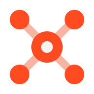<span class="av-clist__text"><span class="av-clist__title">GCP · Analytics</span><span class="av-clist__sub">3 projects</span></span><span class="av-clist__end"><svg class="av-icon" width="14" height="14" viewBox="0 0 24 24" fill="none" stroke="currentColor" stroke-width="2" stroke-linecap="round" stroke-linejoin="round" aria-hidden="true"><path d="M9 6l6 6-6 6"/></svg></span></div>
</div>
```

#### With actions
```html
<div class="av-clist"><div class="av-clist__head">Connected accounts<button class="av-btn av-btn--secondary av-btn--sm"><svg class="av-icon" width="12" height="12" viewBox="0 0 24 24" fill="none" stroke="currentColor" stroke-width="2.2" stroke-linecap="round" stroke-linejoin="round" aria-hidden="true"><path d="M12 5v14M5 12h14"/></svg>Connect</button></div>
  <div class="av-clist__item"><span class="av-clist__text"><span class="av-clist__title">Production Demo Account</span><span class="av-clist__sub av-mono">010545334631</span></span><span class="av-tag av-tag--success"><span class="av-tag__dot"></span>Healthy</span><button class="av-icon-btn av-icon-btn--ghost" aria-label="More"><svg class="av-icon" width="18" height="18" viewBox="0 0 24 24" fill="none" stroke="currentColor" stroke-width="2.6" stroke-linecap="round" stroke-linejoin="round" aria-hidden="true"><path d="M5 12h.01M12 12h.01M19 12h.01"/></svg></button></div>
</div>
```

#### With search
```html
<div class="av-clist"><div class="av-clist__search"><div class="av-search av-search--field av-search--sm"><svg class="av-icon" width="16" height="16" viewBox="0 0 24 24" fill="none" stroke="currentColor" stroke-width="2" stroke-linecap="round" stroke-linejoin="round" aria-hidden="true"><path d="M11 18a7 7 0 1 0 0-14 7 7 0 0 0 0 14zM20 20l-4-4"/></svg><input class="av-search__input" placeholder="Filter accounts"></div></div>
  <div class="av-clist__item">Production Demo Account</div><div class="av-clist__item">Staging Account</div></div>
```

### Content switcher
Pill segmented control. Selected = inverse fill (Cards / List on Your clients).

#### Icon + label
```html
<div class="av-switcher" role="group" aria-label="View"><button aria-pressed="true"><svg class="av-icon" width="14" height="14" viewBox="0 0 24 24" fill="none" stroke="currentColor" stroke-width="1.8" stroke-linecap="round" stroke-linejoin="round" aria-hidden="true"><path d="M4 4h7v7H4zM13 4h7v7h-7zM4 13h7v7H4zM13 13h7v7h-7z"/></svg>Cards</button><button aria-pressed="false"><svg class="av-icon" width="14" height="14" viewBox="0 0 24 24" fill="none" stroke="currentColor" stroke-width="1.8" stroke-linecap="round" stroke-linejoin="round" aria-hidden="true"><path d="M8 6h12M8 12h12M8 18h12M4 6h.01M4 12h.01M4 18h.01"/></svg>List</button></div>
```

#### Text
```html
<div class="av-switcher" role="group"><button aria-pressed="false">24h</button><button aria-pressed="true">7 days</button><button aria-pressed="false">30 days</button></div>
```

#### Small
```html
<div class="av-switcher av-switcher--sm" role="group"><button aria-pressed="true">All</button><button aria-pressed="false">Human</button><button aria-pressed="false">Machine</button></div>
```

#### Soft
```html
<div class="av-switcher av-switcher--soft" role="group"><button aria-pressed="true">Open</button><button aria-pressed="false">Resolved</button><button aria-pressed="false">Ignored</button></div>
```

#### Icon only
```html
<div class="av-switcher av-switcher--icon" role="group"><button aria-pressed="true" aria-label="Cards"><svg class="av-icon" width="14" height="14" viewBox="0 0 24 24" fill="none" stroke="currentColor" stroke-width="1.8" stroke-linecap="round" stroke-linejoin="round" aria-hidden="true"><path d="M4 4h7v7H4zM13 4h7v7h-7zM4 13h7v7H4zM13 13h7v7h-7z"/></svg></button><button aria-pressed="false" aria-label="List"><svg class="av-icon" width="14" height="14" viewBox="0 0 24 24" fill="none" stroke="currentColor" stroke-width="1.8" stroke-linecap="round" stroke-linejoin="round" aria-hidden="true"><path d="M8 6h12M8 12h12M8 18h12M4 6h.01M4 12h.01M4 18h.01"/></svg></button></div>
```

### Data table
56px rows, mono uppercase headers, tabular numerals, selectable rows. Dashed variant is used on the intro client list.

#### Basic
```html
<div class="av-table-wrap"><table class="av-table"><thead><tr><th>Identity</th><th>Provider</th><th>Risk</th><th class="av-table__num">Last used</th></tr></thead>
  <tbody>
    <tr><td><span class="av-table__primary">ci-deploy-runner</span><span class="av-table__id">arn:aws:iam::0105:role/ci</span></td><td><span class="av-tag av-tag--mono">AWS</span></td><td><span class="av-tag av-tag--critical"><span class="av-tag__dot"></span>Critical</span></td><td class="av-table__num">2m ago</td></tr>
    <tr><td><span class="av-table__primary">svc-billing-writer</span><span class="av-table__id">arn:aws:iam::0105:role/billing</span></td><td><span class="av-tag av-tag--mono">AWS</span></td><td><span class="av-tag av-tag--high"><span class="av-tag__dot"></span>High</span></td><td class="av-table__num">1h ago</td></tr>
    <tr><td><span class="av-table__primary">gke-node-sa</span><span class="av-table__id">node@prod.iam.gserviceaccount.com</span></td><td><span class="av-tag av-tag--mono">GCP</span></td><td><span class="av-tag av-tag--medium"><span class="av-tag__dot"></span>Medium</span></td><td class="av-table__num">3h ago</td></tr>
  </tbody></table></div>
```

#### Toolbar + selection
```html
<div class="av-table-wrap"><div class="av-table-toolbar"><span class="av-table-toolbar__title">Machine identities<span class="av-table-toolbar__count">48</span></span><div class="av-row" style="gap:8px"><div class="av-search av-search--field av-search--sm" style="width:min(220px,100%)"><svg class="av-icon" width="16" height="16" viewBox="0 0 24 24" fill="none" stroke="currentColor" stroke-width="2" stroke-linecap="round" stroke-linejoin="round" aria-hidden="true"><path d="M11 18a7 7 0 1 0 0-14 7 7 0 0 0 0 14zM20 20l-4-4"/></svg><input class="av-search__input" placeholder="Search identities"></div><button class="av-btn av-btn--secondary av-btn--sm"><svg class="av-icon" width="12" height="12" viewBox="0 0 24 24" fill="none" stroke="currentColor" stroke-width="1.8" stroke-linecap="round" stroke-linejoin="round" aria-hidden="true"><path d="M4 5h16l-6 8v6l-4-2v-4z"/></svg>Filter</button></div></div><table class="av-table"><thead><tr><th class="av-table__check"><label class="av-checkbox av-checkbox--sm"><input type="checkbox" aria-label="Select all"></label></th><th>Identity</th><th>Provider</th><th>Risk</th><th class="av-table__num">Last used</th></tr></thead>
  <tbody>
    <tr><td class="av-table__check"><label class="av-checkbox av-checkbox--sm"><input type="checkbox" aria-label="Select ci-deploy-runner"></label></td><td><span class="av-table__primary">ci-deploy-runner</span><span class="av-table__id">arn:aws:iam::0105:role/ci</span></td><td><span class="av-tag av-tag--mono">AWS</span></td><td><span class="av-tag av-tag--critical"><span class="av-tag__dot"></span>Critical</span></td><td class="av-table__num">2m ago</td></tr>
    <tr aria-selected="true"><td class="av-table__check"><label class="av-checkbox av-checkbox--sm"><input type="checkbox" checked aria-label="Select svc-billing-writer"></label></td><td><span class="av-table__primary">svc-billing-writer</span><span class="av-table__id">arn:aws:iam::0105:role/billing</span></td><td><span class="av-tag av-tag--mono">AWS</span></td><td><span class="av-tag av-tag--high"><span class="av-tag__dot"></span>High</span></td><td class="av-table__num">1h ago</td></tr>
    <tr><td class="av-table__check"><label class="av-checkbox av-checkbox--sm"><input type="checkbox" aria-label="Select gke-node-sa"></label></td><td><span class="av-table__primary">gke-node-sa</span><span class="av-table__id">node@prod.iam.gserviceaccount.com</span></td><td><span class="av-tag av-tag--mono">GCP</span></td><td><span class="av-tag av-tag--medium"><span class="av-tag__dot"></span>Medium</span></td><td class="av-table__num">3h ago</td></tr>
    <tr><td class="av-table__check"><label class="av-checkbox av-checkbox--sm"><input type="checkbox" aria-label="Select backup-agent"></label></td><td><span class="av-table__primary">backup-agent</span><span class="av-table__id">sp-7f2c-backup</span></td><td><span class="av-tag av-tag--mono">AZURE</span></td><td><span class="av-tag av-tag--low"><span class="av-tag__dot"></span>Low</span></td><td class="av-table__num">1d ago</td></tr>
  </tbody></table></div>
```

#### Sortable
```html
<div class="av-table-wrap"><table class="av-table"><thead><tr><th aria-sort="ascending"><button>Identity<svg class="av-icon" width="12" height="12" viewBox="0 0 24 24" fill="none" stroke="currentColor" stroke-width="2" stroke-linecap="round" stroke-linejoin="round" aria-hidden="true"><path d="M6 15l6-6 6 6"/></svg></button></th><th>Provider</th><th>Risk</th><th class="av-table__num"><button>Last used<svg class="av-icon" width="12" height="12" viewBox="0 0 24 24" fill="none" stroke="currentColor" stroke-width="2" stroke-linecap="round" stroke-linejoin="round" aria-hidden="true"><path d="M6 9l6 6 6-6"/></svg></button></th></tr></thead><tbody>
    <tr><td><span class="av-table__primary">ci-deploy-runner</span><span class="av-table__id">arn:aws:iam::0105:role/ci</span></td><td><span class="av-tag av-tag--mono">AWS</span></td><td><span class="av-tag av-tag--critical"><span class="av-tag__dot"></span>Critical</span></td><td class="av-table__num">2m ago</td></tr>
    <tr><td><span class="av-table__primary">svc-billing-writer</span><span class="av-table__id">arn:aws:iam::0105:role/billing</span></td><td><span class="av-tag av-tag--mono">AWS</span></td><td><span class="av-tag av-tag--high"><span class="av-tag__dot"></span>High</span></td><td class="av-table__num">1h ago</td></tr>
  </tbody></table></div>
```

#### Compact
```html
<div class="av-table-wrap"><table class="av-table av-table--compact"><thead><tr><th>Identity</th><th>Provider</th><th>Risk</th><th class="av-table__num">Last used</th></tr></thead><tbody>
    <tr><td><span class="av-table__primary">ci-deploy-runner</span><span class="av-table__id">arn:aws:iam::0105:role/ci</span></td><td><span class="av-tag av-tag--mono">AWS</span></td><td><span class="av-tag av-tag--critical"><span class="av-tag__dot"></span>Critical</span></td><td class="av-table__num">2m ago</td></tr>
    <tr><td><span class="av-table__primary">svc-billing-writer</span><span class="av-table__id">arn:aws:iam::0105:role/billing</span></td><td><span class="av-tag av-tag--mono">AWS</span></td><td><span class="av-tag av-tag--high"><span class="av-tag__dot"></span>High</span></td><td class="av-table__num">1h ago</td></tr>
    <tr><td><span class="av-table__primary">gke-node-sa</span><span class="av-table__id">node@prod.iam.gserviceaccount.com</span></td><td><span class="av-tag av-tag--mono">GCP</span></td><td><span class="av-tag av-tag--medium"><span class="av-tag__dot"></span>Medium</span></td><td class="av-table__num">3h ago</td></tr>
    <tr><td><span class="av-table__primary">backup-agent</span><span class="av-table__id">sp-7f2c-backup</span></td><td><span class="av-tag av-tag--mono">AZURE</span></td><td><span class="av-tag av-tag--low"><span class="av-tag__dot"></span>Low</span></td><td class="av-table__num">1d ago</td></tr>
  </tbody></table></div>
```

#### Batch actions
```html
<div class="av-table-wrap"><div class="av-table-batch"><strong>2 selected</strong><button class="av-btn av-btn--secondary av-btn--sm">Assign owner</button><button class="av-btn av-btn--danger av-btn--sm">Revoke</button><button class="av-btn av-btn--ghost av-btn--sm" style="margin-left:auto">Clear</button></div><table class="av-table"><thead><tr><th class="av-table__check"><label class="av-checkbox av-checkbox--sm"><input type="checkbox" aria-label="Select all"></label></th><th>Identity</th><th>Provider</th><th>Risk</th><th class="av-table__num">Last used</th></tr></thead><tbody>
    <tr aria-selected="true"><td class="av-table__check"><label class="av-checkbox av-checkbox--sm"><input type="checkbox" checked aria-label="Select ci-deploy-runner"></label></td><td><span class="av-table__primary">ci-deploy-runner</span><span class="av-table__id">arn:aws:iam::0105:role/ci</span></td><td><span class="av-tag av-tag--mono">AWS</span></td><td><span class="av-tag av-tag--critical"><span class="av-tag__dot"></span>Critical</span></td><td class="av-table__num">2m ago</td></tr>
    <tr aria-selected="true"><td class="av-table__check"><label class="av-checkbox av-checkbox--sm"><input type="checkbox" checked aria-label="Select svc-billing-writer"></label></td><td><span class="av-table__primary">svc-billing-writer</span><span class="av-table__id">arn:aws:iam::0105:role/billing</span></td><td><span class="av-tag av-tag--mono">AWS</span></td><td><span class="av-tag av-tag--high"><span class="av-tag__dot"></span>High</span></td><td class="av-table__num">1h ago</td></tr>
    <tr><td class="av-table__check"><label class="av-checkbox av-checkbox--sm"><input type="checkbox" aria-label="Select gke-node-sa"></label></td><td><span class="av-table__primary">gke-node-sa</span><span class="av-table__id">node@prod.iam.gserviceaccount.com</span></td><td><span class="av-tag av-tag--mono">GCP</span></td><td><span class="av-tag av-tag--medium"><span class="av-tag__dot"></span>Medium</span></td><td class="av-table__num">3h ago</td></tr>
  </tbody></table></div>
```

#### Findings (with action)
```html
<div class="av-table-wrap"><table class="av-table"><thead><tr><th>Finding</th><th>Severity</th><th>Resource</th><th class="av-table__num">Fix time</th><th></th></tr></thead><tbody>
    <tr><td><span class="av-table__primary">S3 bucket is publicly readable</span><span class="av-table__id">AV-S3-001</span></td><td><span class="av-tag av-tag--critical"><span class="av-tag__dot"></span>Critical</span></td><td class="av-mono" style="font-size:12px">hci-exports-prod</td><td class="av-table__num">~2 min</td><td style="text-align:right"><button class="av-btn av-btn--secondary av-btn--sm">Fix</button></td></tr>
    <tr><td><span class="av-table__primary">Access key unused for 412 days</span><span class="av-table__id">AV-IAM-014</span></td><td><span class="av-tag av-tag--high"><span class="av-tag__dot"></span>High</span></td><td class="av-mono" style="font-size:12px">AKIA…7Q2F</td><td class="av-table__num">~1 min</td><td style="text-align:right"><button class="av-btn av-btn--secondary av-btn--sm">Fix</button></td></tr>
  </tbody></table></div>
```

#### Dashed (intro list)
```html
<div class="av-table-wrap av-table-wrap--dashed"><table class="av-table"><thead><tr><th>Client</th><th>Clouds</th><th class="av-table__num">Posture</th><th>Findings</th></tr></thead><tbody>
    <tr><td><span class="av-table__primary">Hydroponic Cloud</span><span class="av-table__id">AgriTech · 3 accounts</span></td><td><span class="av-row" style="gap:6px"><span class="av-tag av-tag--mono">AWS</span><span class="av-tag av-tag--mono">AZURE</span></span></td><td class="av-table__num av-mono av-posture--poor" style="font-size:16px">64</td><td>293 open · scanned 2h ago</td></tr>
    <tr><td><span class="av-table__primary">Corvane</span><span class="av-table__id">SaaS · 5 accounts</span></td><td><span class="av-tag av-tag--mono">GCP</span></td><td class="av-table__num av-mono av-posture--good" style="font-size:16px">86</td><td>38 open · scanned 15m ago</td></tr>
  </tbody></table></div>
```

### Date picker
Input + calendar popover. Today has a ring, selected uses the inverse fill, ranges use background-selected.

#### Single input
```html
<label class="av-field" style="max-width:240px"><span class="av-field__label">Scan from</span><span class="av-date"><input class="av-input" value="10/14/2026"><span class="av-date__icon"><svg class="av-icon" width="16" height="16" viewBox="0 0 24 24" fill="none" stroke="currentColor" stroke-width="1.8" stroke-linecap="round" stroke-linejoin="round" aria-hidden="true"><path d="M4 6h16v14H4zM4 10h16M8 3v4M16 3v4"/></svg></span></span></label>
```

#### Calendar
```html
<div class="av-calendar" role="dialog" aria-label="Choose date">
  <div class="av-calendar__head">
    <button class="av-icon-btn av-icon-btn--ghost" aria-label="Previous month"><svg class="av-icon" width="16" height="16" viewBox="0 0 24 24" fill="none" stroke="currentColor" stroke-width="1.8" stroke-linecap="round" stroke-linejoin="round" aria-hidden="true"><path d="M15 6l-6 6 6 6"/></svg></button>
    <span>October 2026</span>
    <button class="av-icon-btn av-icon-btn--ghost" aria-label="Next month"><svg class="av-icon" width="16" height="16" viewBox="0 0 24 24" fill="none" stroke="currentColor" stroke-width="1.8" stroke-linecap="round" stroke-linejoin="round" aria-hidden="true"><path d="M9 6l6 6-6 6"/></svg></button>
  </div>
  <div class="av-calendar__grid">
    <span class="av-calendar__dow">Su</span><span class="av-calendar__dow">Mo</span><span class="av-calendar__dow">Tu</span><span class="av-calendar__dow">We</span><span class="av-calendar__dow">Th</span><span class="av-calendar__dow">Fr</span><span class="av-calendar__dow">Sa</span>
    <span class="av-calendar__day av-calendar__day--muted">27</span>
    <span class="av-calendar__day av-calendar__day--muted">28</span>
    <span class="av-calendar__day av-calendar__day--muted">29</span>
    <span class="av-calendar__day av-calendar__day--muted">30</span>
    <button class="av-calendar__day">1</button>
    <button class="av-calendar__day">2</button>
    <button class="av-calendar__day">3</button>
    <button class="av-calendar__day">4</button>
    <button class="av-calendar__day">5</button>
    <button class="av-calendar__day">6</button>
    <button class="av-calendar__day">7</button>
    <button class="av-calendar__day">8</button>
    <button class="av-calendar__day">9</button>
    <button class="av-calendar__day">10</button>
    <button class="av-calendar__day">11</button>
    <button class="av-calendar__day">12</button>
    <button class="av-calendar__day">13</button>
    <button class="av-calendar__day av-calendar__day--selected" aria-pressed="true">14</button>
    <button class="av-calendar__day">15</button>
    <button class="av-calendar__day">16</button>
    <button class="av-calendar__day">17</button>
    <button class="av-calendar__day">18</button>
    <button class="av-calendar__day">19</button>
    <button class="av-calendar__day">20</button>
    <button class="av-calendar__day">21</button>
    <button class="av-calendar__day">22</button>
    <button class="av-calendar__day">23</button>
    <button class="av-calendar__day">24</button>
    <button class="av-calendar__day">25</button>
    <button class="av-calendar__day">26</button>
    <button class="av-calendar__day">27</button>
    <button class="av-calendar__day">28</button>
    <button class="av-calendar__day">29</button>
    <button class="av-calendar__day av-calendar__day--today">30</button>
    <button class="av-calendar__day">31</button>
  </div>
</div>
```

#### Range input
```html
<div class="av-date-range"><span class="av-date"><input class="av-input" value="Oct 6, 2026" aria-label="Start"><span class="av-date__icon"><svg class="av-icon" width="16" height="16" viewBox="0 0 24 24" fill="none" stroke="currentColor" stroke-width="1.8" stroke-linecap="round" stroke-linejoin="round" aria-hidden="true"><path d="M4 6h16v14H4zM4 10h16M8 3v4M16 3v4"/></svg></span></span><span class="av-date-range__sep">–</span><span class="av-date"><input class="av-input" value="Oct 14, 2026" aria-label="End"><span class="av-date__icon"><svg class="av-icon" width="16" height="16" viewBox="0 0 24 24" fill="none" stroke="currentColor" stroke-width="1.8" stroke-linecap="round" stroke-linejoin="round" aria-hidden="true"><path d="M4 6h16v14H4zM4 10h16M8 3v4M16 3v4"/></svg></span></span></div>
```

#### Range calendar
```html
<div class="av-calendar" role="dialog" aria-label="Choose date">
  <div class="av-calendar__head">
    <button class="av-icon-btn av-icon-btn--ghost" aria-label="Previous month"><svg class="av-icon" width="16" height="16" viewBox="0 0 24 24" fill="none" stroke="currentColor" stroke-width="1.8" stroke-linecap="round" stroke-linejoin="round" aria-hidden="true"><path d="M15 6l-6 6 6 6"/></svg></button>
    <span>October 2026</span>
    <button class="av-icon-btn av-icon-btn--ghost" aria-label="Next month"><svg class="av-icon" width="16" height="16" viewBox="0 0 24 24" fill="none" stroke="currentColor" stroke-width="1.8" stroke-linecap="round" stroke-linejoin="round" aria-hidden="true"><path d="M9 6l6 6-6 6"/></svg></button>
  </div>
  <div class="av-calendar__grid">
    <span class="av-calendar__dow">Su</span><span class="av-calendar__dow">Mo</span><span class="av-calendar__dow">Tu</span><span class="av-calendar__dow">We</span><span class="av-calendar__dow">Th</span><span class="av-calendar__dow">Fr</span><span class="av-calendar__dow">Sa</span>
    <span class="av-calendar__day av-calendar__day--muted">27</span>
    <span class="av-calendar__day av-calendar__day--muted">28</span>
    <span class="av-calendar__day av-calendar__day--muted">29</span>
    <span class="av-calendar__day av-calendar__day--muted">30</span>
    <button class="av-calendar__day">1</button>
    <button class="av-calendar__day">2</button>
    <button class="av-calendar__day">3</button>
    <button class="av-calendar__day">4</button>
    <button class="av-calendar__day">5</button>
    <button class="av-calendar__day av-calendar__day--selected" aria-pressed="true">6</button>
    <button class="av-calendar__day av-calendar__day--range">7</button>
    <button class="av-calendar__day av-calendar__day--range">8</button>
    <button class="av-calendar__day av-calendar__day--range">9</button>
    <button class="av-calendar__day av-calendar__day--range">10</button>
    <button class="av-calendar__day av-calendar__day--range">11</button>
    <button class="av-calendar__day av-calendar__day--range">12</button>
    <button class="av-calendar__day av-calendar__day--range">13</button>
    <button class="av-calendar__day av-calendar__day--selected" aria-pressed="true">14</button>
    <button class="av-calendar__day">15</button>
    <button class="av-calendar__day">16</button>
    <button class="av-calendar__day">17</button>
    <button class="av-calendar__day">18</button>
    <button class="av-calendar__day">19</button>
    <button class="av-calendar__day">20</button>
    <button class="av-calendar__day">21</button>
    <button class="av-calendar__day">22</button>
    <button class="av-calendar__day">23</button>
    <button class="av-calendar__day">24</button>
    <button class="av-calendar__day">25</button>
    <button class="av-calendar__day">26</button>
    <button class="av-calendar__day">27</button>
    <button class="av-calendar__day">28</button>
    <button class="av-calendar__day">29</button>
    <button class="av-calendar__day av-calendar__day--today">30</button>
    <button class="av-calendar__day">31</button>
  </div>
</div>
```

#### Presets
```html
<div class="av-presets"><button class="av-tag av-tag--filter" aria-pressed="false">Last 24h</button><button class="av-tag av-tag--filter" aria-pressed="true">Last 7 days</button><button class="av-tag av-tag--filter" aria-pressed="false">Last 30 days</button><button class="av-tag av-tag--filter" aria-pressed="false">Custom…</button></div>
```

#### Disabled
```html
<span class="av-date" style="max-width:240px"><input class="av-input" value="10/14/2026" disabled><span class="av-date__icon"><svg class="av-icon" width="16" height="16" viewBox="0 0 24 24" fill="none" stroke="currentColor" stroke-width="1.8" stroke-linecap="round" stroke-linejoin="round" aria-hidden="true"><path d="M4 6h16v14H4zM4 10h16M8 3v4M16 3v4"/></svg></span></span>
```

#### Invalid
```html
<label class="av-field" style="max-width:240px"><span class="av-field__label">End date</span><span class="av-date"><input class="av-input" value="10/02/2026" aria-invalid="true"><span class="av-date__icon"><svg class="av-icon" width="16" height="16" viewBox="0 0 24 24" fill="none" stroke="currentColor" stroke-width="1.8" stroke-linecap="round" stroke-linejoin="round" aria-hidden="true"><path d="M4 6h16v14H4zM4 10h16M8 3v4M16 3v4"/></svg></span></span><span class="av-field__error"><svg class="av-icon" width="12" height="12" viewBox="0 0 24 24" fill="none" stroke="currentColor" stroke-width="2" stroke-linecap="round" stroke-linejoin="round" aria-hidden="true"><path d="M12 3l10 18H2zM12 10v4M12 17h.01"/></svg>End date is before start</span></label>
```

### Dropdown
Custom listbox trigger + menu. Use for rich options (logos, scores). Use Select for plain native lists.

#### Closed
```html
<div class="av-dropdown"><span class="av-dropdown__label">Environment</span><button class="av-dropdown__trigger" aria-haspopup="listbox" aria-expanded="false"><span class="av-dropdown__value">All environments</span><svg class="av-icon av-dropdown__chev" width="16" height="16" viewBox="0 0 24 24" fill="none" stroke="currentColor" stroke-width="2" stroke-linecap="round" stroke-linejoin="round" aria-hidden="true"><path d="M6 9l6 6 6-6"/></svg></button></div>
```

#### Open
```html
<div class="av-dropdown"><button class="av-dropdown__trigger" aria-haspopup="listbox" aria-expanded="true"><span class="av-dropdown__value">Production</span><svg class="av-icon av-dropdown__chev" width="16" height="16" viewBox="0 0 24 24" fill="none" stroke="currentColor" stroke-width="2" stroke-linecap="round" stroke-linejoin="round" aria-hidden="true"><path d="M6 9l6 6 6-6"/></svg></button>
  <div class="av-menu" role="listbox"><button class="av-menu__item" role="option">All environments</button><button class="av-menu__item" role="option" aria-selected="true">Production<svg class="av-icon av-menu__check" width="14" height="14" viewBox="0 0 24 24" fill="none" stroke="currentColor" stroke-width="2.2" stroke-linecap="round" stroke-linejoin="round" aria-hidden="true"><path d="M5 12l5 5 9-10"/></svg></button><button class="av-menu__item" role="option">Staging</button></div></div>
```

#### Rich (account switcher)
```html
<div class="av-dropdown" style="min-width:min(300px,100%)"><button class="av-dropdown__trigger" aria-expanded="true"><span class="av-dropdown__value">Production Demo Account</span><svg class="av-icon av-dropdown__chev" width="16" height="16" viewBox="0 0 24 24" fill="none" stroke="currentColor" stroke-width="2" stroke-linecap="round" stroke-linejoin="round" aria-hidden="true"><path d="M6 9l6 6 6-6"/></svg></button>
  <div class="av-menu" role="listbox">
    <button class="av-menu__item av-menu__item--rich" role="option" aria-selected="true"><span class="av-menu__logo"></span><span class="av-menu__text"><span>Production Demo Account</span><span class="av-menu__sub">010545334631</span></span><span class="av-menu__score av-posture--poor">58</span><svg class="av-icon av-menu__check" width="14" height="14" viewBox="0 0 24 24" fill="none" stroke="currentColor" stroke-width="2.2" stroke-linecap="round" stroke-linejoin="round" aria-hidden="true"><path d="M5 12l5 5 9-10"/></svg></button>
    <button class="av-menu__item av-menu__item--rich" role="option"><span class="av-menu__logo"></span><span class="av-menu__text"><span>Northwind Commerce</span><span class="av-menu__sub">alvl-vulnlab-d6a0cd</span></span><span class="av-menu__score av-posture--good">96</span></button>
  </div></div>
```

#### Inline filter
```html
<div class="av-row"><div class="av-dropdown av-dropdown--inline"><button class="av-dropdown__trigger">Severity: All<svg class="av-icon av-dropdown__chev" width="14" height="14" viewBox="0 0 24 24" fill="none" stroke="currentColor" stroke-width="2" stroke-linecap="round" stroke-linejoin="round" aria-hidden="true"><path d="M6 9l6 6 6-6"/></svg></button></div><div class="av-dropdown av-dropdown--inline"><button class="av-dropdown__trigger">Provider: AWS<svg class="av-icon av-dropdown__chev" width="14" height="14" viewBox="0 0 24 24" fill="none" stroke="currentColor" stroke-width="2" stroke-linecap="round" stroke-linejoin="round" aria-hidden="true"><path d="M6 9l6 6 6-6"/></svg></button></div></div>
```

#### With icon
```html
<div class="av-dropdown"><button class="av-dropdown__trigger">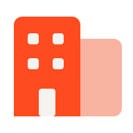<span class="av-dropdown__value">Avistar Demo Org</span><svg class="av-icon av-dropdown__chev" width="16" height="16" viewBox="0 0 24 24" fill="none" stroke="currentColor" stroke-width="2" stroke-linecap="round" stroke-linejoin="round" aria-hidden="true"><path d="M6 9l6 6 6-6"/></svg></button></div>
```

#### Disabled
```html
<div class="av-dropdown"><button class="av-dropdown__trigger" disabled><span class="av-dropdown__value">Region locked by policy</span><svg class="av-icon av-dropdown__chev" width="16" height="16" viewBox="0 0 24 24" fill="none" stroke="currentColor" stroke-width="2" stroke-linecap="round" stroke-linejoin="round" aria-hidden="true"><path d="M6 9l6 6 6-6"/></svg></button></div>
```

#### Invalid
```html
<div class="av-dropdown"><span class="av-dropdown__label">Owner</span><button class="av-dropdown__trigger" aria-invalid="true"><span class="av-dropdown__value" style="color:var(--av-text-placeholder)">Choose an owner</span><svg class="av-icon av-dropdown__chev" width="16" height="16" viewBox="0 0 24 24" fill="none" stroke="currentColor" stroke-width="2" stroke-linecap="round" stroke-linejoin="round" aria-hidden="true"><path d="M6 9l6 6 6-6"/></svg></button><span class="av-field__error"><svg class="av-icon" width="12" height="12" viewBox="0 0 24 24" fill="none" stroke="currentColor" stroke-width="2" stroke-linecap="round" stroke-linejoin="round" aria-hidden="true"><path d="M12 3l10 18H2zM12 10v4M12 17h.01"/></svg>Every identity needs an owner</span></div>
```

### File uploader
Dashed drop zone + file rows. Used to import CloudFormation outputs and certificates (Azure).

#### Drop zone
```html
<label class="av-upload"><input type="file" class="av-sr-only"><span class="av-upload__icon"><svg class="av-icon" width="20" height="20" viewBox="0 0 24 24" fill="none" stroke="currentColor" stroke-width="1.8" stroke-linecap="round" stroke-linejoin="round" aria-hidden="true"><path d="M12 20V9M7.5 13.5 12 9l4.5 4.5M5 4h14"/></svg></span><span class="av-upload__title">Drop certificate or browse</span><span class="av-upload__hint">.PEM .CER .PFX · MAX 2 MB</span></label>
```

#### Drag over
```html
<label class="av-upload av-upload--dragover"><span class="av-upload__icon"><svg class="av-icon" width="20" height="20" viewBox="0 0 24 24" fill="none" stroke="currentColor" stroke-width="1.8" stroke-linecap="round" stroke-linejoin="round" aria-hidden="true"><path d="M12 20V9M7.5 13.5 12 9l4.5 4.5M5 4h14"/></svg></span><span class="av-upload__title">Release to upload</span></label>
```

#### Uploading
```html
<div class="av-file"><span style="color:var(--av-icon-tertiary)"><svg class="av-icon" width="18" height="18" viewBox="0 0 24 24" fill="none" stroke="currentColor" stroke-width="1.8" stroke-linecap="round" stroke-linejoin="round" aria-hidden="true"><path d="M6 3h9l4 4v14H6zM14 3v5h5"/></svg></span><span class="av-file__body"><span class="av-file__name">avistar-entra.pfx</span><span class="av-progress av-progress--sm"><span class="av-progress__track"><span class="av-progress__fill" style="width:62%"></span></span></span></span><button class="av-icon-btn av-icon-btn--ghost" aria-label="Cancel"><svg class="av-icon" width="16" height="16" viewBox="0 0 24 24" fill="none" stroke="currentColor" stroke-width="1.8" stroke-linecap="round" stroke-linejoin="round" aria-hidden="true"><path d="M6 6l12 12M18 6 6 18"/></svg></button></div>
```

#### Uploaded list
```html
<div class="av-stack" style="gap:8px">
  <div class="av-file"><span class="av-file__ok"><svg class="av-icon" width="18" height="18" viewBox="0 0 24 24" fill="none" stroke="currentColor" stroke-width="2.2" stroke-linecap="round" stroke-linejoin="round" aria-hidden="true"><path d="M5 12l5 5 9-10"/></svg></span><span class="av-file__body"><span class="av-file__name">outputs.json</span><span class="av-file__meta">4.2 KB · VALIDATED</span></span><button class="av-icon-btn av-icon-btn--ghost" aria-label="Remove"><svg class="av-icon" width="16" height="16" viewBox="0 0 24 24" fill="none" stroke="currentColor" stroke-width="1.8" stroke-linecap="round" stroke-linejoin="round" aria-hidden="true"><path d="M4 7h16M9 7V4h6v3M6 7l1 13h10l1-13"/></svg></button></div>
  <div class="av-file"><span class="av-file__ok"><svg class="av-icon" width="18" height="18" viewBox="0 0 24 24" fill="none" stroke="currentColor" stroke-width="2.2" stroke-linecap="round" stroke-linejoin="round" aria-hidden="true"><path d="M5 12l5 5 9-10"/></svg></span><span class="av-file__body"><span class="av-file__name">trust-policy.json</span><span class="av-file__meta">1.1 KB · VALIDATED</span></span><button class="av-icon-btn av-icon-btn--ghost" aria-label="Remove"><svg class="av-icon" width="16" height="16" viewBox="0 0 24 24" fill="none" stroke="currentColor" stroke-width="1.8" stroke-linecap="round" stroke-linejoin="round" aria-hidden="true"><path d="M4 7h16M9 7V4h6v3M6 7l1 13h10l1-13"/></svg></button></div>
</div>
```

#### Error
```html
<div class="av-file av-file--error"><span style="color:var(--av-text-error)"><svg class="av-icon" width="18" height="18" viewBox="0 0 24 24" fill="none" stroke="currentColor" stroke-width="1.8" stroke-linecap="round" stroke-linejoin="round" aria-hidden="true"><path d="M12 3l10 18H2zM12 10v4M12 17h.01"/></svg></span><span class="av-file__body"><span class="av-file__name">cert.txt</span><span class="av-file__meta">UNSUPPORTED FILE TYPE</span></span><button class="av-btn av-btn--ghost av-btn--sm">Retry</button></div>
```

### Form
Label above field, 8px label gap, 20px between fields, actions bottom-right. Field primitives: .av-field, .av-field__label, __helper, __error.

#### Stacked
```html
<form class="av-form">
  <label class="av-field"><span class="av-field__label">Client name</span><input class="av-input" placeholder="e.g. Northwind Health"></label>
  <label class="av-field"><span class="av-field__label">Industry<span class="av-field__optional">Optional</span></span><input class="av-input" placeholder="Healthcare"></label>
  <div class="av-form__actions"><button type="button" class="av-btn av-btn--ghost">Cancel</button><button class="av-btn av-btn--primary">Add client</button></div>
</form>
```

#### Two column
```html
<form class="av-form"><div class="av-form__row">
  <label class="av-field"><span class="av-field__label">Account name</span><input class="av-input" value="Production AWS"></label>
  <label class="av-field"><span class="av-field__label">Region</span><span class="av-select"><select><option>us-east-1</option><option>eu-west-1</option></select><svg class="av-icon av-select__chev" width="14" height="14" viewBox="0 0 24 24" fill="none" stroke="currentColor" stroke-width="2" stroke-linecap="round" stroke-linejoin="round" aria-hidden="true"><path d="M6 9l6 6 6-6"/></svg></span></label>
</div></form>
```

#### Sections
```html
<form class="av-form">
  <h3 class="av-form__title">Organization</h3>
  <label class="av-field"><span class="av-field__label">Name</span><input class="av-input" value="Avistar Demo Org"></label>
  <div class="av-form__section"><span class="av-eyebrow">Security</span><label class="av-toggle"><input type="checkbox" role="switch" checked>Require SSO</label></div>
</form>
```

#### Validation
```html
<form class="av-form">
  <label class="av-field"><span class="av-field__label">IAM role ARN</span><input class="av-input av-input--mono" value="not-an-arn" aria-invalid="true"><span class="av-field__error"><svg class="av-icon" width="12" height="12" viewBox="0 0 24 24" fill="none" stroke="currentColor" stroke-width="2" stroke-linecap="round" stroke-linejoin="round" aria-hidden="true"><path d="M12 3l10 18H2zM12 10v4M12 17h.01"/></svg>Enter a valid role ARN — arn:aws:iam::&lt;account&gt;:role/&lt;name&gt;</span></label>
  <label class="av-field"><span class="av-field__label">External ID</span><input class="av-input av-input--mono" value="av-7f2c9d" readonly><span class="av-field__helper">Generated by Avistar. Paste into the trust policy.</span></label>
</form>
```

#### Settings rows
```html
<div>
  <div class="av-setting"><div class="av-setting__k"><span class="av-setting__t">Scan frequency</span><span class="av-setting__d">How often Avistar re-reads your cloud.</span></div><span class="av-select"><select><option>Every 6 hours</option><option>Daily</option></select><svg class="av-icon av-select__chev" width="14" height="14" viewBox="0 0 24 24" fill="none" stroke="currentColor" stroke-width="2" stroke-linecap="round" stroke-linejoin="round" aria-hidden="true"><path d="M6 9l6 6 6-6"/></svg></span></div>
  <div class="av-setting"><div class="av-setting__k"><span class="av-setting__t">Weekly digest</span><span class="av-setting__d">Email summary every Monday.</span></div><label class="av-toggle"><input type="checkbox" role="switch" checked></label></div>
</div>
```

#### In card
```html
<form class="av-form-card" style="max-width:480px"><div class="av-form-card__body"><h3 class="av-form__title">Invite member</h3>
  <label class="av-field"><span class="av-field__label">Email</span><input class="av-input" placeholder="name@company.com"></label>
  <label class="av-field"><span class="av-field__label">Role</span><span class="av-select"><select><option>Analyst</option><option>Owner</option></select><svg class="av-icon av-select__chev" width="14" height="14" viewBox="0 0 24 24" fill="none" stroke="currentColor" stroke-width="2" stroke-linecap="round" stroke-linejoin="round" aria-hidden="true"><path d="M6 9l6 6 6-6"/></svg></span></label>
</div><div class="av-form-card__foot"><button type="button" class="av-btn av-btn--ghost">Cancel</button><button class="av-btn av-btn--primary">Send invite</button></div></form>
```

#### Multi-step
```html
<div class="av-form" style="max-width:560px"><ol class="av-steps"><li class="av-step av-step--done"><span class="av-step__dot"><svg class="av-icon" width="12" height="12" viewBox="0 0 24 24" fill="none" stroke="currentColor" stroke-width="3" stroke-linecap="round" stroke-linejoin="round" aria-hidden="true"><path d="M5 12l5 5 9-10"/></svg></span>Provider<span class="av-step__line"></span></li><li class="av-step av-step--current"><span class="av-step__dot">2</span>Credentials<span class="av-step__line"></span></li><li class="av-step"><span class="av-step__dot">3</span>Verify</li></ol>
  <label class="av-field"><span class="av-field__label">Role ARN</span><input class="av-input av-input--mono" placeholder="arn:aws:iam::…"></label>
  <div class="av-form__actions"><button class="av-btn av-btn--ghost">Back</button><button class="av-btn av-btn--primary">Continue</button></div></div>
```

### Link
Underlined by default, Ion on hover. Action links carry an arrow and sit next to primary buttons.

#### Inline
```html
<p style="margin:0;font-size:14px;color:var(--av-text-tertiary)">Close the 2 public buckets to reach 71. <a class="av-link" href="#">See which ones</a>.</p>
```

#### Action
```html
<div class="av-row" style="gap:24px"><a class="av-link av-link--action" href="#">Schedule scans<svg class="av-icon" width="16" height="16" viewBox="0 0 24 24" fill="none" stroke="currentColor" stroke-width="2" stroke-linecap="round" stroke-linejoin="round" aria-hidden="true"><path d="M5 12h14M13 6l6 6-6 6"/></svg></a><a class="av-link av-link--action" href="#">Help guide<svg class="av-icon" width="14" height="14" viewBox="0 0 24 24" fill="none" stroke="currentColor" stroke-width="2" stroke-linecap="round" stroke-linejoin="round" aria-hidden="true"><path d="M5 12h14M13 6l6 6-6 6"/></svg></a></div>
```

#### Quiet
```html
<a class="av-link av-link--quiet" href="#">View all bulletins</a>
```

#### Standalone
```html
<a class="av-link av-link--standalone" href="#">Open →</a>
```

#### External
```html
<a class="av-link av-link--action" href="#" target="_blank" rel="noopener">Open AWS console<svg class="av-icon" width="14" height="14" viewBox="0 0 24 24" fill="none" stroke="currentColor" stroke-width="2" stroke-linecap="round" stroke-linejoin="round" aria-hidden="true"><path d="M14 4h6v6M20 4l-9 9M18 14v6H4V6h6"/></svg></a>
```

#### Small
```html
<a class="av-link av-link--sm" href="#">Start with this fix</a>
```

#### Disabled
```html
<a class="av-link" aria-disabled="true">Download report</a>
```

### Loading
Spinner (Ion head on layer-04 track), inline status, skeleton shimmer.

#### Spinner sizes
```html
<div class="av-row" style="gap:24px"><span class="av-spinner av-spinner--sm" role="status" aria-label="Loading"></span><span class="av-spinner" role="status" aria-label="Loading"></span><span class="av-spinner av-spinner--lg" role="status" aria-label="Loading"></span></div>
```

#### Inline status
```html
<div class="av-stack"><span class="av-loading-inline"><span class="av-spinner av-spinner--sm"></span>Syncing AWS accounts…</span><span class="av-loading-inline"><span class="av-live-dot"></span>Scan in progress · 64%</span></div>
```

#### Button
```html
<button class="av-btn av-btn--primary" aria-busy="true"><span class="av-btn__spinner"></span>Running scan…</button>
```

#### Skeleton card
```html
<div class="av-tile" style="max-width:320px"><div class="av-row"><span class="av-skeleton av-skeleton--circle" style="width:40px;height:40px"></span><span class="av-stack" style="flex:1;gap:8px"><span class="av-skeleton" style="height:12px;width:70%"></span><span class="av-skeleton" style="height:10px;width:45%"></span></span></div><span class="av-skeleton" style="height:64px;border-radius:10px"></span></div>
```

#### Skeleton rows
```html
<div class="av-stack" style="gap:14px"><div class="av-row"><span class="av-skeleton" style="height:14px;width:80%"></span><span class="av-skeleton" style="height:14px;width:12%;margin-left:auto"></span></div><div class="av-row"><span class="av-skeleton" style="height:14px;width:64%"></span><span class="av-skeleton" style="height:14px;width:12%;margin-left:auto"></span></div><div class="av-row"><span class="av-skeleton" style="height:14px;width:72%"></span><span class="av-skeleton" style="height:14px;width:12%;margin-left:auto"></span></div></div>
```

### Menu
Popover list with 6px padding, 36px items, kbd hints, danger at the bottom after a separator. Enters with ctxIn (scale + blur).

#### Basic
```html
<div class="av-menu" role="menu"><button class="av-menu__item" role="menuitem">Rename</button><button class="av-menu__item" role="menuitem">Move to org</button><button class="av-menu__item" role="menuitem">Archive</button></div>
```

#### Shortcuts + danger
```html
<div class="av-menu" role="menu">
  <button class="av-menu__item" role="menuitem"><svg class="av-icon" width="16" height="16" viewBox="0 0 24 24" fill="none" stroke="currentColor" stroke-width="1.8" stroke-linecap="round" stroke-linejoin="round" aria-hidden="true"><path d="M14 4h6v6M20 4l-9 9M18 14v6H4V6h6"/></svg>Open details<kbd class="av-menu__kbd">↵</kbd></button>
  <button class="av-menu__item" role="menuitem"><svg class="av-icon" width="16" height="16" viewBox="0 0 24 24" fill="none" stroke="currentColor" stroke-width="1.8" stroke-linecap="round" stroke-linejoin="round" aria-hidden="true"><path d="M9 9h11v11H9zM5 15H4V4h11v1"/></svg>Copy ARN<kbd class="av-menu__kbd">⌘C</kbd></button>
  <button class="av-menu__item" role="menuitem"><svg class="av-icon" width="16" height="16" viewBox="0 0 24 24" fill="none" stroke="currentColor" stroke-width="1.8" stroke-linecap="round" stroke-linejoin="round" aria-hidden="true"><path d="M12 3l8 3v6c0 5-3.5 8-8 9-4.5-1-8-4-8-9V6z"/></svg>Request approval</button>
  <div class="av-menu__sep" role="separator"></div>
  <button class="av-menu__item av-menu__item--danger" role="menuitem"><svg class="av-icon" width="16" height="16" viewBox="0 0 24 24" fill="none" stroke="currentColor" stroke-width="1.8" stroke-linecap="round" stroke-linejoin="round" aria-hidden="true"><path d="M4 7h16M9 7V4h6v3M6 7l1 13h10l1-13"/></svg>Revoke access<kbd class="av-menu__kbd">⌫</kbd></button>
</div>
```

#### Groups
```html
<div class="av-menu" role="menu"><span class="av-menu__group">Client</span><button class="av-menu__item">Hydroponic Cloud</button><button class="av-menu__item">Acme Health · Archived</button><div class="av-menu__sep"></div><span class="av-menu__group">Account</span><button class="av-menu__item">Production Demo Account</button></div>
```

#### Selectable
```html
<div class="av-menu" role="listbox"><button class="av-menu__item" role="option">Newest first</button><button class="av-menu__item" role="option" aria-selected="true">Severity<svg class="av-icon av-menu__check" width="14" height="14" viewBox="0 0 24 24" fill="none" stroke="currentColor" stroke-width="2.2" stroke-linecap="round" stroke-linejoin="round" aria-hidden="true"><path d="M5 12l5 5 9-10"/></svg></button><button class="av-menu__item" role="option">Fix time</button></div>
```

#### Rich
```html
<div class="av-menu" style="width:min(300px,100%)"><button class="av-menu__item av-menu__item--rich"><span class="av-menu__logo"></span><span class="av-menu__text"><span>Ashgrove Azure</span><span class="av-menu__sub">tenant 4c1e…b20</span></span><span class="av-menu__score av-posture--fair">78</span></button><button class="av-menu__item av-menu__item--rich"><span class="av-menu__logo"></span><span class="av-menu__text"><span>Ashgrove Analytics</span><span class="av-menu__sub">ash-analytics-01</span></span><span class="av-menu__score av-posture--good">88</span></button></div>
```

#### With footer action
```html
<div class="av-menu" style="width:min(280px,100%)"><button class="av-menu__item" aria-selected="true">Production Demo Account<svg class="av-icon av-menu__check" width="14" height="14" viewBox="0 0 24 24" fill="none" stroke="currentColor" stroke-width="2.2" stroke-linecap="round" stroke-linejoin="round" aria-hidden="true"><path d="M5 12l5 5 9-10"/></svg></button><button class="av-menu__item">Staging Account</button><div class="av-menu__foot"><button class="av-btn av-btn--ghost av-btn--sm" style="padding:0"><svg class="av-icon" width="14" height="14" viewBox="0 0 24 24" fill="none" stroke="currentColor" stroke-width="2" stroke-linecap="round" stroke-linejoin="round" aria-hidden="true"><path d="M12 5v14M5 12h14"/></svg>Connect account</button></div></div>
```

### Menu buttons
Buttons that open a Menu. Chevron rotates when expanded.

#### Secondary
```html
<div class="av-menubtn"><button class="av-btn av-btn--secondary" aria-haspopup="menu" aria-expanded="false"><svg class="av-icon" width="14" height="14" viewBox="0 0 24 24" fill="none" stroke="currentColor" stroke-width="1.8" stroke-linecap="round" stroke-linejoin="round" aria-hidden="true"><path d="M12 4v11M7.5 10.5 12 15l4.5-4.5M5 20h14"/></svg>Export<svg class="av-icon av-menubtn__chev" width="14" height="14" viewBox="0 0 24 24" fill="none" stroke="currentColor" stroke-width="2" stroke-linecap="round" stroke-linejoin="round" aria-hidden="true"><path d="M6 9l6 6 6-6"/></svg></button></div>
```

#### Open
```html
<div class="av-menubtn"><button class="av-btn av-btn--secondary" aria-haspopup="menu" aria-expanded="true">Export<svg class="av-icon av-menubtn__chev" width="14" height="14" viewBox="0 0 24 24" fill="none" stroke="currentColor" stroke-width="2" stroke-linecap="round" stroke-linejoin="round" aria-hidden="true"><path d="M6 9l6 6 6-6"/></svg></button><div class="av-menu" role="menu"><button class="av-menu__item"><svg class="av-icon" width="16" height="16" viewBox="0 0 24 24" fill="none" stroke="currentColor" stroke-width="1.8" stroke-linecap="round" stroke-linejoin="round" aria-hidden="true"><path d="M6 3h9l4 4v14H6zM14 3v5h5M9 13h7M9 17h5"/></svg>PDF report</button><button class="av-menu__item"><svg class="av-icon" width="16" height="16" viewBox="0 0 24 24" fill="none" stroke="currentColor" stroke-width="1.8" stroke-linecap="round" stroke-linejoin="round" aria-hidden="true"><path d="M6 3h9l4 4v14H6zM14 3v5h5"/></svg>CSV findings</button></div></div>
```

#### Split primary
```html
<div class="av-split"><button class="av-btn av-btn--primary"><svg class="av-icon" width="14" height="14" viewBox="0 0 24 24" fill="currentColor" stroke="none" stroke-width="0" stroke-linecap="round" stroke-linejoin="round" aria-hidden="true"><path d="M7 5v14l11-7z"/></svg>Run scan</button><button class="av-btn av-btn--primary" aria-label="Scan options" aria-haspopup="menu"><svg class="av-icon" width="14" height="14" viewBox="0 0 24 24" fill="none" stroke="currentColor" stroke-width="2.2" stroke-linecap="round" stroke-linejoin="round" aria-hidden="true"><path d="M6 9l6 6 6-6"/></svg></button></div>
```

#### Overflow
```html
<div class="av-menubtn"><button class="av-icon-btn av-icon-btn--ghost" aria-label="Row actions" aria-haspopup="menu" aria-expanded="true"><svg class="av-icon" width="18" height="18" viewBox="0 0 24 24" fill="none" stroke="currentColor" stroke-width="2.6" stroke-linecap="round" stroke-linejoin="round" aria-hidden="true"><path d="M5 12h.01M12 12h.01M19 12h.01"/></svg></button><div class="av-menu" role="menu"><button class="av-menu__item" role="menuitem"><svg class="av-icon" width="16" height="16" viewBox="0 0 24 24" fill="none" stroke="currentColor" stroke-width="1.8" stroke-linecap="round" stroke-linejoin="round" aria-hidden="true"><path d="M14 4h6v6M20 4l-9 9M18 14v6H4V6h6"/></svg>Open details<kbd class="av-menu__kbd">↵</kbd></button>
  <button class="av-menu__item" role="menuitem"><svg class="av-icon" width="16" height="16" viewBox="0 0 24 24" fill="none" stroke="currentColor" stroke-width="1.8" stroke-linecap="round" stroke-linejoin="round" aria-hidden="true"><path d="M9 9h11v11H9zM5 15H4V4h11v1"/></svg>Copy ARN<kbd class="av-menu__kbd">⌘C</kbd></button>
  <button class="av-menu__item" role="menuitem"><svg class="av-icon" width="16" height="16" viewBox="0 0 24 24" fill="none" stroke="currentColor" stroke-width="1.8" stroke-linecap="round" stroke-linejoin="round" aria-hidden="true"><path d="M12 3l8 3v6c0 5-3.5 8-8 9-4.5-1-8-4-8-9V6z"/></svg>Request approval</button>
  <div class="av-menu__sep" role="separator"></div>
  <button class="av-menu__item av-menu__item--danger" role="menuitem"><svg class="av-icon" width="16" height="16" viewBox="0 0 24 24" fill="none" stroke="currentColor" stroke-width="1.8" stroke-linecap="round" stroke-linejoin="round" aria-hidden="true"><path d="M4 7h16M9 7V4h6v3M6 7l1 13h10l1-13"/></svg>Revoke access<kbd class="av-menu__kbd">⌫</kbd></button></div></div>
```

#### Account
```html
<button class="av-account-btn" aria-haspopup="menu" aria-expanded="false"><span class="av-avatar">Z</span>zalak@avistar.ai<svg class="av-icon" width="14" height="14" viewBox="0 0 24 24" fill="none" stroke="currentColor" stroke-width="2" stroke-linecap="round" stroke-linejoin="round" aria-hidden="true"><path d="M6 9l6 6 6-6"/></svg></button>
```

### Modal
16px radius on layer-01, scrim 55% black. Title 18/600, body 14 tertiary, footer right-aligned. Side sheet for drill-ins (fix drawer). .av-demo-stage is only for docs — use position:fixed in product.

#### Passive
```html
<div class="av-demo-stage"><div class="av-modal-scrim"><div class="av-modal" role="dialog" aria-modal="true" aria-labelledby="m1"><div class="av-modal__head"><div class="av-modal__heading"><span class="av-eyebrow">Help</span><h2 class="av-modal__title" id="m1">Everything flows into one score</h2></div><button class="av-icon-btn av-icon-btn--ghost" aria-label="Close"><svg class="av-icon" width="16" height="16" viewBox="0 0 24 24" fill="none" stroke="currentColor" stroke-width="1.8" stroke-linecap="round" stroke-linejoin="round" aria-hidden="true"><path d="M6 6l12 12M18 6 6 18"/></svg></button></div><div class="av-modal__body">Every scan feeds the posture number. Close the top three fixes and watch it climb.</div></div></div></div>
```

#### Transactional
```html
<div class="av-demo-stage"><div class="av-modal-scrim"><div class="av-modal" role="dialog" aria-modal="true"><div class="av-modal__head"><div class="av-modal__heading"><h2 class="av-modal__title">Run a full scan?</h2></div><button class="av-icon-btn av-icon-btn--ghost" aria-label="Close"><svg class="av-icon" width="16" height="16" viewBox="0 0 24 24" fill="none" stroke="currentColor" stroke-width="1.8" stroke-linecap="round" stroke-linejoin="round" aria-hidden="true"><path d="M6 6l12 12M18 6 6 18"/></svg></button></div><div class="av-modal__body">This reads 3 accounts and takes about 6 minutes. You can keep working.</div><div class="av-modal__foot"><button class="av-btn av-btn--ghost">Cancel</button><button class="av-btn av-btn--primary"><svg class="av-icon" width="14" height="14" viewBox="0 0 24 24" fill="currentColor" stroke="none" stroke-width="0" stroke-linecap="round" stroke-linejoin="round" aria-hidden="true"><path d="M7 5v14l11-7z"/></svg>Run scan</button></div></div></div></div>
```

#### Danger
```html
<div class="av-demo-stage"><div class="av-modal-scrim"><div class="av-modal" role="alertdialog" aria-modal="true"><div class="av-modal__head"><div class="av-modal__heading"><h2 class="av-modal__title">Revoke access key?</h2></div><button class="av-icon-btn av-icon-btn--ghost" aria-label="Close"><svg class="av-icon" width="16" height="16" viewBox="0 0 24 24" fill="none" stroke="currentColor" stroke-width="1.8" stroke-linecap="round" stroke-linejoin="round" aria-hidden="true"><path d="M6 6l12 12M18 6 6 18"/></svg></button></div><div class="av-modal__body">AKIA…7Q2F stops working immediately. 2 workloads depend on it.</div><div class="av-modal__foot"><button class="av-btn av-btn--secondary">Cancel</button><button class="av-btn av-btn--danger-solid">Revoke key</button></div></div></div></div>
```

#### Form
```html
<div class="av-demo-stage" style="height:440px"><div class="av-modal-scrim"><div class="av-modal" role="dialog" aria-modal="true"><div class="av-modal__head"><div class="av-modal__heading"><h2 class="av-modal__title">Create organization</h2></div><button class="av-icon-btn av-icon-btn--ghost" aria-label="Close"><svg class="av-icon" width="16" height="16" viewBox="0 0 24 24" fill="none" stroke="currentColor" stroke-width="1.8" stroke-linecap="round" stroke-linejoin="round" aria-hidden="true"><path d="M6 6l12 12M18 6 6 18"/></svg></button></div><div class="av-modal__body"><label class="av-field"><span class="av-field__label">Name</span><input class="av-input" placeholder="Ridgeway Partners MSP"></label><label class="av-checkbox"><input type="checkbox" checked>I'm the owner</label></div><div class="av-modal__foot"><button class="av-btn av-btn--ghost">Cancel</button><button class="av-btn av-btn--primary">Create</button></div></div></div></div>
```

#### With illustration
```html
<div class="av-demo-stage"><div class="av-modal-scrim"><div class="av-modal" role="dialog" aria-modal="true"><div class="av-modal__body" style="padding-top:24px;align-items:center;text-align:center">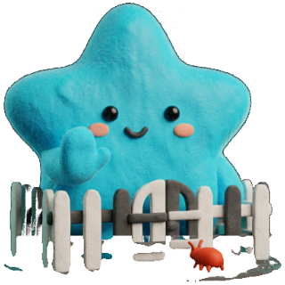<h2 class="av-modal__title" style="color:var(--av-text-primary)">Account connected</h2>First scan starts now. We'll notify you when it's done.</div><div class="av-modal__foot" style="justify-content:center"><button class="av-btn av-btn--primary">View first scan<svg class="av-icon" width="16" height="16" viewBox="0 0 24 24" fill="none" stroke="currentColor" stroke-width="2" stroke-linecap="round" stroke-linejoin="round" aria-hidden="true"><path d="M5 12h14M13 6l6 6-6 6"/></svg></button></div></div></div></div>
```

#### Side sheet
```html
<div class="av-demo-stage" style="height:420px"><div class="av-sheet-scrim"></div><aside class="av-sheet" role="dialog" aria-modal="true"><div class="av-sheet__head"><div class="av-modal__heading"><span class="av-tag av-tag--critical" style="align-self:flex-start"><span class="av-tag__dot"></span>Critical</span><h2 class="av-modal__title">S3 bucket is publicly readable</h2><span class="av-table__id">hci-exports-prod · us-east-1</span></div><button class="av-icon-btn av-icon-btn--ghost" aria-label="Close"><svg class="av-icon" width="16" height="16" viewBox="0 0 24 24" fill="none" stroke="currentColor" stroke-width="1.8" stroke-linecap="round" stroke-linejoin="round" aria-hidden="true"><path d="M6 6l12 12M18 6 6 18"/></svg></button></div><div class="av-sheet__body">Anyone with the URL can list and download objects.<div class="av-code av-code--single"><span>aws s3api put-public-access-block …</span><button class="av-icon-btn av-icon-btn--ghost av-code__copy" aria-label="Copy"><svg class="av-icon" width="16" height="16" viewBox="0 0 24 24" fill="none" stroke="currentColor" stroke-width="1.8" stroke-linecap="round" stroke-linejoin="round" aria-hidden="true"><path d="M9 9h11v11H9zM5 15H4V4h11v1"/></svg></button></div></div><div class="av-sheet__foot"><button class="av-btn av-btn--primary">Mark fixed</button><button class="av-btn av-btn--secondary">Assign</button></div></aside></div>
```

### Notification
Inline notices (info / success / warning / error), toasts (inverse) and the dismissible banner.

#### Inline kinds
```html
<div class="av-stack">
  <div class="av-notice" role="status"><span class="av-notice__icon">i</span><span class="av-notice__body"><span class="av-notice__title">Scan scheduled</span><span class="av-notice__text">Next full scan runs tonight at 02:00 UTC.</span></span><a class="av-link av-notice__action" href="#">Change</a></div>
  <div class="av-notice av-notice--success" role="status"><span class="av-notice__icon">✓</span><span class="av-notice__body"><span class="av-notice__title">Guardrail applied</span><span class="av-notice__text">“Rotate keys every 90 days” now enforced on 4 clients.</span></span></div>
  <div class="av-notice av-notice--warning" role="status"><span class="av-notice__icon">!</span><span class="av-notice__body"><span class="av-notice__title">Credentials expiring</span><span class="av-notice__text">Azure service principal expires in 6 days.</span></span><a class="av-link av-notice__action" href="#">Renew</a></div>
  <div class="av-notice av-notice--error" role="alert"><span class="av-notice__icon">!</span><span class="av-notice__body"><span class="av-notice__title">Critical exposure</span><span class="av-notice__text">A key for ci-deploy-runner was found in a public repo.</span></span><a class="av-link av-notice__action" href="#">Revoke now</a></div>
</div>
```

#### Toasts
```html
<div class="av-stack" style="align-items:flex-start">
  <div class="av-toast" role="status"><span class="av-toast__dot"></span>Scan complete · 3 new findings<a href="#">View</a></div>
  <div class="av-toast av-toast--quiet" role="status"><span class="av-spinner av-spinner--sm"></span>Syncing AWS accounts…</div>
  <div class="av-toast av-toast--error" role="alert">Couldn't reach GCP. Retrying in 30s</div>
  <div class="av-toast" role="status">ARN copied</div>
</div>
```

#### Dismissible
```html
<div class="av-notice av-notice--subtle"><span class="av-notice__icon">i</span><span class="av-notice__body"><span class="av-notice__title">New: guardrails</span><span class="av-notice__text">Block risky changes before they ship.</span></span><button class="av-icon-btn av-icon-btn--ghost" aria-label="Dismiss"><svg class="av-icon" width="16" height="16" viewBox="0 0 24 24" fill="none" stroke="currentColor" stroke-width="1.8" stroke-linecap="round" stroke-linejoin="round" aria-hidden="true"><path d="M6 6l12 12M18 6 6 18"/></svg></button></div>
```

#### Actionable
```html
<div class="av-notice av-notice--warning"><span class="av-notice__icon">!</span><span class="av-notice__body"><span class="av-notice__title">1 of 3 accounts not scanned</span><span class="av-notice__text">Staging is missing permissions.</span></span><button class="av-btn av-btn--secondary av-btn--sm" style="align-self:center">Fix permissions</button></div>
```

### Number input
Field with stepper buttons and optional unit. Focus ring applies to the whole group.

#### Default
```html
<label class="av-field"><span class="av-field__label">Retention</span><div class="av-number "><input type="number" value="30" aria-label="Value"><button aria-label="Decrease"><svg class="av-icon" width="14" height="14" viewBox="0 0 24 24" fill="none" stroke="currentColor" stroke-width="2" stroke-linecap="round" stroke-linejoin="round" aria-hidden="true"><path d="M5 12h14"/></svg></button><button aria-label="Increase"><svg class="av-icon" width="14" height="14" viewBox="0 0 24 24" fill="none" stroke="currentColor" stroke-width="2" stroke-linecap="round" stroke-linejoin="round" aria-hidden="true"><path d="M12 5v14M5 12h14"/></svg></button></div></label>
```

#### With unit
```html
<div class="av-number "><input type="number" value="90" aria-label="Value"><span class="av-number__unit">DAYS</span><button aria-label="Decrease"><svg class="av-icon" width="14" height="14" viewBox="0 0 24 24" fill="none" stroke="currentColor" stroke-width="2" stroke-linecap="round" stroke-linejoin="round" aria-hidden="true"><path d="M5 12h14"/></svg></button><button aria-label="Increase"><svg class="av-icon" width="14" height="14" viewBox="0 0 24 24" fill="none" stroke="currentColor" stroke-width="2" stroke-linecap="round" stroke-linejoin="round" aria-hidden="true"><path d="M12 5v14M5 12h14"/></svg></button></div>
```

#### Invalid
```html
<label class="av-field"><span class="av-field__label">Key max age</span><div class="av-number av-number--invalid"><input type="number" value="400" aria-label="Value"><span class="av-number__unit">DAYS</span><button aria-label="Decrease"><svg class="av-icon" width="14" height="14" viewBox="0 0 24 24" fill="none" stroke="currentColor" stroke-width="2" stroke-linecap="round" stroke-linejoin="round" aria-hidden="true"><path d="M5 12h14"/></svg></button><button aria-label="Increase"><svg class="av-icon" width="14" height="14" viewBox="0 0 24 24" fill="none" stroke="currentColor" stroke-width="2" stroke-linecap="round" stroke-linejoin="round" aria-hidden="true"><path d="M12 5v14M5 12h14"/></svg></button></div><span class="av-field__error"><svg class="av-icon" width="12" height="12" viewBox="0 0 24 24" fill="none" stroke="currentColor" stroke-width="2" stroke-linecap="round" stroke-linejoin="round" aria-hidden="true"><path d="M12 3l10 18H2zM12 10v4M12 17h.01"/></svg>Max 365 days</span></label>
```

#### Disabled
```html
<div class="av-number av-number--disabled"><input type="number" value="6" disabled aria-label="Value"><span class="av-number__unit">HOURS</span><button aria-label="Decrease" disabled><svg class="av-icon" width="14" height="14" viewBox="0 0 24 24" fill="none" stroke="currentColor" stroke-width="2" stroke-linecap="round" stroke-linejoin="round" aria-hidden="true"><path d="M5 12h14"/></svg></button><button aria-label="Increase" disabled><svg class="av-icon" width="14" height="14" viewBox="0 0 24 24" fill="none" stroke="currentColor" stroke-width="2" stroke-linecap="round" stroke-linejoin="round" aria-hidden="true"><path d="M12 5v14M5 12h14"/></svg></button></div>
```

#### Small
```html
<div class="av-number av-number--sm"><input type="number" value="3" aria-label="Value"><button aria-label="Decrease"><svg class="av-icon" width="14" height="14" viewBox="0 0 24 24" fill="none" stroke="currentColor" stroke-width="2" stroke-linecap="round" stroke-linejoin="round" aria-hidden="true"><path d="M5 12h14"/></svg></button><button aria-label="Increase"><svg class="av-icon" width="14" height="14" viewBox="0 0 24 24" fill="none" stroke="currentColor" stroke-width="2" stroke-linecap="round" stroke-linejoin="round" aria-hidden="true"><path d="M12 5v14M5 12h14"/></svg></button></div>
```

### Pagination
32px page buttons, current page has strong border + layer-03.

#### Numbered
```html
<nav class="av-pagination" aria-label="Pagination"><span>1–25 of 293</span><div class="av-pagination__pages"><button class="av-page" disabled aria-label="Previous"><svg class="av-icon" width="14" height="14" viewBox="0 0 24 24" fill="none" stroke="currentColor" stroke-width="2" stroke-linecap="round" stroke-linejoin="round" aria-hidden="true"><path d="M15 6l-6 6 6 6"/></svg></button><button class="av-page" aria-current="page">1</button><button class="av-page">2</button><button class="av-page">3</button><span class="av-page" aria-hidden="true">…</span><button class="av-page">12</button><button class="av-page" aria-label="Next"><svg class="av-icon" width="14" height="14" viewBox="0 0 24 24" fill="none" stroke="currentColor" stroke-width="2" stroke-linecap="round" stroke-linejoin="round" aria-hidden="true"><path d="M9 6l6 6-6 6"/></svg></button></div></nav>
```

#### With page size
```html
<nav class="av-pagination"><span class="av-pagination__size">Rows<span class="av-select av-select--sm"><select><option>25</option><option>50</option></select><svg class="av-icon av-select__chev" width="12" height="12" viewBox="0 0 24 24" fill="none" stroke="currentColor" stroke-width="2" stroke-linecap="round" stroke-linejoin="round" aria-hidden="true"><path d="M6 9l6 6 6-6"/></svg></span></span><span>26–50 of 293</span><div class="av-pagination__pages"><button class="av-page"><svg class="av-icon" width="14" height="14" viewBox="0 0 24 24" fill="none" stroke="currentColor" stroke-width="2" stroke-linecap="round" stroke-linejoin="round" aria-hidden="true"><path d="M15 6l-6 6 6 6"/></svg></button><button class="av-page">1</button><button class="av-page" aria-current="page">2</button><button class="av-page">3</button><button class="av-page"><svg class="av-icon" width="14" height="14" viewBox="0 0 24 24" fill="none" stroke="currentColor" stroke-width="2" stroke-linecap="round" stroke-linejoin="round" aria-hidden="true"><path d="M9 6l6 6-6 6"/></svg></button></div></nav>
```

#### Simple
```html
<nav class="av-pagination"><span>Page 2 of 12</span><div class="av-pagination__pages"><button class="av-btn av-btn--secondary av-btn--sm"><svg class="av-icon" width="12" height="12" viewBox="0 0 24 24" fill="none" stroke="currentColor" stroke-width="2" stroke-linecap="round" stroke-linejoin="round" aria-hidden="true"><path d="M15 6l-6 6 6 6"/></svg>Previous</button><button class="av-btn av-btn--secondary av-btn--sm">Next<svg class="av-icon" width="12" height="12" viewBox="0 0 24 24" fill="none" stroke="currentColor" stroke-width="2" stroke-linecap="round" stroke-linejoin="round" aria-hidden="true"><path d="M9 6l6 6-6 6"/></svg></button></div></nav>
```

#### Load more
```html
<div class="av-pagination__more"><button class="av-btn av-btn--secondary">Show 25 more</button></div>
```

### Password input
Text input with reveal toggle; optional 4-segment strength meter.

#### Hidden
```html
<label class="av-field" style="max-width:320px"><span class="av-field__label">Password</span><span class="av-input-group av-input-group--end"><input class="av-input" type="password" value="correct horse"><span class="av-input-group__end"><button class="av-icon-btn av-icon-btn--ghost" aria-label="Show password"><svg class="av-icon" width="16" height="16" viewBox="0 0 24 24" fill="none" stroke="currentColor" stroke-width="1.8" stroke-linecap="round" stroke-linejoin="round" aria-hidden="true"><path d="M2 12s3.5-7 10-7 10 7 10 7-3.5 7-10 7S2 12 2 12zM12 15a3 3 0 1 0 0-6 3 3 0 0 0 0 6z"/></svg></button></span></span></label>
```

#### Visible
```html
<label class="av-field" style="max-width:320px"><span class="av-field__label">Client secret</span><span class="av-input-group av-input-group--end"><input class="av-input av-input--mono" type="text" value="Zx8~q1Lr-2mp"><span class="av-input-group__end"><button class="av-icon-btn av-icon-btn--ghost" aria-label="Hide password"><svg class="av-icon" width="16" height="16" viewBox="0 0 24 24" fill="none" stroke="currentColor" stroke-width="1.8" stroke-linecap="round" stroke-linejoin="round" aria-hidden="true"><path d="M3 3l18 18M10.6 10.6a2 2 0 0 0 2.8 2.8M9.4 5.2A10 10 0 0 1 12 5c6.5 0 10 7 10 7a17 17 0 0 1-3.2 4M6.1 6.1C3.6 7.8 2 12 2 12s3.5 7 10 7a9.8 9.8 0 0 0 4.3-1"/></svg></button></span></span></label>
```

#### Strength
```html
<label class="av-field" style="max-width:320px"><span class="av-field__label">New password</span><span class="av-input-group av-input-group--end"><input class="av-input" type="password" value="hunter22"><span class="av-input-group__end"><button class="av-icon-btn av-icon-btn--ghost" aria-label="Show password"><svg class="av-icon" width="16" height="16" viewBox="0 0 24 24" fill="none" stroke="currentColor" stroke-width="1.8" stroke-linecap="round" stroke-linejoin="round" aria-hidden="true"><path d="M2 12s3.5-7 10-7 10 7 10 7-3.5 7-10 7S2 12 2 12zM12 15a3 3 0 1 0 0-6 3 3 0 0 0 0 6z"/></svg></button></span></span><span class="av-strength" data-level="2"><span></span><span></span><span></span><span></span></span><span class="av-field__helper">Fair · add a symbol or 4 more characters</span></label>
```

#### Invalid
```html
<label class="av-field" style="max-width:320px"><span class="av-field__label">Password</span><span class="av-input-group av-input-group--end"><input class="av-input" type="password" value="abc" aria-invalid="true"><span class="av-input-group__end"><button class="av-icon-btn av-icon-btn--ghost" aria-label="Show password"><svg class="av-icon" width="16" height="16" viewBox="0 0 24 24" fill="none" stroke="currentColor" stroke-width="1.8" stroke-linecap="round" stroke-linejoin="round" aria-hidden="true"><path d="M2 12s3.5-7 10-7 10 7 10 7-3.5 7-10 7S2 12 2 12zM12 15a3 3 0 1 0 0-6 3 3 0 0 0 0 6z"/></svg></button></span></span><span class="av-field__error"><svg class="av-icon" width="12" height="12" viewBox="0 0 24 24" fill="none" stroke="currentColor" stroke-width="2" stroke-linecap="round" stroke-linejoin="round" aria-hidden="true"><path d="M12 3l10 18H2zM12 10v4M12 17h.01"/></svg>Incorrect password</span></label>
```

### Popover
Rich floating panel (280px) with optional caret. Anchor with Floating UI or CSS anchor positioning.

#### Basic
```html
<div class="av-popover" role="dialog"><span class="av-popover__title">svc-billing-writer</span>Has s3:PutObject on 14 buckets. Used by 1 workload.</div>
```

#### With actions
```html
<div class="av-popover" role="dialog"><span class="av-popover__title">Scope down?</span>Remove write access on 12 unused buckets.<div class="av-popover__actions"><button class="av-btn av-btn--primary av-btn--sm">Scope down</button><button class="av-btn av-btn--secondary av-btn--sm">Details</button></div></div>
```

#### Caret top
```html
<div style="padding-top:8px"><div class="av-popover av-popover--caret-top"><span class="av-popover__title">Posture score</span>0–64 poor · 65–79 fair · 80+ good.</div></div>
```

#### Caret bottom
```html
<div style="padding-bottom:8px"><div class="av-popover av-popover--caret-bottom"><span class="av-popover__title">Last scan</span>Finished 2 hours ago in 5m 41s.</div></div>
```

#### Rich
```html
<div class="av-popover" style="width:min(300px,100%)"><div class="av-row" style="gap:10px"><span class="av-avatar av-avatar--square">CI</span><span class="av-stack" style="gap:2px"><span class="av-popover__title">ci-deploy-runner</span><span class="av-table__id">arn:aws:iam::0105:role/ci</span></span></div><div class="av-popover__stats"><span class="av-popover__stat"><b>14</b>policies</span><span class="av-popover__stat"><b class="av-posture--poor">3</b>critical</span><span class="av-popover__stat"><b>2m</b>last used</span></div></div>
```

### Progress bar
6px track on layer-04. Brand gradient for coverage/score, status colours for compliance, indeterminate for scanning.

#### Brand
```html
<div class="av-progress"><div class="av-progress__head"><span>Identity coverage</span><span class="av-progress__value">72%</span></div><span class="av-progress__track" role="progressbar" aria-valuenow="72" aria-valuemin="0" aria-valuemax="100"><span class="av-progress__fill" style="width:72%"></span></span></div>
```

#### Status
```html
<div class="av-stack" style="gap:16px">
  <div class="av-progress av-progress--amber"><div class="av-progress__head"><span>Rotation compliance</span><span class="av-progress__value">48%</span></div><span class="av-progress__track"><span class="av-progress__fill" style="width:48%"></span></span></div>
  <div class="av-progress av-progress--success"><div class="av-progress__head"><span>MFA enforced</span><span class="av-progress__value">96%</span></div><span class="av-progress__track"><span class="av-progress__fill" style="width:96%"></span></span></div>
</div>
```

#### Indeterminate
```html
<div class="av-progress av-progress--ion av-progress--indeterminate"><div class="av-progress__head"><span>Scanning Production Demo Account</span></div><span class="av-progress__track"><span class="av-progress__fill"></span></span><span class="av-progress__helper">Reading IAM roles…</span></div>
```

#### Error
```html
<div class="av-progress av-progress--error"><div class="av-progress__head"><span>Upload</span><span class="av-progress__value">31%</span></div><span class="av-progress__track"><span class="av-progress__fill" style="width:31%"></span></span><span class="av-progress__helper">Connection lost</span></div>
```

### Progress indicator
Stepper for multi-step flows (Connect account). Done = Ion, current = Signal, upcoming = outline.

#### Horizontal
```html
<ol class="av-steps">
  <li class="av-step av-step--done"><span class="av-step__dot"><svg class="av-icon" width="12" height="12" viewBox="0 0 24 24" fill="none" stroke="currentColor" stroke-width="3" stroke-linecap="round" stroke-linejoin="round" aria-hidden="true"><path d="M5 12l5 5 9-10"/></svg></span>Connect cloud<span class="av-step__line"></span></li>
  <li class="av-step av-step--done"><span class="av-step__dot"><svg class="av-icon" width="12" height="12" viewBox="0 0 24 24" fill="none" stroke="currentColor" stroke-width="3" stroke-linecap="round" stroke-linejoin="round" aria-hidden="true"><path d="M5 12l5 5 9-10"/></svg></span>Scan identities<span class="av-step__line"></span></li>
  <li class="av-step av-step--current" aria-current="step"><span class="av-step__dot">3</span>Review findings<span class="av-step__line"></span></li>
  <li class="av-step"><span class="av-step__dot">4</span>Set guardrails</li>
</ol>
```

#### Vertical
```html
<ol class="av-steps av-steps--vertical">
  <li class="av-step av-step--done"><span class="av-step__dot"><svg class="av-icon" width="12" height="12" viewBox="0 0 24 24" fill="none" stroke="currentColor" stroke-width="3" stroke-linecap="round" stroke-linejoin="round" aria-hidden="true"><path d="M5 12l5 5 9-10"/></svg></span><span class="av-step__text">Connect cloud<span class="av-step__desc">Read-only role</span></span><span class="av-step__line"></span></li>
  <li class="av-step av-step--done"><span class="av-step__dot"><svg class="av-icon" width="12" height="12" viewBox="0 0 24 24" fill="none" stroke="currentColor" stroke-width="3" stroke-linecap="round" stroke-linejoin="round" aria-hidden="true"><path d="M5 12l5 5 9-10"/></svg></span><span class="av-step__text">Scan identities<span class="av-step__desc">~6 min</span></span><span class="av-step__line"></span></li>
  <li class="av-step av-step--current" aria-current="step"><span class="av-step__dot">3</span><span class="av-step__text">Review findings<span class="av-step__desc">293 open</span></span><span class="av-step__line"></span></li>
  <li class="av-step"><span class="av-step__dot">4</span><span class="av-step__text">Set guardrails<span class="av-step__desc">Optional</span></span></li>
</ol>
```

#### With descriptions
```html
<ol class="av-steps">
  <li class="av-step av-step--done"><span class="av-step__dot"><svg class="av-icon" width="12" height="12" viewBox="0 0 24 24" fill="none" stroke="currentColor" stroke-width="3" stroke-linecap="round" stroke-linejoin="round" aria-hidden="true"><path d="M5 12l5 5 9-10"/></svg></span><span class="av-step__text">Connect cloud<span class="av-step__desc">Read-only role</span></span><span class="av-step__line"></span></li>
  <li class="av-step av-step--done"><span class="av-step__dot"><svg class="av-icon" width="12" height="12" viewBox="0 0 24 24" fill="none" stroke="currentColor" stroke-width="3" stroke-linecap="round" stroke-linejoin="round" aria-hidden="true"><path d="M5 12l5 5 9-10"/></svg></span><span class="av-step__text">Scan identities<span class="av-step__desc">~6 min</span></span><span class="av-step__line"></span></li>
  <li class="av-step av-step--current" aria-current="step"><span class="av-step__dot">3</span><span class="av-step__text">Review findings<span class="av-step__desc">293 open</span></span><span class="av-step__line"></span></li>
  <li class="av-step"><span class="av-step__dot">4</span><span class="av-step__text">Set guardrails<span class="av-step__desc">Optional</span></span></li>
</ol>
```

#### Invalid step
```html
<ol class="av-steps">
  <li class="av-step av-step--done"><span class="av-step__dot"><svg class="av-icon" width="12" height="12" viewBox="0 0 24 24" fill="none" stroke="currentColor" stroke-width="3" stroke-linecap="round" stroke-linejoin="round" aria-hidden="true"><path d="M5 12l5 5 9-10"/></svg></span>Connect cloud<span class="av-step__line"></span></li>
  <li class="av-step av-step--done"><span class="av-step__dot"><svg class="av-icon" width="12" height="12" viewBox="0 0 24 24" fill="none" stroke="currentColor" stroke-width="3" stroke-linecap="round" stroke-linejoin="round" aria-hidden="true"><path d="M5 12l5 5 9-10"/></svg></span>Scan identities<span class="av-step__line"></span></li>
  <li class="av-step av-step--invalid"><span class="av-step__dot">!</span>Review findings<span class="av-step__line"></span></li>
  <li class="av-step"><span class="av-step__dot">4</span>Set guardrails</li>
</ol>
```

### Radio button
18px ring, 8px Ion dot. Radio cards for choosing a connect method.

#### Group
```html
<fieldset class="av-fieldset"><legend>Scan frequency</legend><div class="av-radio-group"><label class="av-radio"><input type="radio" name="f1" checked>Every 6 hours</label><label class="av-radio"><input type="radio" name="f1">Daily</label><label class="av-radio"><input type="radio" name="f1">Weekly</label></div></fieldset>
```

#### Horizontal
```html
<div class="av-radio-group av-radio-group--row"><label class="av-radio"><input type="radio" name="f2" checked>AWS</label><label class="av-radio"><input type="radio" name="f2">Azure</label><label class="av-radio"><input type="radio" name="f2">GCP</label></div>
```

#### Disabled
```html
<div class="av-radio-group"><label class="av-radio"><input type="radio" name="f3" disabled checked>Read-only (required)</label><label class="av-radio"><input type="radio" name="f3" disabled>Read-write</label></div>
```

#### Invalid
```html
<div class="av-stack" style="gap:4px"><div class="av-radio-group"><label class="av-radio av-radio--invalid"><input type="radio" name="f4">Owner</label><label class="av-radio av-radio--invalid"><input type="radio" name="f4">Analyst</label></div><span class="av-field__error"><svg class="av-icon" width="12" height="12" viewBox="0 0 24 24" fill="none" stroke="currentColor" stroke-width="2" stroke-linecap="round" stroke-linejoin="round" aria-hidden="true"><path d="M12 3l10 18H2zM12 10v4M12 17h.01"/></svg>Choose a role</span></div>
```

#### With helper
```html
<label class="av-radio" style="align-items:flex-start"><input type="radio" name="f5" checked style="margin-top:2px"><span class="av-checkbox__text">Quick connect<span class="av-checkbox__helper">CloudFormation stack · ~2 min</span></span></label>
```

#### Radio cards
```html
<div class="av-stack" style="gap:8px;max-width:420px"><label class="av-radio-card"><span class="av-radio"><input type="radio" name="f6" checked></span><span class="av-radio-card__body"><span class="av-radio-card__title">Quick connect</span><span class="av-radio-card__desc">One-click CloudFormation stack · ~2 min</span></span></label><label class="av-radio-card"><span class="av-radio"><input type="radio" name="f6"></span><span class="av-radio-card__body"><span class="av-radio-card__title">Manual</span><span class="av-radio-card__desc">Create the IAM role yourself · ~5 min</span></span></label></div>
```

### Search
Pill search on the client picker; field search inside tables and lists. ⌘K hint in the top bar.

#### Pill (client picker)
```html
<div class="av-search" style="max-width:420px"><svg class="av-icon" width="18" height="18" viewBox="0 0 24 24" fill="none" stroke="currentColor" stroke-width="2" stroke-linecap="round" stroke-linejoin="round" aria-hidden="true"><path d="M11 18a7 7 0 1 0 0-14 7 7 0 0 0 0 14zM20 20l-4-4"/></svg><input class="av-search__input" type="search" placeholder="Search clients" aria-label="Search clients"></div>
```

#### Field
```html
<div class="av-search av-search--field" style="max-width:360px"><svg class="av-icon" width="16" height="16" viewBox="0 0 24 24" fill="none" stroke="currentColor" stroke-width="2" stroke-linecap="round" stroke-linejoin="round" aria-hidden="true"><path d="M11 18a7 7 0 1 0 0-14 7 7 0 0 0 0 14zM20 20l-4-4"/></svg><input class="av-search__input" placeholder="Search identities, keys, roles"></div>
```

#### With shortcut
```html
<div class="av-search av-search--field av-search--sm" style="max-width:280px"><svg class="av-icon" width="16" height="16" viewBox="0 0 24 24" fill="none" stroke="currentColor" stroke-width="2" stroke-linecap="round" stroke-linejoin="round" aria-hidden="true"><path d="M11 18a7 7 0 1 0 0-14 7 7 0 0 0 0 14zM20 20l-4-4"/></svg><input class="av-search__input" placeholder="Search"><span class="av-search__end"><kbd class="av-kbd">⌘K</kbd></span></div>
```

#### With value + clear
```html
<div class="av-search" style="max-width:360px"><svg class="av-icon" width="18" height="18" viewBox="0 0 24 24" fill="none" stroke="currentColor" stroke-width="2" stroke-linecap="round" stroke-linejoin="round" aria-hidden="true"><path d="M11 18a7 7 0 1 0 0-14 7 7 0 0 0 0 14zM20 20l-4-4"/></svg><input class="av-search__input" value="tide"><span class="av-search__end"><button class="av-icon-btn av-icon-btn--ghost" aria-label="Clear"><svg class="av-icon" width="14" height="14" viewBox="0 0 24 24" fill="none" stroke="currentColor" stroke-width="2" stroke-linecap="round" stroke-linejoin="round" aria-hidden="true"><path d="M6 6l12 12M18 6 6 18"/></svg></button></span></div>
```

#### Collapsed
```html
<div class="av-search av-search--collapsed av-search--sm"><svg class="av-icon" width="16" height="16" viewBox="0 0 24 24" fill="none" stroke="currentColor" stroke-width="2" stroke-linecap="round" stroke-linejoin="round" aria-hidden="true"><path d="M11 18a7 7 0 1 0 0-14 7 7 0 0 0 0 14zM20 20l-4-4"/></svg><input class="av-search__input" aria-label="Search"></div>
```

### Select
Native <select> styled as a field. Inline variant for compact toolbars.

#### Default
```html
<div style="max-width:280px"><span class="av-select "><select><option>All environments</option><option>Production</option><option>Staging</option></select><svg class="av-icon av-select__chev" width="14" height="14" viewBox="0 0 24 24" fill="none" stroke="currentColor" stroke-width="2" stroke-linecap="round" stroke-linejoin="round" aria-hidden="true"><path d="M6 9l6 6 6-6"/></svg></span></div>
```

#### With label
```html
<label class="av-field" style="max-width:280px"><span class="av-field__label">Region</span><span class="av-select "><select><option>us-east-1</option><option>eu-west-1</option></select><svg class="av-icon av-select__chev" width="14" height="14" viewBox="0 0 24 24" fill="none" stroke="currentColor" stroke-width="2" stroke-linecap="round" stroke-linejoin="round" aria-hidden="true"><path d="M6 9l6 6 6-6"/></svg></span><span class="av-field__helper">Where the role lives.</span></label>
```

#### Inline
```html
<span class="av-select av-select--inline"><select><option>Sort: Severity</option><option>Sort: Newest</option></select><svg class="av-icon av-select__chev" width="14" height="14" viewBox="0 0 24 24" fill="none" stroke="currentColor" stroke-width="2" stroke-linecap="round" stroke-linejoin="round" aria-hidden="true"><path d="M6 9l6 6 6-6"/></svg></span>
```

#### Invalid
```html
<label class="av-field" style="max-width:280px"><span class="av-field__label">Owner</span><span class="av-select "><select aria-invalid="true"><option>Choose…</option></select><svg class="av-icon av-select__chev" width="14" height="14" viewBox="0 0 24 24" fill="none" stroke="currentColor" stroke-width="2" stroke-linecap="round" stroke-linejoin="round" aria-hidden="true"><path d="M6 9l6 6 6-6"/></svg></span><span class="av-field__error"><svg class="av-icon" width="12" height="12" viewBox="0 0 24 24" fill="none" stroke="currentColor" stroke-width="2" stroke-linecap="round" stroke-linejoin="round" aria-hidden="true"><path d="M12 3l10 18H2zM12 10v4M12 17h.01"/></svg>Required</span></label>
```

#### Disabled
```html
<div style="max-width:280px"><span class="av-select "><select disabled><option>Managed by policy</option></select><svg class="av-icon av-select__chev" width="14" height="14" viewBox="0 0 24 24" fill="none" stroke="currentColor" stroke-width="2" stroke-linecap="round" stroke-linejoin="round" aria-hidden="true"><path d="M6 9l6 6 6-6"/></svg></span></div>
```

### Slider
Gradient fill track with white thumb + Ion halo. Set --av-pct inline (or via JS on input) to paint the fill.

#### Default
```html
<div class="av-slider"><div class="av-slider__head"><span>Alert threshold</span><span class="av-slider__value">65</span></div><input type="range" min="0" max="100" value="65" style="--av-pct:65%" oninput="this.style.setProperty('--av-pct',this.value+'%')"></div>
```

#### With input
```html
<div class="av-slider"><span class="av-field__label">Key max age (days)</span><div class="av-slider__row"><input type="range" min="30" max="365" value="90" style="--av-pct:18%"><div class="av-number av-number--sm" style="width:96px"><input type="number" value="90" aria-label="Days"></div></div></div>
```

#### With scale
```html
<div class="av-slider"><div class="av-slider__head"><span>Severity floor</span><span class="av-slider__value">HIGH</span></div><input type="range" min="0" max="3" value="2" style="--av-pct:66%"><div class="av-slider__scale"><span>LOW</span><span>MEDIUM</span><span>HIGH</span><span>CRITICAL</span></div></div>
```

#### Disabled
```html
<div class="av-slider"><div class="av-slider__head"><span>Retention</span><span class="av-slider__value">30</span></div><input type="range" value="30" disabled style="--av-pct:30%"></div>
```

### Structured list
Key / value rows for detail panels (identity details, account info).

#### Key / value
```html
<div class="av-slist"><div class="av-slist__row"><span class="av-slist__k">Provider</span><span class="av-slist__v">AWS</span></div><div class="av-slist__row"><span class="av-slist__k">Owner</span><span class="av-slist__v">Platform team</span></div><div class="av-slist__row"><span class="av-slist__k">Created</span><span class="av-slist__v">Mar 2024</span></div></div>
```

#### With header
```html
<div class="av-slist av-slist--3"><div class="av-slist__row av-slist__row--head"><span>Policy</span><span>Type</span><span>Attached</span></div><div class="av-slist__row"><span class="av-slist__v">SecurityAudit</span><span class="av-slist__k">AWS managed</span><span class="av-slist__k">2y ago</span></div><div class="av-slist__row"><span class="av-slist__v">ci-deploy-inline</span><span class="av-slist__k">Inline</span><span class="av-slist__k">14d ago</span></div></div>
```

#### Condensed
```html
<div class="av-slist av-slist--condensed"><div class="av-slist__row"><span class="av-slist__k">Region</span><span class="av-slist__v">us-east-1</span></div><div class="av-slist__row"><span class="av-slist__k">Resources</span><span class="av-slist__v">214</span></div></div>
```

#### Selectable
```html
<div class="av-slist av-slist--selectable"><label class="av-slist__row"><span class="av-radio"><input type="radio" name="sl" checked></span><span class="av-slist__v">Production Demo Account</span><span class="av-slist__k">AWS</span></label><label class="av-slist__row"><span class="av-radio"><input type="radio" name="sl"></span><span class="av-slist__v">Northwind Commerce</span><span class="av-slist__k">GCP</span></label></div>
```

#### In card
```html
<div class="av-slist av-slist--card"><div class="av-slist__row"><span class="av-slist__k">Status</span><span class="av-slist__v"><span class="av-tag av-tag--success"><span class="av-tag__dot"></span>Complete coverage</span></span></div><div class="av-slist__row"><span class="av-slist__k">Last scan</span><span class="av-slist__v">2 hours ago</span></div></div>
```

#### Mono + copy
```html
<div class="av-slist"><div class="av-slist__row"><span class="av-slist__k">Account ID</span><span class="av-slist__v av-slist__copy"><span class="av-slist__v--mono">010545334631</span><button class="av-icon-btn av-icon-btn--ghost" aria-label="Copy"><svg class="av-icon" width="14" height="14" viewBox="0 0 24 24" fill="none" stroke="currentColor" stroke-width="1.8" stroke-linecap="round" stroke-linejoin="round" aria-hidden="true"><path d="M9 9h11v11H9zM5 15H4V4h11v1"/></svg></button></span></div><div class="av-slist__row"><span class="av-slist__k">External ID</span><span class="av-slist__v av-slist__copy"><span class="av-slist__v--mono">av-7f2c9d</span><button class="av-icon-btn av-icon-btn--ghost" aria-label="Copy"><svg class="av-icon" width="14" height="14" viewBox="0 0 24 24" fill="none" stroke="currentColor" stroke-width="1.8" stroke-linecap="round" stroke-linejoin="round" aria-hidden="true"><path d="M9 9h11v11H9zM5 15H4V4h11v1"/></svg></button></span></div></div>
```

### Tabs
Line tabs with Signal 2px indicator; pill tabs for in-card switching; vertical for settings.

#### Line
```html
<div class="av-tabs" role="tablist"><button class="av-tab" role="tab" aria-selected="true">Summary</button><button class="av-tab" role="tab">Permissions</button><button class="av-tab" role="tab">Activity</button><button class="av-tab" role="tab" disabled>Policies</button></div>
```

#### With counts
```html
<div class="av-tabs" role="tablist"><button class="av-tab" role="tab" aria-selected="true">Open<span class="av-tab__count">293</span></button><button class="av-tab" role="tab">Resolved<span class="av-tab__count">1,204</span></button><button class="av-tab" role="tab">Ignored<span class="av-tab__count">12</span></button></div>
```

#### Pill
```html
<div class="av-tabs av-tabs--pill" role="tablist"><button class="av-tab" role="tab" aria-selected="true">Trend</button><button class="av-tab" role="tab">By severity</button><button class="av-tab" role="tab">By provider</button></div>
```

#### Vertical
```html
<div class="av-tabs av-tabs--vertical" role="tablist"><button class="av-tab" role="tab" aria-selected="true">General</button><button class="av-tab" role="tab">Members</button><button class="av-tab" role="tab">Billing</button><button class="av-tab" role="tab">Danger zone</button></div>
```

### Tag
Severity pills with dot, mono outline tags (providers, roles), count badges, delta chips, filter chips.

#### Severity
```html
<div class="av-row" style="gap:8px"><span class="av-tag av-tag--critical"><span class="av-tag__dot"></span>Critical</span><span class="av-tag av-tag--high"><span class="av-tag__dot"></span>High</span><span class="av-tag av-tag--medium"><span class="av-tag__dot"></span>Medium</span><span class="av-tag av-tag--low"><span class="av-tag__dot"></span>Low</span><span class="av-tag"><span class="av-tag__dot"></span>Info</span></div>
```

#### Provider (mono)
```html
<div class="av-row" style="gap:6px"><span class="av-tag av-tag--mono">AWS</span><span class="av-tag av-tag--mono">AZURE</span><span class="av-tag av-tag--mono">GCP</span><span class="av-tag av-tag--aws">AWS</span><span class="av-tag av-tag--azure">Azure</span><span class="av-tag av-tag--gcp">GCP</span></div>
```

#### Role
```html
<div class="av-row" style="gap:8px"><span class="av-tag av-tag--mono av-tag--role">OWNER</span><span class="av-tag av-tag--mono av-tag--role">ANALYST</span><span class="av-tag av-tag--mono av-tag--role">VIEWER</span></div>
```

#### Count badges
```html
<div class="av-row" style="gap:8px"><span class="av-tag av-tag--count">293</span><span class="av-tag av-tag--count-neutral">3 new</span><span class="av-tag av-tag--low av-tag--count-neutral">NEW</span></div>
```

#### Delta chips
```html
<div class="av-row" style="gap:8px"><span class="av-tag av-tag--delta"><svg class="av-icon" width="12" height="12" viewBox="0 0 24 24" fill="none" stroke="currentColor" stroke-width="2.2" stroke-linecap="round" stroke-linejoin="round" aria-hidden="true"><path d="M12 19V5M6 11l6-6 6 6"/></svg>6 this week</span><span class="av-tag av-tag--delta"><svg class="av-icon" width="12" height="12" viewBox="0 0 24 24" fill="none" stroke="currentColor" stroke-width="2.2" stroke-linecap="round" stroke-linejoin="round" aria-hidden="true"><path d="M12 5v14M6 13l6 6 6-6"/></svg>12 fewer</span><span class="av-tag av-tag--delta av-tag--delta-up"><svg class="av-icon" width="12" height="12" viewBox="0 0 24 24" fill="none" stroke="currentColor" stroke-width="2.2" stroke-linecap="round" stroke-linejoin="round" aria-hidden="true"><path d="M12 19V5M6 11l6-6 6 6"/></svg>3 new</span></div>
```

#### Status dot
```html
<div class="av-row" style="gap:20px"><span class="av-status" style="color:var(--av-posture-poor)"><span class="av-status__dot" style="background:currentColor"></span><span style="color:var(--av-text-meta)">293 open · scanned 2h ago</span></span><span class="av-status av-status--ring" style="color:var(--av-support-success)"><span class="av-status__dot" style="background:currentColor"></span><span style="color:var(--av-text-secondary)">Healthy</span></span><span class="av-status av-status--ring" style="color:var(--av-support-low)"><span class="av-status__dot" style="background:currentColor"></span><span style="color:var(--av-text-secondary)">Scanning</span></span></div>
```

#### Filter chips
```html
<div class="av-row" style="gap:6px"><button class="av-tag av-tag--filter" aria-pressed="true">Critical</button><button class="av-tag av-tag--filter" aria-pressed="false">High</button><span class="av-tag av-tag--filter">env: staging<button class="av-tag__remove" aria-label="Remove"><svg class="av-icon" width="10" height="10" viewBox="0 0 24 24" fill="none" stroke="currentColor" stroke-width="3" stroke-linecap="round" stroke-linejoin="round" aria-hidden="true"><path d="M6 6l12 12M18 6 6 18"/></svg></button></span></div>
```

### Text area
Same field chrome as Text input, min-height 96px, vertical resize, optional counter.

#### Default
```html
<label class="av-field" style="max-width:440px"><span class="av-field__label">Approval note</span><textarea class="av-textarea" placeholder="Why does this identity need write access?"></textarea></label>
```

#### With counter
```html
<label class="av-field" style="max-width:440px"><span class="av-field__label">Description</span><textarea class="av-textarea" maxlength="200">Read-only role used by the nightly export job.</textarea><span class="av-field__counter">46 / 200</span></label>
```

#### Invalid
```html
<label class="av-field" style="max-width:440px"><span class="av-field__label">Justification</span><textarea class="av-textarea" aria-invalid="true"></textarea><span class="av-field__error"><svg class="av-icon" width="12" height="12" viewBox="0 0 24 24" fill="none" stroke="currentColor" stroke-width="2" stroke-linecap="round" stroke-linejoin="round" aria-hidden="true"><path d="M12 3l10 18H2zM12 10v4M12 17h.01"/></svg>Add a reason before requesting access</span></label>
```

#### Disabled
```html
<textarea class="av-textarea" style="max-width:440px" disabled>Locked by policy</textarea>
```

#### Read-only
```html
<textarea class="av-textarea av-input--mono" style="max-width:440px" readonly>{ "Effect": "Allow", "Action": "sts:AssumeRole" }</textarea>
```

### Text input
44px, 10px radius, field-01 fill. Focus = Ion border + 3px halo. Mono modifier for IDs/ARNs.

#### Default
```html
<label class="av-field" style="max-width:360px"><span class="av-field__label">Client name</span><input class="av-input" placeholder="e.g. Northwind Health"><span class="av-field__helper">Shown on reports and invoices.</span></label>
```

#### Focused
```html
<input class="av-input av-input--mono is-focus" value="aws-prod-0921" style="max-width:360px">
```

#### Invalid
```html
<label class="av-field" style="max-width:360px"><span class="av-field__label">Email</span><input class="av-input" value="zalak@" aria-invalid="true"><span class="av-field__error"><svg class="av-icon" width="12" height="12" viewBox="0 0 24 24" fill="none" stroke="currentColor" stroke-width="2" stroke-linecap="round" stroke-linejoin="round" aria-hidden="true"><path d="M12 3l10 18H2zM12 10v4M12 17h.01"/></svg>Enter a full email address</span></label>
```

#### Disabled
```html
<input class="av-input" value="Managed by SSO" disabled style="max-width:360px">
```

#### Read-only
```html
<input class="av-input av-input--mono" value="av-7f2c9d" readonly style="max-width:360px">
```

#### Sizes
```html
<div class="av-stack" style="max-width:360px"><input class="av-input av-input--sm" placeholder="Small · 36"><input class="av-input" placeholder="Medium · 44"><input class="av-input av-input--lg" placeholder="Large · 52"></div>
```

#### With icon
```html
<span class="av-input-group av-input-group--start" style="max-width:360px"><svg class="av-icon av-input-group__icon" width="16" height="16" viewBox="0 0 24 24" fill="none" stroke="currentColor" stroke-width="1.8" stroke-linecap="round" stroke-linejoin="round" aria-hidden="true"><path d="M4 6h16v12H4zM4 7l8 6 8-6"/></svg><input class="av-input" placeholder="name@company.com"></span>
```

### Tile
Base card (16px radius, layer-01, hairline). Clickable lifts 2px. Selectable shows an Ion ring and check. Glow modifiers for emphasis.

#### Base + glows
```html
<div style="display:grid;grid-template-columns:repeat(auto-fit,minmax(min(100%,220px),1fr));gap:16px">
  <div class="av-tile"><span class="av-eyebrow">Default</span><span class="av-tile__title">Identity coverage</span><span class="av-tile__text">Machine identities with an owner and rotation policy.</span></div>
  <div class="av-tile av-tile--glow-signal"><span class="av-eyebrow" style="color:var(--av-text-error)">Attention</span><span class="av-tile__title">3 keys older than 365 days</span><span class="av-tile__text">Rotate before the audit window closes.</span></div>
  <div class="av-tile av-tile--glow-ion"><span class="av-eyebrow" style="color:var(--av-text-info)">Positive</span><span class="av-tile__title">Posture up 6</span><span class="av-tile__text">Best week this quarter.</span></div>
</div>
```

#### Clickable
```html
<button class="av-tile av-tile--clickable" style="max-width:320px"><span class="av-tile__title">Northwind Health</span><span class="av-tile__text">4 clouds · 1,284 identities · last scan 2h ago</span><span class="av-link av-link--standalone" style="font-size:13px">Open client →</span></button>
```

#### Selectable
```html
<div style="display:grid;grid-template-columns:repeat(auto-fit,minmax(min(100%,180px),1fr));gap:12px"><button class="av-tile av-tile--selectable" aria-pressed="true"><span class="av-tile__check"><svg class="av-icon" width="12" height="12" viewBox="0 0 24 24" fill="none" stroke="currentColor" stroke-width="3" stroke-linecap="round" stroke-linejoin="round" aria-hidden="true"><path d="M5 12l5 5 9-10"/></svg></span><span class="av-tile__title">AWS</span><span class="av-tile__text">IAM role · ~2 min</span></button><button class="av-tile av-tile--selectable" aria-pressed="false"><span class="av-tile__check"><svg class="av-icon" width="12" height="12" viewBox="0 0 24 24" fill="none" stroke="currentColor" stroke-width="3" stroke-linecap="round" stroke-linejoin="round" aria-hidden="true"><path d="M5 12l5 5 9-10"/></svg></span><span class="av-tile__title">Azure</span><span class="av-tile__text">Entra ID app · ~5 min</span></button></div>
```

### Toggle
36×20 track; Ion when on. Use for instant-apply settings.

#### Default
```html
<div class="av-stack"><label class="av-toggle"><input type="checkbox" role="switch" checked>Auto-remediate</label><label class="av-toggle"><input type="checkbox" role="switch">Slack alerts</label></div>
```

#### Small + state
```html
<label class="av-toggle av-toggle--sm"><input type="checkbox" role="switch" checked><span class="av-toggle__state">ON</span></label>
```

#### Settings row
```html
<div style="max-width:420px"><label class="av-toggle av-toggle--row"><span class="av-setting__k"><span class="av-setting__t" style="color:var(--av-text-primary)">Weekly digest</span><span class="av-setting__d">Every Monday 09:00</span></span><input type="checkbox" role="switch" checked></label></div>
```

#### Disabled
```html
<label class="av-toggle"><input type="checkbox" role="switch" checked disabled>Required by org policy</label>
```

### Toggletip
Click-to-open info bubble next to labels. Holds links (tooltips cannot).

#### Closed
```html
<span class="av-row" style="gap:6px;font-size:13px;color:var(--av-text-secondary)">Posture score<button class="av-toggletip__btn" aria-expanded="false" aria-label="About posture score">i</button></span>
```

#### Open
```html
<div class="av-toggletip"><button class="av-toggletip__btn" aria-expanded="true" aria-label="Info">i</button><div class="av-toggletip__bubble" role="status">0–64 poor · 65–79 fair · 80+ good.</div></div>
```

#### With link
```html
<div class="av-toggletip"><button class="av-toggletip__btn" aria-expanded="true">i</button><div class="av-toggletip__bubble">External ID stops confused-deputy attacks.<a class="av-link av-link--sm" href="#">Learn more</a></div></div>
```

#### In label
```html
<label class="av-field" style="max-width:320px"><span class="av-field__label" style="justify-content:flex-start;align-items:center">External ID<button type="button" class="av-toggletip__btn" aria-label="What is this?">i</button></span><input class="av-input av-input--mono" value="av-7f2c9d" readonly></label>
```

### Tooltip
Inverse bubble, 12px/500, 8px radius. Hover/focus only — no interactive content.

#### Top
```html
<span class="av-tooltip av-tooltip--top" role="tooltip">Last rotated 412 days ago</span>
```

#### Bottom
```html
<span class="av-tooltip av-tooltip--bottom" role="tooltip">Copy ARN</span>
```

#### Right
```html
<span class="av-tooltip av-tooltip--right" role="tooltip">Collapse sidebar</span>
```

#### Hover (live)
```html
<div style="padding-top:44px"><span class="av-tip"><button class="av-icon-btn" aria-describedby="tt1"><svg class="av-icon" width="16" height="16" viewBox="0 0 24 24" fill="none" stroke="currentColor" stroke-width="1.8" stroke-linecap="round" stroke-linejoin="round" aria-hidden="true"><path d="M9 9h11v11H9zM5 15H4V4h11v1"/></svg></button><span class="av-tooltip av-tooltip--top" id="tt1" role="tooltip">Copy account ID</span></span></div>
```

#### Definition
```html
<div style="padding-top:44px;font-size:14px;color:var(--av-text-tertiary)">Fix the <span class="av-tip"><button class="av-definition">blast radius</button><span class="av-tooltip av-tooltip--top" role="tooltip">Resources reachable from this identity</span></span> first.</div>
```

## Dashboard patterns

### App shell
Sticky sidebar + sticky blurred top bar + centred main column.

#### Shell
```html
<div class="av-shell" style="min-height:0;height:420px;border:1px solid var(--av-border-subtle-00);border-radius:16px;overflow:hidden">
  <aside class="av-sidebar av-sidebar--collapsed" style="height:auto"><div class="av-sidebar__brand"></div><nav class="av-sidebar__nav"><a class="av-nav-item" aria-current="page" href="#"></a><a class="av-nav-item" href="#"></a><a class="av-nav-item" href="#"></a></nav></aside>
  <div class="av-shell__body"><header class="av-topbar" style="position:relative"><span class="av-breadcrumb">Avistar Demo Org / Tidewell</span><span style="flex:1"></span><button class="av-btn av-btn--primary"><svg class="av-icon" width="14" height="14" viewBox="0 0 24 24" fill="none" stroke="currentColor" stroke-width="2.2" stroke-linecap="round" stroke-linejoin="round" aria-hidden="true"><path d="M12 5v14M5 12h14"/></svg>Connect account</button></header>
  <main class="av-main" style="padding-top:24px"><div class="av-page-head"><div class="av-page-head__text"><span class="av-eyebrow">Tidewell · 2 accounts</span><h1 class="av-page-head__title">Overview</h1></div></div></main></div>
</div>
```

### Sidebar nav
Section heads in mono, 3D mascot glyphs (scale + tilt when active), Ion gradient active pill, count badges, user footer with theme + collapse.

#### Full
```html
<aside class="av-sidebar" style="height:760px;position:relative">
  <div class="av-sidebar__brand"></div>
  <nav class="av-sidebar__nav">
    <span class="av-sidebar__head">Organization</span>
    <a class="av-nav-item" href="#"><span class="av-nav-item__label">All clients</span></a>
    <a class="av-nav-item" href="#"><span class="av-nav-item__label">Manage clients</span></a>
    <a class="av-nav-item" href="#"><span class="av-nav-item__label">Members</span></a>
    <span class="av-sidebar__head">Client</span>
    <a class="av-nav-item" href="#" aria-current="page"><span class="av-nav-item__label">Overview</span></a>
    <a class="av-nav-item" href="#"><span class="av-nav-item__label">Findings</span><span class="av-nav-item__badge av-nav-item__badge--alert">293</span></a>
    <a class="av-nav-item" href="#"><span class="av-nav-item__label">Identities</span></a>
    <a class="av-nav-item" href="#">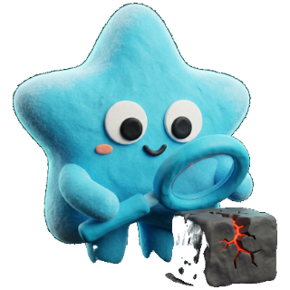<span class="av-nav-item__label">Scans</span></a>
    <span class="av-sidebar__head">Intel</span>
    <a class="av-nav-item" href="#"><span class="av-nav-item__label">Bulletins</span><span class="av-nav-item__badge">3 new</span></a>
    <span class="av-sidebar__head">Workspace</span>
    <a class="av-nav-item" href="#"><span class="av-nav-item__label">Settings</span></a>
  </nav>
  <div class="av-sidebar__foot"><div class="av-user"><span class="av-avatar">Z</span><span class="av-user__text"><span class="av-user__name">Zalak</span><span class="av-user__mail">zalak@avistar.ai</span></span></div><button class="av-sidebar__action"><svg class="av-icon" width="18" height="18" viewBox="0 0 24 24" fill="none" stroke="currentColor" stroke-width="1.6" stroke-linecap="round" stroke-linejoin="round" aria-hidden="true"><path d="M12 17a5 5 0 1 0 0-10 5 5 0 0 0 0 10zM12 1v2M12 21v2M4.2 4.2l1.4 1.4M18.4 18.4l1.4 1.4M1 12h2M21 12h2M4.2 19.8l1.4-1.4M18.4 5.6l1.4-1.4"/></svg>Light mode</button><button class="av-sidebar__action"><svg class="av-icon" width="18" height="18" viewBox="0 0 24 24" fill="none" stroke="currentColor" stroke-width="1.6" stroke-linecap="round" stroke-linejoin="round" aria-hidden="true"><path d="M4 4h16v16H4zM9 4v16M15 10l-2 2 2 2"/></svg>Collapse</button></div>
</aside>
```

#### Collapsed
```html
<aside class="av-sidebar av-sidebar--collapsed" style="height:560px;position:relative">
  <div class="av-sidebar__brand"></div>
  <nav class="av-sidebar__nav">
    <span class="av-sidebar__head">Organization</span>
    <a class="av-nav-item" href="#"><span class="av-nav-item__label">All clients</span></a>
    <a class="av-nav-item" href="#"><span class="av-nav-item__label">Manage clients</span></a>
    <a class="av-nav-item" href="#"><span class="av-nav-item__label">Members</span></a>
    <span class="av-sidebar__head">Client</span>
    <a class="av-nav-item" href="#" aria-current="page"><span class="av-nav-item__label">Overview</span></a>
    <a class="av-nav-item" href="#"><span class="av-nav-item__label">Findings</span><span class="av-nav-item__badge av-nav-item__badge--alert">293</span></a>
    <a class="av-nav-item" href="#"><span class="av-nav-item__label">Identities</span></a>
    <a class="av-nav-item" href="#"><span class="av-nav-item__label">Scans</span></a>
    <span class="av-sidebar__head">Intel</span>
    <a class="av-nav-item" href="#"><span class="av-nav-item__label">Bulletins</span><span class="av-nav-item__badge">3 new</span></a>
    <span class="av-sidebar__head">Workspace</span>
    <a class="av-nav-item" href="#"><span class="av-nav-item__label">Settings</span></a>
  </nav>
  <div class="av-sidebar__foot"><div class="av-user"><span class="av-avatar">Z</span><span class="av-user__text"><span class="av-user__name">Zalak</span><span class="av-user__mail">zalak@avistar.ai</span></span></div><button class="av-sidebar__action"><svg class="av-icon" width="18" height="18" viewBox="0 0 24 24" fill="none" stroke="currentColor" stroke-width="1.6" stroke-linecap="round" stroke-linejoin="round" aria-hidden="true"><path d="M12 17a5 5 0 1 0 0-10 5 5 0 0 0 0 10zM12 1v2M12 21v2M4.2 4.2l1.4 1.4M18.4 18.4l1.4 1.4M1 12h2M21 12h2M4.2 19.8l1.4-1.4M18.4 5.6l1.4-1.4"/></svg>Light mode</button><button class="av-sidebar__action"><svg class="av-icon" width="18" height="18" viewBox="0 0 24 24" fill="none" stroke="currentColor" stroke-width="1.6" stroke-linecap="round" stroke-linejoin="round" aria-hidden="true"><path d="M4 4h16v16H4zM9 4v16M15 10l-2 2 2 2"/></svg>Collapse</button></div>
</aside>
```

#### Mobile drawer (open)
```html
<header class="av-mobilebar">…menu button…</header>
<aside class="av-sidebar" id="av-nav" data-open="false">…</aside>
<script>
  const nav = document.getElementById('av-nav');
  menuBtn.onclick = () => { const o = nav.dataset.open !== 'true'; nav.dataset.open = o; menuBtn.setAttribute('aria-expanded', o); };
</script>
```

#### Mobile bar
```html
<header class="av-mobilebar" style="display:flex;position:relative"><button class="av-icon-btn" aria-label="Open menu" aria-expanded="false"><svg class="av-icon" width="18" height="18" viewBox="0 0 24 24" fill="none" stroke="currentColor" stroke-width="1.8" stroke-linecap="round" stroke-linejoin="round" aria-hidden="true"><path d="M8 6h12M8 12h12M8 18h12M4 6h.01M4 12h.01M4 18h.01"/></svg></button><span class="av-mobilebar__brand"><span style="font-size:14px;font-weight:600">Overview</span></span><button class="av-icon-btn" aria-label="Notifications"><svg class="av-icon" width="18" height="18" viewBox="0 0 24 24" fill="none" stroke="currentColor" stroke-width="1.6" stroke-linecap="round" stroke-linejoin="round" aria-hidden="true"><path d="M6 16V11a6 6 0 1 1 12 0v5l1.5 2h-15zM10 20.5a2 2 0 0 0 4 0"/></svg><span class="av-icon-btn__dot"></span></button></header>
```

#### Nav item states
```html
<div class="av-stack" style="width:min(240px,100%);gap:2px"><a class="av-nav-item" href="#" aria-current="page"><span class="av-nav-item__label">Active</span></a><a class="av-nav-item" href="#"><span class="av-nav-item__label">Default</span></a><a class="av-nav-item" href="#"><span class="av-nav-item__label">With alert badge</span><span class="av-nav-item__badge av-nav-item__badge--alert">293</span></a><a class="av-nav-item" href="#"><span class="av-nav-item__label">With neutral badge</span><span class="av-nav-item__badge">3 new</span></a></div>
```

#### Footer
```html
<div style="width:min(248px,100%);border:1px solid var(--av-border-subtle-00);border-radius:14px"><div class="av-sidebar__foot"><div class="av-user"><span class="av-avatar">Z</span><span class="av-user__text"><span class="av-user__name">Zalak</span><span class="av-user__mail">zalak@avistar.ai</span></span></div><button class="av-sidebar__action"><svg class="av-icon" width="18" height="18" viewBox="0 0 24 24" fill="none" stroke="currentColor" stroke-width="1.6" stroke-linecap="round" stroke-linejoin="round" aria-hidden="true"><path d="M12 17a5 5 0 1 0 0-10 5 5 0 0 0 0 10zM12 1v2M12 21v2M4.2 4.2l1.4 1.4M18.4 18.4l1.4 1.4M1 12h2M21 12h2M4.2 19.8l1.4-1.4M18.4 5.6l1.4-1.4"/></svg>Light mode</button><button class="av-sidebar__action"><svg class="av-icon" width="18" height="18" viewBox="0 0 24 24" fill="none" stroke="currentColor" stroke-width="1.6" stroke-linecap="round" stroke-linejoin="round" aria-hidden="true"><path d="M4 4h16v16H4zM9 4v16M15 10l-2 2 2 2"/></svg>Collapse</button></div></div>
```

### Top bar
64px, blurred background, context breadcrumb pill, primary CTA and notifications.

#### Dashboard
```html
<header class="av-topbar" style="position:relative">
  <nav aria-label="Context"><ol class="av-breadcrumb av-breadcrumb--context"><li>Avistar Demo Org</li><li class="av-breadcrumb__sep">/</li><li style="color:var(--av-text-primary)">Tidewell</li><li class="av-breadcrumb__sep">/</li><li style="display:flex;align-items:center;gap:8px"><span aria-current="page">Production Demo Account</span></li><li class="av-breadcrumb__chev"><svg class="av-icon" width="16" height="16" viewBox="0 0 24 24" fill="none" stroke="currentColor" stroke-width="2" stroke-linecap="round" stroke-linejoin="round" aria-hidden="true"><path d="M6 9l6 6 6-6"/></svg></li></ol></nav>
  <span class="av-topbar__spacer"></span>
  <button class="av-btn av-btn--primary"><svg class="av-icon" width="14" height="14" viewBox="0 0 24 24" fill="none" stroke="currentColor" stroke-width="2.2" stroke-linecap="round" stroke-linejoin="round" aria-hidden="true"><path d="M12 5v14M5 12h14"/></svg>Connect account</button>
  <button class="av-icon-btn" aria-label="Notifications"><svg class="av-icon" width="18" height="18" viewBox="0 0 24 24" fill="none" stroke="currentColor" stroke-width="1.6" stroke-linecap="round" stroke-linejoin="round" aria-hidden="true"><path d="M6 16V11a6 6 0 1 1 12 0v5l1.5 2h-15zM10 20.5a2 2 0 0 0 4 0"/></svg><span class="av-icon-btn__dot"></span></button>
</header>
```

#### Intro (org picker)
```html
<header class="av-topbar av-topbar--intro" style="position:relative">
  <span class="av-row" style="gap:10px"></span>
  <span class="av-topbar__spacer"></span>
  <span class="av-row" style="gap:12px"><span class="av-avatar av-avatar--md">Z</span><span style="font-size:13px;color:var(--av-text-muted-intro)">zalak@avistar.ai</span></span>
</header>
```

### Story banner
Contextual help strip at the top of each page: illustration, title, one line, “Help guide →”.

#### Default
```html
<div class="av-story"><div class="av-story__media" style="background-image:url(assets/illus/clay-flow-1k.jpg)" aria-hidden="true"></div><div class="av-story__body"><span class="av-story__title">Everything flows into one score.</span><span class="av-story__text">Every scan feeds the number below. Close the top three fixes and watch it climb.</span></div><a class="av-link av-link--action" href="#" style="font-size:13px">Help guide<svg class="av-icon" width="14" height="14" viewBox="0 0 24 24" fill="none" stroke="currentColor" stroke-width="2" stroke-linecap="round" stroke-linejoin="round" aria-hidden="true"><path d="M5 12h14M13 6l6 6-6 6"/></svg></a></div>
```

#### Large
```html
<div class="av-story av-story--lg"><div class="av-story__media" style="background-image:url(assets/illus/clay-flow-1k.jpg)" aria-hidden="true"></div><div class="av-story__body"><span class="av-story__title">Everything flows into one score.</span><span class="av-story__text">Every scan feeds the number below.</span></div><a class="av-link av-link--action" href="#">Help guide<svg class="av-icon" width="16" height="16" viewBox="0 0 24 24" fill="none" stroke="currentColor" stroke-width="2" stroke-linecap="round" stroke-linejoin="round" aria-hidden="true"><path d="M5 12h14M13 6l6 6-6 6"/></svg></a></div>
```

### Page header
Mono eyebrow (context) → H1 → one-line status. Actions bottom-right: link action then primary.

#### Overview
```html
<div class="av-page-head"><div class="av-page-head__text"><span class="av-eyebrow">Hydroponic Cloud Industries · 3 accounts</span><h1 class="av-page-head__title">Overview</h1><p class="av-page-head__sub">Last scan finished 2 hours ago. Your posture improved 6 points this week.</p></div><div class="av-page-head__actions"><a class="av-link av-link--action" href="#">Schedule scans<svg class="av-icon" width="16" height="16" viewBox="0 0 24 24" fill="none" stroke="currentColor" stroke-width="2" stroke-linecap="round" stroke-linejoin="round" aria-hidden="true"><path d="M5 12h14M13 6l6 6-6 6"/></svg></a><button class="av-btn av-btn--primary"><svg class="av-icon" width="14" height="14" viewBox="0 0 24 24" fill="currentColor" stroke="none" stroke-width="0" stroke-linecap="round" stroke-linejoin="round" aria-hidden="true"><path d="M7 5v14l11-7z"/></svg>Run scan</button></div></div>
```

#### With search + switcher
```html
<div class="av-page-head"><div class="av-page-head__text"><span class="av-eyebrow">Avistar Demo Org · 10 clients</span><h1 class="av-page-head__title">Your clients</h1></div><div class="av-page-head__actions" style="gap:12px"><div class="av-search" style="width:min(320px,100%)"><svg class="av-icon" width="18" height="18" viewBox="0 0 24 24" fill="none" stroke="currentColor" stroke-width="2" stroke-linecap="round" stroke-linejoin="round" aria-hidden="true"><path d="M11 18a7 7 0 1 0 0-14 7 7 0 0 0 0 14zM20 20l-4-4"/></svg><input class="av-search__input" placeholder="Search clients"></div><div class="av-switcher"><button aria-pressed="true"><svg class="av-icon" width="14" height="14" viewBox="0 0 24 24" fill="none" stroke="currentColor" stroke-width="1.8" stroke-linecap="round" stroke-linejoin="round" aria-hidden="true"><path d="M4 4h7v7H4zM13 4h7v7h-7zM4 13h7v7H4zM13 13h7v7h-7z"/></svg>Cards</button><button aria-pressed="false"><svg class="av-icon" width="14" height="14" viewBox="0 0 24 24" fill="none" stroke="currentColor" stroke-width="1.8" stroke-linecap="round" stroke-linejoin="round" aria-hidden="true"><path d="M8 6h12M8 12h12M8 18h12M4 6h.01M4 12h.01M4 18h.01"/></svg>List</button></div></div></div>
```

#### Secondary actions
```html
<div class="av-page-head"><div class="av-page-head__text"><span class="av-eyebrow">Avistar Demo Org</span><h1 class="av-page-head__title">All clients</h1><p class="av-page-head__sub">10 clients · 30 cloud accounts</p></div><div class="av-page-head__actions" style="gap:10px"><button class="av-btn av-btn--secondary">Portfolio report</button><button class="av-btn av-btn--primary"><svg class="av-icon" width="14" height="14" viewBox="0 0 24 24" fill="none" stroke="currentColor" stroke-width="2.2" stroke-linecap="round" stroke-linejoin="round" aria-hidden="true"><path d="M12 5v14M5 12h14"/></svg>Add client</button></div></div>
```

### Posture score
Hero card. Ring with brand-gradient value, gradient numeral, rating + delta chip, next-step hint, link. SVG ring = lightweight fallback. The production dot-matrix ring lives in Cards & graphs › Posture score card.

#### Card
```html
<div class="av-score-card"><div class="av-weave" aria-hidden="true"></div>
  <div class="av-score-ring "><svg viewBox="0 0 140 140" aria-hidden="true"><defs><linearGradient id="g1" x1="0" y1="1" x2="1" y2="0"><stop offset="0" stop-color="#FF4B1F"/><stop offset="1" stop-color="#1FDDFF"/></linearGradient></defs><circle class="av-score-ring__track" cx="70" cy="70" r="62" fill="none" stroke-width="10"/><circle class="av-score-ring__value" cx="70" cy="70" r="62" fill="none" stroke="url(#g1)" stroke-width="10" stroke-dasharray="389.6" stroke-dashoffset="140.3"/></svg><div class="av-score-ring__center"><span class="av-score-ring__num">64</span><span class="av-score-ring__of">/ 100</span></div></div>
  <div class="av-score-card__body"><span class="av-eyebrow">Posture score</span><div class="av-score-card__rating">Fair<span class="av-tag av-tag--delta"><svg class="av-icon" width="12" height="12" viewBox="0 0 24 24" fill="none" stroke="currentColor" stroke-width="2.2" stroke-linecap="round" stroke-linejoin="round" aria-hidden="true"><path d="M12 19V5M6 11l6-6 6 6"/></svg>6 this week</span></div><p class="av-score-card__hint">Close the 2 public buckets to reach <b>71</b>. That's about 4 minutes of work.</p><a class="av-link av-link--action" href="#" style="font-size:13px">Start with this fix<svg class="av-icon" width="14" height="14" viewBox="0 0 24 24" fill="none" stroke="currentColor" stroke-width="2" stroke-linecap="round" stroke-linejoin="round" aria-hidden="true"><path d="M5 12h14M13 6l6 6-6 6"/></svg></a></div>
</div>
```

#### Ring sizes
```html
<div class="av-row" style="gap:32px"><div class="av-score-ring "><svg viewBox="0 0 140 140" aria-hidden="true"><defs><linearGradient id="g2" x1="0" y1="1" x2="1" y2="0"><stop offset="0" stop-color="#FF4B1F"/><stop offset="1" stop-color="#1FDDFF"/></linearGradient></defs><circle class="av-score-ring__track" cx="70" cy="70" r="62" fill="none" stroke-width="10"/><circle class="av-score-ring__value" cx="70" cy="70" r="62" fill="none" stroke="url(#g2)" stroke-width="10" stroke-dasharray="389.6" stroke-dashoffset="54.5"/></svg><div class="av-score-ring__center"><span class="av-score-ring__num">86</span><span class="av-score-ring__of">/ 100</span></div></div><div class="av-score-ring av-score-ring--sm"><svg viewBox="0 0 140 140" aria-hidden="true"><defs><linearGradient id="g3" x1="0" y1="1" x2="1" y2="0"><stop offset="0" stop-color="#FF4B1F"/><stop offset="1" stop-color="#1FDDFF"/></linearGradient></defs><circle class="av-score-ring__track" cx="70" cy="70" r="62" fill="none" stroke-width="10"/><circle class="av-score-ring__value" cx="70" cy="70" r="62" fill="none" stroke="url(#g3)" stroke-width="10" stroke-dasharray="389.6" stroke-dashoffset="163.6"/></svg><div class="av-score-ring__center"><span class="av-score-ring__num">58</span><span class="av-score-ring__of">/ 100</span></div></div></div>
```

### KPI tile
4-up grid with hairline dividers. Glyph + label + sparkline · big number + unit · delta. Ion = improving, Orange = worsening. Glow tint per tile.

#### Grid
```html
<div class="av-kpi-grid">
  <button class="av-kpi av-kpi--ion"><div class="av-kpi__head"><span class="av-kpi__label">Open findings</span><svg class="av-kpi__spark" width="72" height="24" viewBox="0 0 72 24" fill="none"><path d="M2.0 3.0 L11.7 9.7 L21.4 4.3 L31.1 16.3 L40.9 13.0 L50.6 19.0 L60.3 16.3 L70.0 21.0" stroke="var(--av-support-low)" stroke-width="1.5" stroke-linecap="round" stroke-linejoin="round" pathLength="1"/></svg></div><div class="av-kpi__value"><span class="av-kpi__num">293</span><span class="av-kpi__unit">across 139 resources</span></div><span class="av-kpi__delta"><svg class="av-icon" width="12" height="12" viewBox="0 0 24 24" fill="none" stroke="currentColor" stroke-width="2.2" stroke-linecap="round" stroke-linejoin="round" aria-hidden="true"><path d="M12 5v14M6 13l6 6 6-6"/></svg>12 fewer than last scan</span></button>
  <button class="av-kpi av-kpi--signal"><div class="av-kpi__head"><span class="av-kpi__label">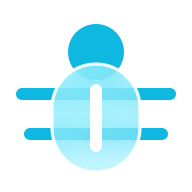Critical + high</span><svg class="av-kpi__spark" width="72" height="24" viewBox="0 0 72 24" fill="none"><path d="M2.0 21.0 L11.7 3.0 L21.4 15.0 L31.1 12.0 L40.9 18.0 L50.6 16.5 L60.3 21.0 L70.0 7.5" stroke="var(--av-support-high)" stroke-width="1.5" stroke-linecap="round" stroke-linejoin="round" pathLength="1"/></svg></div><div class="av-kpi__value"><span class="av-kpi__num">69</span><span class="av-kpi__unit">need action</span></div><span class="av-kpi__delta av-kpi__delta--up"><svg class="av-icon" width="12" height="12" viewBox="0 0 24 24" fill="none" stroke="currentColor" stroke-width="2.2" stroke-linecap="round" stroke-linejoin="round" aria-hidden="true"><path d="M12 19V5M6 11l6-6 6 6"/></svg>3 new since Oct 6</span></button>
  <button class="av-kpi av-kpi--ion"><div class="av-kpi__head"><span class="av-kpi__label">Risky identities</span><svg class="av-kpi__spark" width="72" height="24" viewBox="0 0 72 24" fill="none"><path d="M2.0 3.0 L11.7 6.0 L21.4 6.0 L31.1 9.0 L40.9 9.0 L50.6 12.0 L60.3 15.0 L70.0 21.0" stroke="var(--av-support-low)" stroke-width="1.5" stroke-linecap="round" stroke-linejoin="round" pathLength="1"/></svg></div><div class="av-kpi__value"><span class="av-kpi__num">18</span><span class="av-kpi__unit">of 48 non-human</span></div><span class="av-kpi__delta"><svg class="av-icon" width="12" height="12" viewBox="0 0 24 24" fill="none" stroke="currentColor" stroke-width="2.2" stroke-linecap="round" stroke-linejoin="round" aria-hidden="true"><path d="M12 5v14M6 13l6 6 6-6"/></svg>2 fewer this week</span></button>
  <button class="av-kpi av-kpi--signal"><div class="av-kpi__head"><span class="av-kpi__label">Coverage</span><svg class="av-kpi__spark" width="72" height="24" viewBox="0 0 72 24" fill="none"><path d="M2.0 21.0 L11.7 21.0 L21.4 21.0 L31.1 21.0 L40.9 3.0 L50.6 3.0 L60.3 3.0 L70.0 3.0" stroke="var(--av-support-high)" stroke-width="1.5" stroke-linecap="round" stroke-linejoin="round" pathLength="1"/></svg></div><div class="av-kpi__value"><span class="av-kpi__num">2/3</span><span class="av-kpi__unit">accounts scanned</span></div><span class="av-kpi__delta av-kpi__delta--up"><svg class="av-icon" width="12" height="12" viewBox="0 0 24 24" fill="none" stroke="currentColor" stroke-width="2.2" stroke-linecap="round" stroke-linejoin="round" aria-hidden="true"><path d="M12 19V5M6 11l6-6 6 6"/></svg>1 waiting on permissions</span></button>
</div>
```

#### Single
```html
<div class="av-kpi-grid" style="max-width:320px">  <button class="av-kpi av-kpi--ion"><div class="av-kpi__head"><span class="av-kpi__label">Open findings</span><svg class="av-kpi__spark" width="72" height="24" viewBox="0 0 72 24" fill="none"><path d="M2.0 3.0 L11.7 9.7 L21.4 4.3 L31.1 16.3 L40.9 13.0 L50.6 19.0 L60.3 16.3 L70.0 21.0" stroke="var(--av-support-low)" stroke-width="1.5" stroke-linecap="round" stroke-linejoin="round" pathLength="1"/></svg></div><div class="av-kpi__value"><span class="av-kpi__num">293</span><span class="av-kpi__unit">across 139 resources</span></div><span class="av-kpi__delta"><svg class="av-icon" width="12" height="12" viewBox="0 0 24 24" fill="none" stroke="currentColor" stroke-width="2.2" stroke-linecap="round" stroke-linejoin="round" aria-hidden="true"><path d="M12 5v14M6 13l6 6 6-6"/></svg>12 fewer than last scan</span></button></div>
```

### Client card
Intro picker card — dashed border, 4px radius. Name + meta, posture numeral coloured by scale, provider mono tags, footer with status dot and “Open →”. Archived = 50% + not-allowed.

#### Grid · all states
```html
<div class="av-client-grid">
  <button class="av-client-card">
    <span class="av-client-card__top"><span class="av-client-card__id"><span class="av-client-card__name">Hydroponic Cloud</span><span class="av-client-card__meta">AgriTech · 3 accounts</span></span><span class="av-client-card__score"><span class="av-client-card__num av-posture--poor">64</span><span class="av-client-card__label">POSTURE</span></span></span>
    <span class="av-client-card__tags"><span class="av-tag av-tag--mono">AWS</span><span class="av-tag av-tag--mono">AZURE</span><span class="av-tag av-tag--mono">GCP</span></span>
    <span class="av-client-card__foot"><span class="av-client-card__dot av-posture--poor"></span><span class="av-client-card__status">293 open · scanned 2h ago</span><span class="av-client-card__open">Open →</span></span>
  </button>
  <button class="av-client-card">
    <span class="av-client-card__top"><span class="av-client-card__id"><span class="av-client-card__name">Ashgrove Health</span><span class="av-client-card__meta">Healthcare · 4 accounts</span></span><span class="av-client-card__score"><span class="av-client-card__num av-posture--fair">78</span><span class="av-client-card__label">POSTURE</span></span></span>
    <span class="av-client-card__tags"><span class="av-tag av-tag--mono">AWS</span><span class="av-tag av-tag--mono">AZURE</span></span>
    <span class="av-client-card__foot"><span class="av-client-card__dot av-posture--fair"></span><span class="av-client-card__status">141 open · scanned 40m ago</span><span class="av-client-card__open">Open →</span></span>
  </button>
  <button class="av-client-card">
    <span class="av-client-card__top"><span class="av-client-card__id"><span class="av-client-card__name">Corvane</span><span class="av-client-card__meta">SaaS · 5 accounts</span></span><span class="av-client-card__score"><span class="av-client-card__num av-posture--good">86</span><span class="av-client-card__label">POSTURE</span></span></span>
    <span class="av-client-card__tags"><span class="av-tag av-tag--mono">AWS</span><span class="av-tag av-tag--mono">AZURE</span><span class="av-tag av-tag--mono">GCP</span></span>
    <span class="av-client-card__foot"><span class="av-client-card__dot av-posture--good"></span><span class="av-client-card__status">38 open · scanned 15m ago</span><span class="av-client-card__open">Open →</span></span>
  </button>
  <button class="av-client-card" disabled>
    <span class="av-client-card__top"><span class="av-client-card__id"><span class="av-client-card__name">Acme Health</span><span class="av-client-card__meta">Archived · no accounts</span></span><span class="av-client-card__score"><span class="av-client-card__num av-posture--none">—</span><span class="av-client-card__label">POSTURE</span></span></span>
    <span class="av-client-card__tags"></span>
    <span class="av-client-card__foot"><span class="av-client-card__dot av-posture--none"></span><span class="av-client-card__status">Archived</span></span>
  </button>
</div>
```

#### Poor
```html
<div style="max-width:300px">  <button class="av-client-card">
    <span class="av-client-card__top"><span class="av-client-card__id"><span class="av-client-card__name">Northpeak Clinics</span><span class="av-client-card__meta">Healthcare · 2 accounts</span></span><span class="av-client-card__score"><span class="av-client-card__num av-posture--poor">58</span><span class="av-client-card__label">POSTURE</span></span></span>
    <span class="av-client-card__tags"><span class="av-tag av-tag--mono">AZURE</span></span>
    <span class="av-client-card__foot"><span class="av-client-card__dot av-posture--poor"></span><span class="av-client-card__status">204 open · scanned 5h ago</span><span class="av-client-card__open">Open →</span></span>
  </button></div>
```

#### Good
```html
<div style="max-width:300px">  <button class="av-client-card">
    <span class="av-client-card__top"><span class="av-client-card__id"><span class="av-client-card__name">Harbor Dental Group</span><span class="av-client-card__meta">Healthcare · 1 account</span></span><span class="av-client-card__score"><span class="av-client-card__num av-posture--good">91</span><span class="av-client-card__label">POSTURE</span></span></span>
    <span class="av-client-card__tags"><span class="av-tag av-tag--mono">AWS</span></span>
    <span class="av-client-card__foot"><span class="av-client-card__dot av-posture--good"></span><span class="av-client-card__status">12 open · scanned 1h ago</span><span class="av-client-card__open">Open →</span></span>
  </button></div>
```

### Organization row
Mascot avatar with initials badge, name + meta, mono role tag, round settings button, arrow. Selected = solid border + inverse arrow.

#### List
```html
<div class="av-org-list">
  <div class="av-org-row" role="button" tabindex="0">
    <span class="av-org-row__avatar"><span class="av-org-row__init" style="color:var(--av-support-critical)">AD</span></span>
    <span class="av-org-row__text"><span class="av-org-row__name">Avistar Demo Org</span><span class="av-org-row__meta">10 clients · 30 cloud accounts</span></span>
    <span class="av-org-row__actions"><span class="av-tag av-tag--mono av-tag--role">OWNER</span><button class="av-icon-btn av-icon-btn--round" aria-label="Settings for Avistar Demo Org"><svg class="av-icon" width="18" height="18" viewBox="0 0 24 24" fill="none" stroke="currentColor" stroke-width="1.6" stroke-linecap="round" stroke-linejoin="round" aria-hidden="true"><path d="M12 15a3 3 0 1 0 0-6 3 3 0 0 0 0 6zM19.4 15a1.7 1.7 0 0 0 .3 1.8l.1.1a2 2 0 1 1-2.8 2.8l-.1-.1a1.7 1.7 0 0 0-1.8-.3 1.7 1.7 0 0 0-1 1.5V21a2 2 0 1 1-4 0v-.1a1.7 1.7 0 0 0-1.1-1.5 1.7 1.7 0 0 0-1.8.3l-.1.1a2 2 0 1 1-2.8-2.8l.1-.1a1.7 1.7 0 0 0 .3-1.8 1.7 1.7 0 0 0-1.5-1H3a2 2 0 1 1 0-4h.1a1.7 1.7 0 0 0 1.5-1.1 1.7 1.7 0 0 0-.3-1.8l-.1-.1a2 2 0 1 1 2.8-2.8l.1.1a1.7 1.7 0 0 0 1.8.3H9a1.7 1.7 0 0 0 1-1.5V3a2 2 0 1 1 4 0v.1a1.7 1.7 0 0 0 1 1.5 1.7 1.7 0 0 0 1.8-.3l.1-.1a2 2 0 1 1 2.8 2.8l-.1.1a1.7 1.7 0 0 0-.3 1.8V9a1.7 1.7 0 0 0 1.5 1H21a2 2 0 1 1 0 4h-.1a1.7 1.7 0 0 0-1.5 1z"/></svg></button><button class="av-icon-btn av-icon-btn--arrow" aria-label="Open"><svg class="av-icon" width="14" height="14" viewBox="0 0 24 24" fill="none" stroke="currentColor" stroke-width="2" stroke-linecap="round" stroke-linejoin="round" aria-hidden="true"><path d="M5 12h14M13 6l6 6-6 6"/></svg></button></span>
  </div>
  <div class="av-org-row" role="button" tabindex="0">
    <span class="av-org-row__avatar"><span class="av-org-row__init" style="color:var(--av-support-low)">RP</span></span>
    <span class="av-org-row__text"><span class="av-org-row__name">Ridgeway Partners MSP</span><span class="av-org-row__meta">3 clients · 7 cloud accounts</span></span>
    <span class="av-org-row__actions"><span class="av-tag av-tag--mono av-tag--role">ANALYST</span><button class="av-icon-btn av-icon-btn--round" aria-label="Settings for Ridgeway Partners MSP"><svg class="av-icon" width="18" height="18" viewBox="0 0 24 24" fill="none" stroke="currentColor" stroke-width="1.6" stroke-linecap="round" stroke-linejoin="round" aria-hidden="true"><path d="M12 15a3 3 0 1 0 0-6 3 3 0 0 0 0 6zM19.4 15a1.7 1.7 0 0 0 .3 1.8l.1.1a2 2 0 1 1-2.8 2.8l-.1-.1a1.7 1.7 0 0 0-1.8-.3 1.7 1.7 0 0 0-1 1.5V21a2 2 0 1 1-4 0v-.1a1.7 1.7 0 0 0-1.1-1.5 1.7 1.7 0 0 0-1.8.3l-.1.1a2 2 0 1 1-2.8-2.8l.1-.1a1.7 1.7 0 0 0 .3-1.8 1.7 1.7 0 0 0-1.5-1H3a2 2 0 1 1 0-4h.1a1.7 1.7 0 0 0 1.5-1.1 1.7 1.7 0 0 0-.3-1.8l-.1-.1a2 2 0 1 1 2.8-2.8l.1.1a1.7 1.7 0 0 0 1.8.3H9a1.7 1.7 0 0 0 1-1.5V3a2 2 0 1 1 4 0v.1a1.7 1.7 0 0 0 1 1.5 1.7 1.7 0 0 0 1.8-.3l.1-.1a2 2 0 1 1 2.8 2.8l-.1.1a1.7 1.7 0 0 0-.3 1.8V9a1.7 1.7 0 0 0 1.5 1H21a2 2 0 1 1 0 4h-.1a1.7 1.7 0 0 0-1.5 1z"/></svg></button><button class="av-icon-btn av-icon-btn--arrow" aria-label="Open"><svg class="av-icon" width="14" height="14" viewBox="0 0 24 24" fill="none" stroke="currentColor" stroke-width="2" stroke-linecap="round" stroke-linejoin="round" aria-hidden="true"><path d="M5 12h14M13 6l6 6-6 6"/></svg></button></span>
  </div>
</div>
```

#### Selected
```html
<div class="av-org-row" role="button" tabindex="0" aria-pressed="true">
    <span class="av-org-row__avatar"><span class="av-org-row__init" style="color:var(--av-support-critical)">AD</span></span>
    <span class="av-org-row__text"><span class="av-org-row__name">Avistar Demo Org</span><span class="av-org-row__meta">10 clients · 30 cloud accounts</span></span>
    <span class="av-org-row__actions"><span class="av-tag av-tag--mono av-tag--role">OWNER</span><button class="av-icon-btn av-icon-btn--round" aria-label="Settings for Avistar Demo Org"><svg class="av-icon" width="18" height="18" viewBox="0 0 24 24" fill="none" stroke="currentColor" stroke-width="1.6" stroke-linecap="round" stroke-linejoin="round" aria-hidden="true"><path d="M12 15a3 3 0 1 0 0-6 3 3 0 0 0 0 6zM19.4 15a1.7 1.7 0 0 0 .3 1.8l.1.1a2 2 0 1 1-2.8 2.8l-.1-.1a1.7 1.7 0 0 0-1.8-.3 1.7 1.7 0 0 0-1 1.5V21a2 2 0 1 1-4 0v-.1a1.7 1.7 0 0 0-1.1-1.5 1.7 1.7 0 0 0-1.8.3l-.1.1a2 2 0 1 1-2.8-2.8l.1-.1a1.7 1.7 0 0 0 .3-1.8 1.7 1.7 0 0 0-1.5-1H3a2 2 0 1 1 0-4h.1a1.7 1.7 0 0 0 1.5-1.1 1.7 1.7 0 0 0-.3-1.8l-.1-.1a2 2 0 1 1 2.8-2.8l.1.1a1.7 1.7 0 0 0 1.8.3H9a1.7 1.7 0 0 0 1-1.5V3a2 2 0 1 1 4 0v.1a1.7 1.7 0 0 0 1 1.5 1.7 1.7 0 0 0 1.8-.3l.1-.1a2 2 0 1 1 2.8 2.8l-.1.1a1.7 1.7 0 0 0-.3 1.8V9a1.7 1.7 0 0 0 1.5 1H21a2 2 0 1 1 0 4h-.1a1.7 1.7 0 0 0-1.5 1z"/></svg></button><button class="av-icon-btn av-icon-btn--arrow" aria-pressed="true" aria-label="Open"><svg class="av-icon" width="14" height="14" viewBox="0 0 24 24" fill="none" stroke="currentColor" stroke-width="2" stroke-linecap="round" stroke-linejoin="round" aria-hidden="true"><path d="M6 9l6 6 6-6"/></svg></button></span>
  </div>
```

### Welcome hero
Intro screen: brand chip, display heading with gradient name, intro copy, list label, XL primary.

#### Hero
```html
<div class="av-welcome">
  <span class="av-brand-chip">SECURITY COMMAND CENTER</span>
  <h1 class="av-welcome__title">Welcome back, <span class="av-text-gradient">Zalak</span>.</h1>
  <p class="av-welcome__lead">Choose an organization, then the client whose cloud you want to review. You can switch either one later from the account menu.</p>
  <span class="av-eyebrow" style="color:var(--av-text-label)">Organizations</span>
  <button class="av-btn av-btn--primary av-btn--xl" style="align-self:flex-start"><svg class="av-icon" width="16" height="16" viewBox="0 0 24 24" fill="none" stroke="currentColor" stroke-width="2.2" stroke-linecap="round" stroke-linejoin="round" aria-hidden="true"><path d="M12 5v14M5 12h14"/></svg>Create organization</button>
</div>
```

### Intro frame
Dashed panel (16px radius), centred statement and mono stats footer.

#### Frame
```html
<div class="av-frame" style="min-height:340px">
  <div class="av-frame__body"><p class="av-frame__statement">Secure non-human identities<br>with <span class="av-text-gradient">AI-powered</span> filtering.</p></div>
  <div class="av-frame__stats"><span>2 ORGANIZATIONS</span><span>LAST SIGN-IN · TODAY 09:12</span></div>
</div>
```

### Avatar
Initial circle (Ion letter on layer-03), square org/identity avatar, stacked group, presence dot.

#### Sizes
```html
<div class="av-row" style="gap:20px"><span class="av-avatar av-avatar--sm">Z</span><span class="av-avatar">Z</span><span class="av-avatar av-avatar--md">Z</span><span class="av-avatar av-avatar--lg">ZP</span></div>
```

#### Square
```html
<div class="av-row"><span class="av-avatar av-avatar--square">NW</span><span class="av-avatar av-avatar--square" style="color:var(--av-support-low)">CI</span></div>
```

#### Stack
```html
<span class="av-avatar-stack"><span class="av-avatar av-avatar--md">ZP</span><span class="av-avatar av-avatar--md" style="color:var(--av-support-medium)">AK</span><span class="av-avatar av-avatar--md" style="color:var(--av-support-high)">MR</span><span class="av-avatar av-avatar--md" style="color:var(--av-text-tertiary)">+4</span></span>
```

#### With presence + text
```html
<div class="av-user"><span class="av-avatar av-avatar--md">Z<span class="av-avatar__presence"></span></span><span class="av-user__text"><span class="av-user__name">Zalak</span><span class="av-user__mail">zalak@avistar.ai</span></span></div>
```

### Fix list
“Fix these first” — ranked findings with severity, resource, effort and one action each.

#### List
```html
<div class="av-stack" style="gap:14px"><div class="av-section-head"><div class="av-stack" style="gap:4px"><h2 class="av-section-head__title">Fix these first</h2><span class="av-section-head__sub">Ranked by score impact. One fix each.</span></div></div>
<div class="av-fix-list">
  <div class="av-fix"><span class="av-fix__rank">01</span><span class="av-fix__body"><span class="av-fix__title">S3 bucket is publicly readable</span><span class="av-fix__meta"><span class="av-tag av-tag--critical"><span class="av-tag__dot"></span>Critical</span>hci-exports-prod · +4 pts</span></span><span class="av-fix__effort">~2 min</span><button class="av-btn av-btn--secondary av-btn--sm">Fix</button></div>
  <div class="av-fix"><span class="av-fix__rank">02</span><span class="av-fix__body"><span class="av-fix__title">Access key unused for 412 days</span><span class="av-fix__meta"><span class="av-tag av-tag--high"><span class="av-tag__dot"></span>High</span>AKIA…7Q2F · +2 pts</span></span><span class="av-fix__effort">~1 min</span><button class="av-btn av-btn--secondary av-btn--sm">Fix</button></div>
  <div class="av-fix"><span class="av-fix__rank">03</span><span class="av-fix__body"><span class="av-fix__title">Role allows iam:* on all resources</span><span class="av-fix__meta"><span class="av-tag av-tag--medium"><span class="av-tag__dot"></span>Medium</span>ci-deploy-runner · +1 pt</span></span><span class="av-fix__effort">~5 min</span><button class="av-btn av-btn--secondary av-btn--sm">Fix</button></div>
</div></div>
```

### Charts
Sparkline (72×24, 1.5 stroke), stacked severity bar, trend bars with brand gradient, legend rows.

#### Sparklines
```html
<div class="av-row" style="gap:24px"><svg width="72" height="24" viewBox="0 0 72 24" fill="none"><path d="M2.0 3.0 L11.7 9.7 L21.4 4.3 L31.1 16.3 L40.9 13.0 L50.6 19.0 L60.3 16.3 L70.0 21.0" stroke="var(--av-support-low)" stroke-width="1.5" stroke-linecap="round" stroke-linejoin="round"/></svg><svg width="72" height="24" viewBox="0 0 72 24" fill="none"><path d="M2.0 21.0 L11.7 3.0 L21.4 15.0 L31.1 12.0 L40.9 18.0 L50.6 16.5 L60.3 21.0 L70.0 7.5" stroke="var(--av-support-high)" stroke-width="1.5" stroke-linecap="round" stroke-linejoin="round"/></svg></div>
```

#### Severity stack
```html
<div class="av-chart-card" style="max-width:420px"><div class="av-chart-card__head">Open by severity<span class="av-mono" style="font-size:11px;color:var(--av-text-helper)">293</span></div><div class="av-stackbar"><span style="flex:5;background:var(--av-support-critical)"></span><span style="flex:64;background:var(--av-support-high)"></span><span style="flex:133;background:var(--av-support-medium)"></span><span style="flex:91;background:var(--av-support-low)"></span></div><div class="av-legend"><div class="av-legend__row"><span class="av-legend__sw" style="background:var(--av-support-critical)"></span><span class="av-legend__n">Critical</span><span class="av-legend__v">5</span></div><div class="av-legend__row"><span class="av-legend__sw" style="background:var(--av-support-high)"></span><span class="av-legend__n">High</span><span class="av-legend__v">64</span></div><div class="av-legend__row"><span class="av-legend__sw" style="background:var(--av-support-medium)"></span><span class="av-legend__n">Medium</span><span class="av-legend__v">133</span></div><div class="av-legend__row"><span class="av-legend__sw" style="background:var(--av-support-low)"></span><span class="av-legend__n">Low</span><span class="av-legend__v">91</span></div></div></div>
```

#### Trend bars
```html
<div class="av-chart-card" style="max-width:420px"><div class="av-chart-card__head">Findings by week<span class="av-eyebrow">12 weeks</span></div><div class="av-bars"><span class="av-bars__bar" style="height:40%"></span><span class="av-bars__bar" style="height:55%"></span><span class="av-bars__bar" style="height:35%"></span><span class="av-bars__bar" style="height:70%"></span><span class="av-bars__bar" style="height:62%"></span><span class="av-bars__bar" style="height:85%"></span><span class="av-bars__bar" style="height:48%"></span><span class="av-bars__bar" style="height:66%"></span><span class="av-bars__bar" style="height:90%"></span><span class="av-bars__bar" style="height:58%"></span><span class="av-bars__bar" style="height:52%"></span><span class="av-bars__bar" style="height:44%"></span></div></div>
```

### Empty & error
Mascot + title + one line + one action. Dashed border for empty, solid for error.

#### Empty
```html
<div class="av-empty"><h3 class="av-empty__title">No clouds connected</h3><p class="av-empty__text">Connect AWS, GCP or Azure to start mapping machine identities.</p><button class="av-btn av-btn--primary"><svg class="av-icon" width="14" height="14" viewBox="0 0 24 24" fill="none" stroke="currentColor" stroke-width="2.2" stroke-linecap="round" stroke-linejoin="round" aria-hidden="true"><path d="M12 5v14M5 12h14"/></svg>Connect a cloud</button></div>
```

#### Error
```html
<div class="av-empty av-empty--error"><h3 class="av-empty__title">Couldn't load findings</h3><p class="av-empty__text">The scanner timed out. Your data is safe — try again.</p><button class="av-btn av-btn--secondary"><svg class="av-icon" width="14" height="14" viewBox="0 0 24 24" fill="none" stroke="currentColor" stroke-width="1.8" stroke-linecap="round" stroke-linejoin="round" aria-hidden="true"><path d="M20 11a8 8 0 0 0-14.5-4.5L4 8M4 4v4h4M4 13a8 8 0 0 0 14.5 4.5L20 16M20 20v-4h-4"/></svg>Retry</button></div>
```

#### No results
```html
<div class="av-empty"><h3 class="av-empty__title">No clients match “zeta”</h3><button class="av-btn av-btn--ghost">Clear search</button></div>
```

#### Inline (in menu)
```html
<div class="av-empty av-empty--inline">This client is archived and has no accounts.</div>
```

## Cards & graphs

### Card anatomy
Every dashboard card = .av-card (16px radius, layer-01, hairline) + optional glow + optional line-weave corner + head (glass glyph 28 or tile 44, title 18/600, sub 13).

#### Default
```html
<div class="av-card"><div class="av-card__head"><span class="av-card__heading"><h2 class="av-card__title">Activity</h2><span class="av-card__sub">Last 24 hours</span></span></div><p style="margin:0;font-size:13px;color:var(--av-text-tertiary)">Card content</p></div>
```

#### Glow · ion + weave
```html
<div class="av-card av-card--glow-ion"><div class="av-weave" aria-hidden="true"></div><div class="av-card__head"><span class="av-card__heading"><h2 class="av-card__title">Compliance</h2><span class="av-card__sub">Controls passing per framework</span></span></div></div>
```

#### Glow · signal + weave
```html
<div class="av-card av-card--glow-signal"><div class="av-weave" aria-hidden="true"></div><div class="av-card__head"><span class="av-card__heading"><h2 class="av-card__title">By severity</h2><span class="av-card__sub">Open findings over 30 days</span></span></div></div>
```

#### Weave bottom-left
```html
<div class="av-card" style="min-height:160px"><div class="av-weave av-weave--bl" aria-hidden="true"></div><div class="av-card__head"><span class="av-card__tile"></span><span class="av-card__heading"><h2 class="av-card__title">Identity mix</h2><span class="av-card__sub">4,602 identities discovered</span></span></div></div>
```

#### Hero glow
```html
<div class="av-card av-card--glow-hero" style="min-height:140px"><div class="av-weave" aria-hidden="true"></div><div class="av-card__head"><span class="av-card__heading"><h2 class="av-card__title">Identities found</h2><span class="av-card__sub">Last run · Oct 13, 8:41 PM</span></span></div></div>
```

### Posture score card
Dot-matrix ring (Ion→Signal gradient on the scored arc, muted squares for the remainder) drawn by av-charts.js. Gradient numeral, rating + delta, hint, link.

#### Card
```html
<div class="av-score-card" style="max-width:420px;flex-direction:column;align-items:flex-start"><div class="av-weave" aria-hidden="true"></div><div class="av-weave av-weave--bl" aria-hidden="true"></div>
  <div class="av-dotring" style="width:min(200px,100%)">
  <canvas data-av-ring data-values='[64,36]' data-colors='["#FF4B1F","var(--av-border-strong-02)"]' data-grad aria-hidden="true"></canvas>
  <div class="av-dotring__center"><span class="av-dotring__num av-dotring__num--brand" style="font-size:52px">64</span><span class="av-dotring__label">/ 100</span></div>
</div>
  <div class="av-score-card__body"><span class="av-eyebrow">Posture score</span><div class="av-score-card__rating">Fair<span class="av-tag av-tag--delta"><svg class="av-icon" width="12" height="12" viewBox="0 0 24 24" fill="none" stroke="currentColor" stroke-width="2.2" stroke-linecap="round" stroke-linejoin="round" aria-hidden="true"><path d="M12 19V5M6 11l6-6 6 6"/></svg>6 this week</span></div><p class="av-score-card__hint">Close the 2 public buckets to reach <b>71</b>. That's about 4 minutes of work.</p><a class="av-link av-link--action" href="#" style="font-size:13px">Start with this fix<svg class="av-icon" width="14" height="14" viewBox="0 0 24 24" fill="none" stroke="currentColor" stroke-width="2" stroke-linecap="round" stroke-linejoin="round" aria-hidden="true"><path d="M5 12h14M13 6l6 6-6 6"/></svg></a></div>
</div>
```

#### Horizontal
```html
<div class="av-score-card"><div class="av-weave" aria-hidden="true"></div>
  <div class="av-dotring" style="width:min(160px,100%)">
  <canvas data-av-ring data-values='[64,36]' data-colors='["#FF4B1F","var(--av-border-strong-02)"]' data-grad aria-hidden="true"></canvas>
  <div class="av-dotring__center"><span class="av-dotring__num av-dotring__num--brand" style="font-size:44px">64</span><span class="av-dotring__label">/ 100</span></div>
</div>
  <div class="av-score-card__body"><span class="av-eyebrow">Posture score</span><div class="av-score-card__rating">Fair<span class="av-tag av-tag--delta"><svg class="av-icon" width="12" height="12" viewBox="0 0 24 24" fill="none" stroke="currentColor" stroke-width="2.2" stroke-linecap="round" stroke-linejoin="round" aria-hidden="true"><path d="M12 19V5M6 11l6-6 6 6"/></svg>6 this week</span></div><p class="av-score-card__hint">Close the 2 public buckets to reach <b>71</b>.</p></div>
</div>
```

#### Score states
```html
<div class="av-row" style="gap:28px"><div class="av-stack" style="align-items:center;gap:8px"><div class="av-dotring" style="width:min(120px,100%)">
  <canvas data-av-ring data-values='[42,58]' data-colors='["#FF4B1F","var(--av-border-strong-02)"]' data-grad aria-hidden="true"></canvas>
  <div class="av-dotring__center"><span class="av-dotring__num av-dotring__num--brand" style="font-size:30px">42</span><span class="av-dotring__label">/ 100</span></div>
</div><span class="av-eyebrow">Poor</span></div><div class="av-stack" style="align-items:center;gap:8px"><div class="av-dotring" style="width:min(120px,100%)">
  <canvas data-av-ring data-values='[64,36]' data-colors='["#FF4B1F","var(--av-border-strong-02)"]' data-grad aria-hidden="true"></canvas>
  <div class="av-dotring__center"><span class="av-dotring__num av-dotring__num--brand" style="font-size:30px">64</span><span class="av-dotring__label">/ 100</span></div>
</div><span class="av-eyebrow">Fair</span></div><div class="av-stack" style="align-items:center;gap:8px"><div class="av-dotring" style="width:min(120px,100%)">
  <canvas data-av-ring data-values='[88,12]' data-colors='["#FF4B1F","var(--av-border-strong-02)"]' data-grad aria-hidden="true"></canvas>
  <div class="av-dotring__center"><span class="av-dotring__num av-dotring__num--brand" style="font-size:30px">88</span><span class="av-dotring__label">/ 100</span></div>
</div><span class="av-eyebrow">Good</span></div></div>
```

### Fix card
“Fix these first” cards: WebGL orb (orb.js) tinted by severity, mono severity pill, title + resource, dashed stat row (score gain in Ion), full-width Fix now. Tint = severity colour at 13% glow / 22% border.

#### Row of three
```html
<div class="av-fix-grid">
  <article class="av-fix-card av-fix-card--critical">
    <div class="av-weave" aria-hidden="true"></div>
    <div class="av-fix-card__top"><canvas class="av-fix-card__orb" data-av-orb="critical" aria-hidden="true"></canvas><span class="av-sev-pill av-sev-pill--critical">critical</span></div>
    <div class="av-fix-card__body"><span class="av-fix-card__title">Block public write on 2 buckets</span><span class="av-fix-card__meta">S3 · Production Demo</span></div>
    <div class="av-fix-card__stats"><div class="av-fix-card__stat"><span>Score</span><b class="av-fix-card__gain">+7</b></div><div class="av-fix-card__stat"><span>Clears</span><b>2 critical</b></div><div class="av-fix-card__stat"><span>Effort</span><b>~4 min</b></div></div>
    <button class="av-btn av-btn--primary">Fix now</button>
  </article>
  <article class="av-fix-card av-fix-card--high">
    <div class="av-weave" aria-hidden="true"></div>
    <div class="av-fix-card__top"><canvas class="av-fix-card__orb" data-av-orb="high" aria-hidden="true"></canvas><span class="av-sev-pill av-sev-pill--high">high</span></div>
    <div class="av-fix-card__body"><span class="av-fix-card__title">Rotate 3 stale access keys</span><span class="av-fix-card__meta">IAM · Production Demo</span></div>
    <div class="av-fix-card__stats"><div class="av-fix-card__stat"><span>Score</span><b class="av-fix-card__gain">+4</b></div><div class="av-fix-card__stat"><span>Clears</span><b>3 high</b></div><div class="av-fix-card__stat"><span>Effort</span><b>~3 min</b></div></div>
    <button class="av-btn av-btn--primary">Fix now</button>
  </article>
  <article class="av-fix-card av-fix-card--medium">
    <div class="av-weave" aria-hidden="true"></div>
    <div class="av-fix-card__top"><canvas class="av-fix-card__orb" data-av-orb="medium" aria-hidden="true"></canvas><span class="av-sev-pill av-sev-pill--medium">medium</span></div>
    <div class="av-fix-card__body"><span class="av-fix-card__title">Enable TLS on 31 endpoints</span><span class="av-fix-card__meta">Transmission · Production Demo</span></div>
    <div class="av-fix-card__stats"><div class="av-fix-card__stat"><span>Score</span><b class="av-fix-card__gain">+3</b></div><div class="av-fix-card__stat"><span>Clears</span><b>31 medium</b></div><div class="av-fix-card__stat"><span>Effort</span><b>~5 min</b></div></div>
    <button class="av-btn av-btn--primary">Fix now</button>
  </article>
</div>
```

#### Single
```html
<div style="max-width:320px">  <article class="av-fix-card av-fix-card--critical">
    <div class="av-weave" aria-hidden="true"></div>
    <div class="av-fix-card__top"><canvas class="av-fix-card__orb" data-av-orb="critical" aria-hidden="true"></canvas><span class="av-sev-pill av-sev-pill--critical">critical</span></div>
    <div class="av-fix-card__body"><span class="av-fix-card__title">Block public write on 2 buckets</span><span class="av-fix-card__meta">S3 · Production Demo</span></div>
    <div class="av-fix-card__stats"><div class="av-fix-card__stat"><span>Score</span><b class="av-fix-card__gain">+7</b></div><div class="av-fix-card__stat"><span>Clears</span><b>2 critical</b></div><div class="av-fix-card__stat"><span>Effort</span><b>~4 min</b></div></div>
    <button class="av-btn av-btn--primary">Fix now</button>
  </article></div>
```

#### Severity pills
```html
<div class="av-row" style="gap:8px"><span class="av-sev-pill">Critical</span><span class="av-sev-pill av-sev-pill--high">High</span><span class="av-sev-pill av-sev-pill--medium">Medium</span><span class="av-sev-pill av-sev-pill--low">Low</span></div>
```

### Findings raised
24-month bar chart: thin 2px ink bars (hover → 4px Signal), mono big stats with dashed divider, axis note. Bar height = value / max × 92%.

#### Card
```html
<div class="av-card av-card--glow-ion"><div class="av-weave" aria-hidden="true"></div>
  <div style="display:flex;flex-wrap:wrap;justify-content:space-between;align-items:flex-start;gap:16px 24px">
    <div class="av-bigstats"><div class="av-bigstat"><span class="av-bigstat__k">[!] Findings raised</span><span class="av-bigstat__v">64,890</span><span class="av-bigstat__s">Last 12 months · all accounts</span></div><div class="av-bigstat"><span class="av-bigstat__k">[↑] Peak month</span><span class="av-bigstat__v">Aug</span><span class="av-bigstat__s">8,850 findings</span></div></div>
    <div class="av-axis-note"><span>// X-AXIS: <b>MONTHS</b></span><span>// Y-AXIS: <b>FINDINGS</b></span></div>
  </div>
  <div class="av-card__rule"></div>
  <div class="av-stack" style="gap:12px;padding-top:8px">
    <div class="av-month-bars"><div class="av-month-bars__col" title="Jan 2025: 3,010"><span class="av-month-bars__bar" style="height:30.4%"></span></div><div class="av-month-bars__col" title="Feb 2025: 8,690"><span class="av-month-bars__bar" style="height:87.9%"></span></div><div class="av-month-bars__col" title="Mar 2025: 5,070"><span class="av-month-bars__bar" style="height:51.3%"></span></div><div class="av-month-bars__col" title="Apr 2025: 6,180"><span class="av-month-bars__bar" style="height:62.5%"></span></div><div class="av-month-bars__col" title="May 2025: 4,590"><span class="av-month-bars__bar" style="height:46.4%"></span></div><div class="av-month-bars__col" title="Jun 2025: 7,860"><span class="av-month-bars__bar" style="height:79.5%"></span></div><div class="av-month-bars__col" title="Jul 2025: 4,080"><span class="av-month-bars__bar" style="height:41.2%"></span></div><div class="av-month-bars__col" title="Aug 2025: 9,100"><span class="av-month-bars__bar" style="height:92.0%"></span></div><div class="av-month-bars__col" title="Sep 2025: 5,960"><span class="av-month-bars__bar" style="height:60.3%"></span></div><div class="av-month-bars__col" title="Oct 2025: 4,950"><span class="av-month-bars__bar" style="height:50.0%"></span></div><div class="av-month-bars__col" title="Nov 2025: 8,010"><span class="av-month-bars__bar" style="height:81.0%"></span></div><div class="av-month-bars__col" title="Dec 2025: 2,330"><span class="av-month-bars__bar" style="height:23.6%"></span></div><div class="av-month-bars__col" title="Jan 2026: 3,020"><span class="av-month-bars__bar" style="height:30.5%"></span></div><div class="av-month-bars__col" title="Feb 2026: 7,570"><span class="av-month-bars__bar" style="height:76.5%"></span></div><div class="av-month-bars__col" title="Mar 2026: 4,690"><span class="av-month-bars__bar" style="height:47.4%"></span></div><div class="av-month-bars__col" title="Apr 2026: 5,860"><span class="av-month-bars__bar" style="height:59.2%"></span></div><div class="av-month-bars__col" title="May 2026: 4,190"><span class="av-month-bars__bar" style="height:42.4%"></span></div><div class="av-month-bars__col" title="Jun 2026: 7,180"><span class="av-month-bars__bar" style="height:72.6%"></span></div><div class="av-month-bars__col" title="Jul 2026: 3,700"><span class="av-month-bars__bar" style="height:37.4%"></span></div><div class="av-month-bars__col" title="Aug 2026: 8,850" aria-current="true"><span class="av-month-bars__bar" style="height:89.5%"></span></div><div class="av-month-bars__col" title="Sep 2026: 5,620"><span class="av-month-bars__bar" style="height:56.8%"></span></div><div class="av-month-bars__col" title="Oct 2026: 4,590"><span class="av-month-bars__bar" style="height:46.4%"></span></div><div class="av-month-bars__col" title="Nov 2026: 7,380"><span class="av-month-bars__bar" style="height:74.6%"></span></div><div class="av-month-bars__col" title="Dec 2026: 2,240"><span class="av-month-bars__bar" style="height:22.6%"></span></div></div>
    <div class="av-month-labels"><span></span><span>Feb</span><span></span><span>Apr</span><span></span><span>Jun</span><span></span><span>Aug</span><span></span><span>Oct</span><span></span><span>Dec</span><span></span><span>Feb</span><span></span><span>Apr</span><span></span><span>Jun</span><span></span><span>Aug</span><span></span><span>Oct</span><span></span><span>Dec</span></div>
  </div>
</div>
```

### Severity trend
Line + area (30 days) with dashed forecast (+14d), “now” marker, projected end marker with inverse tooltip, and severity rows that filter the line on hover.

#### Card
```html
<div class="av-card av-card--glow-signal" style="max-width:460px"><div class="av-weave" aria-hidden="true"></div>
  <div class="av-card__head"><span class="av-card__heading"><h2 class="av-card__title">By severity</h2><span class="av-card__sub">Open findings over 30 days · hover a severity</span></span></div>
  <div class="av-stack" style="gap:10px">
    <div style="display:flex;align-items:baseline;gap:8px"><span class="av-kpi__num">293</span><span style="font-size:13px;color:var(--av-text-tertiary)">open today</span></div>
    <div class="av-trend">
      <svg viewBox="0 0 400 190" preserveAspectRatio="none" aria-hidden="true"><defs><linearGradient id="svLine" x1="0" x2="1"><stop offset="0" stop-color="#FF4B1F"/><stop offset="1" stop-color="#1FDDFF"/></linearGradient><linearGradient id="svArea" x1="0" y1="0" x2="0" y2="1"><stop offset="0" stop-color="#1FDDFF" stop-opacity=".22"/><stop offset="1" stop-color="#1FDDFF" stop-opacity="0"/></linearGradient></defs>
        <line class="av-trend__grid" x1="0" y1="10" x2="400" y2="10" vector-effect="non-scaling-stroke"/><line class="av-trend__grid" x1="0" y1="70" x2="400" y2="70" vector-effect="non-scaling-stroke"/><line class="av-trend__grid" x1="0" y1="130" x2="400" y2="130" vector-effect="non-scaling-stroke"/><line class="av-trend__grid" x1="0" y1="190" x2="400" y2="190" vector-effect="non-scaling-stroke"/>
        <path d="M0.0 176.2 C20.0 176.2 20.0 162.5 40.0 162.5 C60.0 162.5 60.0 168.2 80.0 168.2 C100.0 168.2 100.0 146.5 120.0 146.5 C140.0 146.5 140.0 125.9 160.0 125.9 C180.0 125.9 180.0 130.5 200.0 130.5 C220.0 130.5 220.0 108.8 240.0 108.8 C260.0 108.8 260.0 83.6 280.0 83.6 L280.0 190 L0 190 Z" fill="url(#svArea)"/>
        <line x1="280.0" y1="0" x2="280.0" y2="190" stroke="var(--av-border-strong-02)" stroke-dasharray="3 4" vector-effect="non-scaling-stroke"/>
        <path d="M0.0 176.2 C20.0 176.2 20.0 162.5 40.0 162.5 C60.0 162.5 60.0 168.2 80.0 168.2 C100.0 168.2 100.0 146.5 120.0 146.5 C140.0 146.5 140.0 125.9 160.0 125.9 C180.0 125.9 180.0 130.5 200.0 130.5 C220.0 130.5 220.0 108.8 240.0 108.8 C260.0 108.8 260.0 83.6 280.0 83.6" fill="none" stroke="url(#svLine)" stroke-width="2.5" stroke-linecap="round" vector-effect="non-scaling-stroke"/>
        <path d="M280.0 83.6 C300.0 83.6 300.0 69.9 320.0 69.9 C340.0 69.9 340.0 50.4 360.0 50.4 C380.0 50.4 380.0 32.2 400.0 32.2" fill="none" stroke="#1FDDFF" stroke-width="2.5" stroke-linecap="round" stroke-dasharray="5 6" vector-effect="non-scaling-stroke"/>
      </svg>
      <span class="av-trend__now" style="left:70.0%;top:44.0%"></span>
      <span class="av-trend__end" style="left:100%;top:16.9%"></span>
      <span class="av-trend__tip" style="top:16.9%">338 projected</span>
      <span class="av-trend__fc" style="left:calc(70.0% + 8px)">Forecast</span>
    </div>
    <div class="av-trend-axis"><span>30d ago</span><span>Today</span><span>+14d</span></div>
  </div>
  <div class="av-sev-rows"><button class="av-sev-rows__row"><span class="av-sev-rows__dot" style="background:var(--av-support-critical)"></span><span class="av-sev-rows__l">Critical</span><span class="av-sev-rows__n">5</span><span class="av-sev-rows__p">1.7%</span></button><button class="av-sev-rows__row"><span class="av-sev-rows__dot" style="background:var(--av-support-high)"></span><span class="av-sev-rows__l">High</span><span class="av-sev-rows__n">64</span><span class="av-sev-rows__p">21.8%</span></button><button class="av-sev-rows__row"><span class="av-sev-rows__dot" style="background:var(--av-support-medium)"></span><span class="av-sev-rows__l">Medium</span><span class="av-sev-rows__n">133</span><span class="av-sev-rows__p">45.4%</span></button><button class="av-sev-rows__row"><span class="av-sev-rows__dot" style="background:var(--av-support-low)"></span><span class="av-sev-rows__l">Low</span><span class="av-sev-rows__n">91</span><span class="av-sev-rows__p">31.1%</span></button></div>
</div>
```

### Identity mix
Dot-matrix donut with period switcher and legend rows (count + %). Hovering a row sets data-hi on the ring to dim other segments.

#### Card
```html
<div class="av-card"><div class="av-weave av-weave--bl" aria-hidden="true"></div>
  <div style="display:flex;flex-wrap:wrap;align-items:center;gap:16px"><div style="flex:1;min-width:min(220px,100%)"><div class="av-card__head"><span class="av-card__tile"></span><span class="av-card__heading"><h2 class="av-card__title">Identity mix</h2><span class="av-card__sub">4,602 identities discovered</span></span></div></div><div class="av-period" role="group"><button aria-pressed="false">Week</button><button aria-pressed="true">Month</button><button aria-pressed="false">Quarter</button><button aria-pressed="false">Year</button></div></div>
  <div style="display:grid;grid-template-columns:repeat(auto-fit,minmax(min(100%,220px),1fr));gap:24px;align-items:center">
    <div class="av-dotring" style="width:min(240px,100%)">
  <canvas data-av-ring data-values='[1180,1904,412,866,240]' data-colors='["var(--av-text-primary)","#FF4B1F","#1FDDFF","#FFB547","var(--av-support-neutral)"]' aria-hidden="true"></canvas>
  <div class="av-dotring__center"><span class="av-dotring__num" style="font-size:34px">4,602</span><span class="av-dotring__label">identities</span></div>
</div>
    <div class="av-legend-rows"><div class="av-legend-rows__row"><span class="av-legend-rows__dot" style="background:var(--av-text-primary)"></span><span class="av-legend-rows__label">Clinical & staff users</span><span class="av-legend-rows__n">1,180</span><span class="av-legend-rows__pct">25.6%</span></div><div class="av-legend-rows__row"><span class="av-legend-rows__dot" style="background:#FF4B1F"></span><span class="av-legend-rows__label">Service accounts</span><span class="av-legend-rows__n">1,904</span><span class="av-legend-rows__pct">41.4%</span></div><div class="av-legend-rows__row"><span class="av-legend-rows__dot" style="background:#1FDDFF"></span><span class="av-legend-rows__label">AI agents</span><span class="av-legend-rows__n">412</span><span class="av-legend-rows__pct">9.0%</span></div><div class="av-legend-rows__row"><span class="av-legend-rows__dot" style="background:#FFB547"></span><span class="av-legend-rows__label">API keys</span><span class="av-legend-rows__n">866</span><span class="av-legend-rows__pct">18.8%</span></div><div class="av-legend-rows__row"><span class="av-legend-rows__dot" style="background:var(--av-support-neutral)"></span><span class="av-legend-rows__label">OAuth apps</span><span class="av-legend-rows__n">240</span><span class="av-legend-rows__pct">5.2%</span></div></div>
  </div>
</div>
```

#### Highlighted segment
```html
<div class="av-row" style="gap:28px"><div class="av-dotring" style="width:min(180px,100%)">
  <canvas data-av-ring data-values='[1180,1904,412,866,240]' data-colors='["var(--av-text-primary)","#FF4B1F","#1FDDFF","#FFB547","var(--av-support-neutral)"]' data-hi="1" aria-hidden="true"></canvas>
  <div class="av-dotring__center"><span class="av-dotring__num" style="font-size:28px">1,904</span><span class="av-dotring__label">service accts</span></div>
</div></div>
```

### Compliance
Framework list with 48px gradient mini rings, failing-control count and weekly delta.

#### Card
```html
<div class="av-card av-card--glow-ion" style="max-width:420px;gap:14px"><div class="av-card__head"><span class="av-card__heading"><h2 class="av-card__title">Compliance</h2><span class="av-card__sub">Controls passing per framework</span></span></div>
  <div class="av-comp"><div class="av-minring"><svg width="48" height="48" viewBox="0 0 48 48"><defs><linearGradient id="avgh" x1="0" x2="1"><stop offset="0" stop-color="#FF4B1F"/><stop offset="1" stop-color="#1FDDFF"/></linearGradient></defs><circle cx="24" cy="24" r="19" fill="none" stroke="var(--av-layer-05)" stroke-width="5"/><circle cx="24" cy="24" r="19" fill="none" stroke="url(#avgh)" stroke-width="5" stroke-linecap="round" stroke-dasharray="105.1 119.4"/></svg><span class="av-minring__v">88%</span></div><span class="av-comp__text"><span class="av-comp__name">HIPAA</span><span class="av-comp__fail">6 failing controls</span></span><span class="av-comp__delta av-comp__delta--up">+4 pts</span></div>
  <div class="av-comp"><div class="av-minring"><svg width="48" height="48" viewBox="0 0 48 48"><defs><linearGradient id="avgh" x1="0" x2="1"><stop offset="0" stop-color="#FF4B1F"/><stop offset="1" stop-color="#1FDDFF"/></linearGradient></defs><circle cx="24" cy="24" r="19" fill="none" stroke="var(--av-layer-05)" stroke-width="5"/><circle cx="24" cy="24" r="19" fill="none" stroke="url(#avgh)" stroke-width="5" stroke-linecap="round" stroke-dasharray="97.9 119.4"/></svg><span class="av-minring__v">82%</span></div><span class="av-comp__text"><span class="av-comp__name">SOC 2</span><span class="av-comp__fail">11 failing controls</span></span><span class="av-comp__delta av-comp__delta--up">+3 pts</span></div>
  <div class="av-comp"><div class="av-minring"><svg width="48" height="48" viewBox="0 0 48 48"><defs><linearGradient id="avgh" x1="0" x2="1"><stop offset="0" stop-color="#FF4B1F"/><stop offset="1" stop-color="#1FDDFF"/></linearGradient></defs><circle cx="24" cy="24" r="19" fill="none" stroke="var(--av-layer-05)" stroke-width="5"/><circle cx="24" cy="24" r="19" fill="none" stroke="url(#avgh)" stroke-width="5" stroke-linecap="round" stroke-dasharray="90.7 119.4"/></svg><span class="av-minring__v">76%</span></div><span class="av-comp__text"><span class="av-comp__name">ISO 27001</span><span class="av-comp__fail">19 failing controls</span></span><span class="av-comp__delta av-comp__delta--up">+2 pts</span></div>
  <div class="av-comp"><div class="av-minring"><svg width="48" height="48" viewBox="0 0 48 48"><defs><linearGradient id="avgh" x1="0" x2="1"><stop offset="0" stop-color="#FF4B1F"/><stop offset="1" stop-color="#1FDDFF"/></linearGradient></defs><circle cx="24" cy="24" r="19" fill="none" stroke="var(--av-layer-05)" stroke-width="5"/><circle cx="24" cy="24" r="19" fill="none" stroke="url(#avgh)" stroke-width="5" stroke-linecap="round" stroke-dasharray="84.8 119.4"/></svg><span class="av-minring__v">71%</span></div><span class="av-comp__text"><span class="av-comp__name">NIST 800-53</span><span class="av-comp__fail">34 failing controls</span></span><span class="av-comp__delta">No change</span></div>
  <div class="av-comp"><div class="av-minring"><svg width="48" height="48" viewBox="0 0 48 48"><defs><linearGradient id="avgh" x1="0" x2="1"><stop offset="0" stop-color="#FF4B1F"/><stop offset="1" stop-color="#1FDDFF"/></linearGradient></defs><circle cx="24" cy="24" r="19" fill="none" stroke="var(--av-layer-05)" stroke-width="5"/><circle cx="24" cy="24" r="19" fill="none" stroke="url(#avgh)" stroke-width="5" stroke-linecap="round" stroke-dasharray="76.4 119.4"/></svg><span class="av-minring__v">64%</span></div><span class="av-comp__text"><span class="av-comp__name">CIS AWS</span><span class="av-comp__fail">41 failing controls</span></span><span class="av-comp__delta av-comp__delta--down">−1 pts</span></div>
</div>
```

#### Mini ring
```html
<div class="av-row" style="gap:20px"><div class="av-minring"><svg width="48" height="48" viewBox="0 0 48 48"><defs><linearGradient id="avgh" x1="0" x2="1"><stop offset="0" stop-color="#FF4B1F"/><stop offset="1" stop-color="#1FDDFF"/></linearGradient></defs><circle cx="24" cy="24" r="19" fill="none" stroke="var(--av-layer-05)" stroke-width="5"/><circle cx="24" cy="24" r="19" fill="none" stroke="url(#avgh)" stroke-width="5" stroke-linecap="round" stroke-dasharray="105.1 119.4"/></svg><span class="av-minring__v">88%</span></div><div class="av-minring"><svg width="48" height="48" viewBox="0 0 48 48"><defs><linearGradient id="avgh" x1="0" x2="1"><stop offset="0" stop-color="#FF4B1F"/><stop offset="1" stop-color="#1FDDFF"/></linearGradient></defs><circle cx="24" cy="24" r="19" fill="none" stroke="var(--av-layer-05)" stroke-width="5"/><circle cx="24" cy="24" r="19" fill="none" stroke="url(#avgh)" stroke-width="5" stroke-linecap="round" stroke-dasharray="76.4 119.4"/></svg><span class="av-minring__v">64%</span></div><div class="av-minring"><svg width="48" height="48" viewBox="0 0 48 48"><defs><linearGradient id="avgh" x1="0" x2="1"><stop offset="0" stop-color="#FF4B1F"/><stop offset="1" stop-color="#1FDDFF"/></linearGradient></defs><circle cx="24" cy="24" r="19" fill="none" stroke="var(--av-layer-05)" stroke-width="5"/><circle cx="24" cy="24" r="19" fill="none" stroke="url(#avgh)" stroke-width="5" stroke-linecap="round" stroke-dasharray="38.2 119.4"/></svg><span class="av-minring__v">32%</span></div></div>
```

### Cloud accounts
Account list card: provider chip (tinted), name + mono ID, posture bar (brand gradient), status + last scan, chevron.

#### Card
```html
<div class="av-card av-card--flush">
  <div class="av-acct-head"><div class="av-card__head"><span class="av-card__heading"><h2 class="av-card__title">Cloud accounts</h2></span></div><a class="av-link av-link--action" href="#" style="font-size:13px">Connect account<svg class="av-icon" width="14" height="14" viewBox="0 0 24 24" fill="none" stroke="currentColor" stroke-width="2" stroke-linecap="round" stroke-linejoin="round" aria-hidden="true"><path d="M5 12h14M13 6l6 6-6 6"/></svg></a></div>
  <button class="av-acct"><span class="av-acct__id"><span class="av-acct__prov av-tag av-tag--aws" style="height:auto">AWS</span><span class="av-acct__name"><b>Production Demo Account</b><span>010545334631</span></span></span><span class="av-acct__score"><span class="av-acct__score-row"><span>Posture</span><b>58</b></span><span class="av-acct__bar"><i style="width:58%"></i></span></span><span class="av-acct__status"><b style="font-weight:400;color:var(--av-text-success)">Complete coverage</b><span>Scanned 2 hours ago</span></span><svg class="av-icon" style="color:var(--av-icon-disabled)" width="16" height="16" viewBox="0 0 24 24" fill="none" stroke="currentColor" stroke-width="2" stroke-linecap="round" stroke-linejoin="round" aria-hidden="true"><path d="M9 6l6 6-6 6"/></svg></button>
  <button class="av-acct"><span class="av-acct__id"><span class="av-acct__prov av-tag av-tag--gcp" style="height:auto">GCP</span><span class="av-acct__name"><b>Northwind Commerce Account</b><span>alvl-vulnlab-d6a0cd</span></span></span><span class="av-acct__score"><span class="av-acct__score-row"><span>Posture</span><b>96</b></span><span class="av-acct__bar"><i style="width:96%"></i></span></span><span class="av-acct__status"><b style="font-weight:400;color:var(--av-text-success)">Complete coverage</b><span>Scanned 40 min ago</span></span><svg class="av-icon" style="color:var(--av-icon-disabled)" width="16" height="16" viewBox="0 0 24 24" fill="none" stroke="currentColor" stroke-width="2" stroke-linecap="round" stroke-linejoin="round" aria-hidden="true"><path d="M9 6l6 6-6 6"/></svg></button>
  <button class="av-acct"><span class="av-acct__id"><span class="av-acct__prov av-tag av-tag--azure" style="height:auto">AZ</span><span class="av-acct__name"><b>Ashgrove Azure</b><span>4c1e…b20</span></span></span><span class="av-acct__score"><span class="av-acct__score-row"><span>Posture</span><b>—</b></span><span class="av-acct__bar"><i style="width:0%"></i></span></span><span class="av-acct__status"><b style="font-weight:400;color:var(--av-text-warning)">Needs permissions</b><span>Scanned never</span></span><svg class="av-icon" style="color:var(--av-icon-disabled)" width="16" height="16" viewBox="0 0 24 24" fill="none" stroke="currentColor" stroke-width="2" stroke-linecap="round" stroke-linejoin="round" aria-hidden="true"><path d="M9 6l6 6-6 6"/></svg></button>
</div>
```

### Activity
Feed card: severity dot, sentence, time + optional inline Ion action.

#### Card
```html
<div class="av-card" style="max-width:420px;gap:6px"><div class="av-weave av-weave--bl" aria-hidden="true"></div><div style="margin-bottom:8px"><div class="av-card__head"><span class="av-card__heading"><h2 class="av-card__title">Activity</h2></span></div></div>
  <div class="av-activity"><span class="av-activity__dot" style="background:var(--av-support-critical)"></span><span class="av-activity__body"><span class="av-activity__t">New critical: S3 bucket hci-exports-prod is publicly readable</span><span class="av-activity__meta">12 min ago<button class="av-activity__cta">Review</button></span></span></div>
  <div class="av-activity"><span class="av-activity__dot" style="background:var(--av-support-low)"></span><span class="av-activity__body"><span class="av-activity__t">Scan finished on Production Demo Account · 293 open</span><span class="av-activity__meta">2 h ago</span></span></div>
  <div class="av-activity"><span class="av-activity__dot" style="background:var(--av-support-medium)"></span><span class="av-activity__body"><span class="av-activity__t">Access key AKIA…7Q2F unused for 412 days</span><span class="av-activity__meta">5 h ago<button class="av-activity__cta">Rotate</button></span></span></div>
  <div class="av-activity"><span class="av-activity__dot" style="background:var(--av-support-success)"></span><span class="av-activity__body"><span class="av-activity__t">Zalak resolved 4 findings in IAM</span><span class="av-activity__meta">Yesterday</span></span></div>
  <div class="av-activity"><span class="av-activity__dot" style="background:var(--av-support-neutral)"></span><span class="av-activity__body"><span class="av-activity__t">Northwind Commerce connected</span><span class="av-activity__meta">Oct 12</span></span></div>
</div>
```

### Findings summary
Findings page header card: stat strip (tinted cells) above a ring + severity filter chips row.

#### Card
```html
<div class="av-card av-card--flush" style="border-radius:14px">
  <div class="av-stat-strip" style="border:0;border-radius:0"><div class="av-stat" style="background:radial-gradient(90% 120% at 100% 0%,rgba(31,221,255,.10),transparent 60%)"><span class="av-stat__label">Open findings</span><span class="av-stat__v">293</span></div><div class="av-stat" style="background:radial-gradient(90% 120% at 100% 0%,rgba(255,75,31,.12),transparent 60%)"><span class="av-stat__label">Critical + high</span><span class="av-stat__v">69</span></div><div class="av-stat" style="background:transparent"><span class="av-stat__label">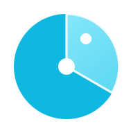Resources affected</span><span class="av-stat__v">139</span></div></div>
  <div style="display:flex;flex-wrap:wrap;align-items:center;gap:16px 24px;padding:16px 20px;border-top:1px solid var(--av-border-subtle-00)">
    <div class="av-dotring" style="width:min(120px,100%)">
  <canvas data-av-ring data-values='[5,64,133,91]' data-colors='["var(--av-support-critical)","var(--av-support-high)","var(--av-support-medium)","var(--av-support-low)"]' aria-hidden="true"></canvas>
  <div class="av-dotring__center"><span class="av-dotring__num" style="font-size:22px">293</span><span class="av-dotring__label">open</span></div>
</div>
    <div style="flex:1;min-width:min(240px,100%);display:flex;flex-wrap:wrap;gap:6px"><button class="av-sev-chip"><i style="background:var(--av-support-critical)"></i>Critical<span>5</span></button><button class="av-sev-chip" aria-pressed="true"><i style="background:var(--av-support-high)"></i>High<span>64</span></button><button class="av-sev-chip"><i style="background:var(--av-support-medium)"></i>Medium<span>133</span></button><button class="av-sev-chip"><i style="background:var(--av-support-low)"></i>Low<span>91</span></button></div>
  </div>
</div>
```

### Ring summary cards
Dot ring + titled legend grid. Used on Scans, Identities, Bulletins, Clients and Members.

#### Findings by scanner
```html
<div class="av-card av-card--glow-signal" style="display:grid;grid-template-columns:repeat(auto-fit,minmax(min(100%,220px),1fr));gap:24px;align-items:center"><div class="av-stack" style="gap:16px"><div class="av-card__head"><span class="av-card__heading"><h2 class="av-card__title">Findings by scanner</h2><span class="av-card__sub">Latest sweep · Oct 13, 3:33 PM</span></span></div><div class="av-dotring" style="width:min(200px,100%)">
  <canvas data-av-ring data-values='[151,76,31,35,0]' data-colors='["#FF4B1F","#1FDDFF","#FFB547","var(--av-text-primary)","var(--av-support-neutral)"]' aria-hidden="true"></canvas>
  <div class="av-dotring__center"><span class="av-dotring__num" style="font-size:30px">293</span><span class="av-dotring__label">findings</span></div>
</div></div><div class="av-legend-rows"><div class="av-legend-rows__row"><span class="av-legend-rows__dot" style="background:#FF4B1F"></span><span class="av-legend-rows__label">IAM</span><span class="av-legend-rows__n">151</span><span class="av-legend-rows__pct">51.5%</span></div><div class="av-legend-rows__row"><span class="av-legend-rows__dot" style="background:#1FDDFF"></span><span class="av-legend-rows__label">S3</span><span class="av-legend-rows__n">76</span><span class="av-legend-rows__pct">25.9%</span></div><div class="av-legend-rows__row"><span class="av-legend-rows__dot" style="background:#FFB547"></span><span class="av-legend-rows__label">Transmission</span><span class="av-legend-rows__n">31</span><span class="av-legend-rows__pct">10.6%</span></div><div class="av-legend-rows__row"><span class="av-legend-rows__dot" style="background:var(--av-text-primary)"></span><span class="av-legend-rows__label">Logging</span><span class="av-legend-rows__n">35</span><span class="av-legend-rows__pct">11.9%</span></div><div class="av-legend-rows__row"><span class="av-legend-rows__dot" style="background:var(--av-support-neutral)"></span><span class="av-legend-rows__label">Security groups</span><span class="av-legend-rows__n">0</span><span class="av-legend-rows__pct">0%</span></div></div></div>
```

#### Identities hero
```html
<div class="av-card av-card--glow-hero" style="flex-direction:row;flex-wrap:wrap;gap:28px;align-items:center;padding:24px"><div class="av-weave" aria-hidden="true"></div><div class="av-stack" style="gap:4px;min-width:min(140px,100%)"><span style="font-size:13px;color:var(--av-text-tertiary)">Identities found</span><span style="font-size:44px;font-weight:600;letter-spacing:-0.04em;line-height:1">48</span><span style="font-size:12px;color:var(--av-text-helper)">Last run · Oct 13, 8:41 PM</span></div><div style="flex:1;min-width:min(260px,100%);display:flex;flex-wrap:wrap;align-items:center;gap:20px 28px"><div class="av-dotring" style="width:min(150px,100%)">
  <canvas data-av-ring data-values='[31,14,3]' data-colors='["#FF8A5B","#1FDDFF","#FFB547"]' aria-hidden="true"></canvas>
  <div class="av-dotring__center"><span class="av-dotring__num" style="font-size:26px">48</span><span class="av-dotring__label">non-human</span></div>
</div><div class="av-stack" style="gap:10px"><span style="display:flex;align-items:center;gap:8px;font-size:13px;color:var(--av-text-tertiary)"><span style="width:8px;height:8px;border-radius:2px;background:#FF8A5B"></span>Service accounts<b style="color:var(--av-text-primary)">31</b></span><span style="display:flex;align-items:center;gap:8px;font-size:13px;color:var(--av-text-tertiary)"><span style="width:8px;height:8px;border-radius:2px;background:#1FDDFF"></span>AI agents<b style="color:var(--av-text-primary)">14</b></span><span style="display:flex;align-items:center;gap:8px;font-size:13px;color:var(--av-text-tertiary)"><span style="width:8px;height:8px;border-radius:2px;background:#FFB547"></span>API keys<b style="color:var(--av-text-primary)">3</b></span></div></div></div>
```

#### Advisories (Bulletins)
```html
<div class="av-card" style="flex-direction:row;flex-wrap:wrap;align-items:center;gap:20px 28px"><div class="av-weave" aria-hidden="true"></div><div class="av-dotring" style="width:min(150px,100%)">
  <canvas data-av-ring data-values='[1,2,2,3]' data-colors='["var(--av-support-critical)","var(--av-support-high)","var(--av-support-medium)","var(--av-support-low)"]' aria-hidden="true"></canvas>
  <div class="av-dotring__center"><span class="av-dotring__num" style="font-size:26px">8</span><span class="av-dotring__label">advisories</span></div>
</div><div style="flex:1;min-width:min(220px,100%);display:flex;flex-direction:column;gap:6px"><div style="margin-bottom:6px"><div class="av-card__head"><span class="av-card__heading"><h2 class="av-card__title">Advisories by severity</h2><span class="av-card__sub">Last 30 days · all providers</span></span></div></div><div class="av-legend-grid"><div class="av-legend-grid__row"><span class="av-legend-rows__dot" style="background:var(--av-support-critical)"></span><span class="av-legend-rows__label">Critical</span><span class="av-legend-rows__n">1</span></div><div class="av-legend-grid__row"><span class="av-legend-rows__dot" style="background:var(--av-support-high)"></span><span class="av-legend-rows__label">High</span><span class="av-legend-rows__n">2</span></div><div class="av-legend-grid__row"><span class="av-legend-rows__dot" style="background:var(--av-support-medium)"></span><span class="av-legend-rows__label">Medium</span><span class="av-legend-rows__n">2</span></div><div class="av-legend-grid__row"><span class="av-legend-rows__dot" style="background:var(--av-support-low)"></span><span class="av-legend-rows__label">Low</span><span class="av-legend-rows__n">3</span></div></div></div></div>
```

#### Accounts by provider (Clients)
```html
<div class="av-card" style="flex-direction:row;flex-wrap:wrap;align-items:center;gap:20px 28px"><div class="av-weave" aria-hidden="true"></div><div class="av-dotring" style="width:min(150px,100%)">
  <canvas data-av-ring data-values='[1,1,1]' data-colors='["#FFB547","#1FDDFF","var(--av-text-primary)"]' aria-hidden="true"></canvas>
  <div class="av-dotring__center"><span class="av-dotring__num" style="font-size:26px">3</span><span class="av-dotring__label">accounts</span></div>
</div><div style="flex:1;min-width:min(220px,100%);display:flex;flex-direction:column;gap:6px"><div style="margin-bottom:6px"><div class="av-card__head">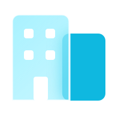<span class="av-card__heading"><h2 class="av-card__title">Accounts by provider</h2><span class="av-card__sub">Across all clients</span></span></div></div><div class="av-legend-grid"><div class="av-legend-grid__row"><span class="av-legend-rows__dot" style="background:#FFB547"></span><span class="av-legend-rows__label">AWS</span><span class="av-legend-rows__n">1</span></div><div class="av-legend-grid__row"><span class="av-legend-rows__dot" style="background:#1FDDFF"></span><span class="av-legend-rows__label">GCP</span><span class="av-legend-rows__n">1</span></div><div class="av-legend-grid__row"><span class="av-legend-rows__dot" style="background:var(--av-text-primary)"></span><span class="av-legend-rows__label">Azure</span><span class="av-legend-rows__n">1</span></div></div></div></div>
```

#### Roles (Members)
```html
<div class="av-card" style="flex-direction:row;flex-wrap:wrap;align-items:center;gap:20px 28px"><div class="av-weave" aria-hidden="true"></div><div class="av-dotring" style="width:min(150px,100%)">
  <canvas data-av-ring data-values='[4,3,1]' data-colors='["#1FDDFF","#FFB547","var(--av-support-neutral)"]' aria-hidden="true"></canvas>
  <div class="av-dotring__center"><span class="av-dotring__num" style="font-size:26px">8</span><span class="av-dotring__label">members</span></div>
</div><div style="flex:1;min-width:min(220px,100%);display:flex;flex-direction:column;gap:6px"><div style="margin-bottom:6px"><div class="av-card__head"><span class="av-card__heading"><h2 class="av-card__title">Roles</h2><span class="av-card__sub">Least privilege applies to people too</span></span></div></div><div class="av-legend-grid"><div class="av-legend-grid__row"><span class="av-legend-rows__dot" style="background:#1FDDFF"></span><span class="av-legend-rows__label">Owners</span><span class="av-legend-rows__n">4</span></div><div class="av-legend-grid__row"><span class="av-legend-rows__dot" style="background:#FFB547"></span><span class="av-legend-rows__label">Analysts</span><span class="av-legend-rows__n">3</span></div><div class="av-legend-grid__row"><span class="av-legend-rows__dot" style="background:var(--av-support-neutral)"></span><span class="av-legend-rows__label">Invited</span><span class="av-legend-rows__n">1</span></div></div></div></div>
```

### Stat strip
Compact KPI row used atop Findings and Scans: tinted cells, glass glyph, 30px value, optional sub.

#### Strip
```html
<div class="av-stat-strip"><div class="av-stat" style="background:radial-gradient(90% 120% at 100% 0%,rgba(31,221,255,.10),transparent 60%)"><span class="av-stat__label">Last scan</span><span class="av-stat__v" style="font-size:22px;letter-spacing:-0.025em">2h ago</span><span class="av-stat__s">5m 41s · 214 resources</span></div><div class="av-stat" style="background:radial-gradient(90% 120% at 100% 0%,rgba(255,75,31,.12),transparent 60%)"><span class="av-stat__label">New findings</span><span class="av-stat__v" style="font-size:22px;letter-spacing:-0.025em">+12</span><span class="av-stat__s">since previous scan</span></div><div class="av-stat" style="background:radial-gradient(90% 120% at 100% 0%,rgba(61,220,151,.10),transparent 60%)"><span class="av-stat__label">Resolved</span><span class="av-stat__v" style="font-size:22px;letter-spacing:-0.025em">24</span><span class="av-stat__s">this week</span></div></div>
```

### Identity graph
Hub orb (account) with gradient bezier edges fanning to finding / identity / resource nodes; animated white flow pulses. Edge gradient = node kind colours. Product renders via React; this is the static reference.

#### Graph
```html
<div style="overflow-x:auto"><div class="av-graph" style="aspect-ratio:760/460">
  <svg viewBox="0 0 760 460" aria-hidden="true"><defs><linearGradient id="dg0" gradientUnits="userSpaceOnUse" x1="252.1" y1="182.8" x2="420" y2="55"><stop offset="0" stop-color="#FF4B1F"/><stop offset="1" stop-color="#FFB547"/></linearGradient><linearGradient id="dg1" gradientUnits="userSpaceOnUse" x1="261.0" y1="197.6" x2="420" y2="125"><stop offset="0" stop-color="#FF4B1F"/><stop offset="1" stop-color="#FFB547"/></linearGradient><linearGradient id="dg2" gradientUnits="userSpaceOnUse" x1="267.1" y1="218.3" x2="420" y2="195"><stop offset="0" stop-color="#FF4B1F"/><stop offset="1" stop-color="#1FDDFF"/></linearGradient><linearGradient id="dg3" gradientUnits="userSpaceOnUse" x1="267.1" y1="241.7" x2="420" y2="265"><stop offset="0" stop-color="#FF4B1F"/><stop offset="1" stop-color="#1FDDFF"/></linearGradient><linearGradient id="dg4" gradientUnits="userSpaceOnUse" x1="261.0" y1="262.4" x2="420" y2="335"><stop offset="0" stop-color="#1FDDFF"/><stop offset="1" stop-color="#F2F2F0"/></linearGradient><linearGradient id="dg5" gradientUnits="userSpaceOnUse" x1="252.1" y1="277.2" x2="420" y2="405"><stop offset="0" stop-color="#1FDDFF"/><stop offset="1" stop-color="#F2F2F0"/></linearGradient></defs>
    <path class="av-graph__edge" d="M252.1 182.8 C334.5 182.8 334.5 55 402 55" stroke="url(#dg0)" pathLength="1" style="animation-delay:0ms"/><path class="av-graph__flow" d="M252.1 182.8 C334.5 182.8 334.5 55 402 55" pathLength="1" style="animation-delay:1.20s"/>
    <path class="av-graph__edge" d="M261.0 197.6 C338.5 197.6 338.5 125 402 125" stroke="url(#dg1)" pathLength="1" style="animation-delay:70ms"/><path class="av-graph__flow" d="M261.0 197.6 C338.5 197.6 338.5 125 402 125" pathLength="1" style="animation-delay:1.35s"/>
    <path class="av-graph__edge" d="M267.1 218.3 C341.3 218.3 341.3 195 402 195" stroke="url(#dg2)" pathLength="1" style="animation-delay:140ms"/><path class="av-graph__flow" d="M267.1 218.3 C341.3 218.3 341.3 195 402 195" pathLength="1" style="animation-delay:1.50s"/>
    <path class="av-graph__edge" d="M267.1 241.7 C341.3 241.7 341.3 265 402 265" stroke="url(#dg3)" pathLength="1" style="animation-delay:210ms"/><path class="av-graph__flow" d="M267.1 241.7 C341.3 241.7 341.3 265 402 265" pathLength="1" style="animation-delay:1.65s"/>
    <path class="av-graph__edge" d="M261.0 262.4 C338.5 262.4 338.5 335 402 335" stroke="url(#dg4)" pathLength="1" style="animation-delay:280ms"/><path class="av-graph__flow" d="M261.0 262.4 C338.5 262.4 338.5 335 402 335" pathLength="1" style="animation-delay:1.80s"/>
    <path class="av-graph__edge" d="M252.1 277.2 C334.5 277.2 334.5 405 402 405" stroke="url(#dg5)" pathLength="1" style="animation-delay:350ms"/><path class="av-graph__flow" d="M252.1 277.2 C334.5 277.2 334.5 405 402 405" pathLength="1" style="animation-delay:1.95s"/>
  </svg>
  <div class="av-graph__hub" style="left:25.00%;top:50.00%"><canvas data-av-orb="hub"></canvas><span class="av-graph__hub-label">PRODUCTION DEMO</span></div>
  <div class="av-gnode" style="left:53.42%;top:11.96%"><span class="av-gnode__dot"></span><span class="av-gnode__t"><b>S3 bucket publicly readable</b><span><em class="av-gnode__kind" style="color:var(--av-support-medium)">Finding</em> · Critical · 2 resources</span></span></div>
  <div class="av-gnode" style="left:53.42%;top:27.17%"><span class="av-gnode__dot"></span><span class="av-gnode__t"><b>Unused key > 365 days</b><span><em class="av-gnode__kind" style="color:var(--av-support-medium)">Finding</em> · High · 1 resource</span></span></div>
  <div class="av-gnode" style="left:53.42%;top:42.39%"><span class="av-gnode__dot"></span><span class="av-gnode__t"><b>ci-deploy-runner</b><span><em class="av-gnode__kind" style="color:var(--av-support-low)">Identity</em> · role · 3 findings</span></span></div>
  <div class="av-gnode" style="left:53.42%;top:57.61%"><span class="av-gnode__dot"></span><span class="av-gnode__t"><b>svc-billing-writer</b><span><em class="av-gnode__kind" style="color:var(--av-support-low)">Identity</em> · role · 2 findings</span></span></div>
  <div class="av-gnode" style="left:53.42%;top:72.83%"><span class="av-gnode__dot"></span><span class="av-gnode__t"><b>hci-exports-prod</b><span><em class="av-gnode__kind" style="color:var(--av-support-low)">Resource</em> · s3 · us-east-1</span></span></div>
  <div class="av-gnode" style="left:53.42%;top:88.04%"><span class="av-gnode__dot"></span><span class="av-gnode__t"><b>vpc-0a12 · sg-web</b><span><em class="av-gnode__kind" style="color:var(--av-support-low)">Resource</em> · ec2 · us-east-1</span></span></div>
  <div class="av-graph__legend"><span><i style="background:linear-gradient(90deg,#FF4B1F,#FFB547)"></i>Finding</span><span><i style="background:linear-gradient(90deg,#FF4B1F,#1FDDFF)"></i>Identity</span><span><i style="background:linear-gradient(90deg,#1FDDFF,#F2F2F0)"></i>Resource</span></div>
</div></div>
```

### KPI tiles
See Dashboard patterns › KPI tile for the 4-up grid (sparkline + delta). Repeated here with the posture card as the Overview hero row.

#### Overview hero row
```html
<div style="display:flex;flex-wrap:wrap;gap:16px"><div class="av-score-card" style="flex:1 1 340px"><div class="av-weave" aria-hidden="true"></div><div class="av-dotring" style="width:min(160px,100%)">
  <canvas data-av-ring data-values='[64,36]' data-colors='["#FF4B1F","var(--av-border-strong-02)"]' data-grad aria-hidden="true"></canvas>
  <div class="av-dotring__center"><span class="av-dotring__num av-dotring__num--brand" style="font-size:44px">64</span><span class="av-dotring__label">/ 100</span></div>
</div><div class="av-score-card__body"><span class="av-eyebrow">Posture score</span><div class="av-score-card__rating">Fair<span class="av-tag av-tag--delta"><svg class="av-icon" width="12" height="12" viewBox="0 0 24 24" fill="none" stroke="currentColor" stroke-width="2.2" stroke-linecap="round" stroke-linejoin="round" aria-hidden="true"><path d="M12 19V5M6 11l6-6 6 6"/></svg>6 this week</span></div></div></div>
  <div class="av-kpi-grid" style="flex:2 1 520px"><button class="av-kpi av-kpi--ion"><div class="av-kpi__head"><span class="av-kpi__label">Open findings</span></div><div class="av-kpi__value"><span class="av-kpi__num">293</span><span class="av-kpi__unit">across 139 resources</span></div><span class="av-kpi__delta"><svg class="av-icon" width="12" height="12" viewBox="0 0 24 24" fill="none" stroke="currentColor" stroke-width="2.2" stroke-linecap="round" stroke-linejoin="round" aria-hidden="true"><path d="M12 5v14M6 13l6 6 6-6"/></svg>12 fewer than last scan</span></button><button class="av-kpi av-kpi--signal"><div class="av-kpi__head"><span class="av-kpi__label">Critical + high</span></div><div class="av-kpi__value"><span class="av-kpi__num">69</span><span class="av-kpi__unit">need action</span></div><span class="av-kpi__delta av-kpi__delta--up"><svg class="av-icon" width="12" height="12" viewBox="0 0 24 24" fill="none" stroke="currentColor" stroke-width="2.2" stroke-linecap="round" stroke-linejoin="round" aria-hidden="true"><path d="M12 19V5M6 11l6-6 6 6"/></svg>3 new since Oct 6</span></button></div></div>
```

### Empty account
Shown when an account has no scan yet: illustration tile, title, text, primary + secondary.

#### Card
```html
<div class="av-empty-card"><div class="av-empty-card__img" style="background-image:url(assets/illus/clay-clouds-1k.jpg)"></div><div class="av-empty-card__body"><h2 class="av-empty-card__title">No scan yet for this account</h2><p class="av-empty-card__text">Run the first scan to see posture, findings and identities. It takes about 6 minutes.</p><div class="av-row" style="gap:8px;margin-top:6px"><button class="av-btn av-btn--primary"><svg class="av-icon" width="14" height="14" viewBox="0 0 24 24" fill="currentColor" stroke="none" stroke-width="0" stroke-linecap="round" stroke-linejoin="round" aria-hidden="true"><path d="M7 5v14l11-7z"/></svg>Run first scan</button><button class="av-btn av-btn--secondary">View Production Demo</button></div></div></div>
```
